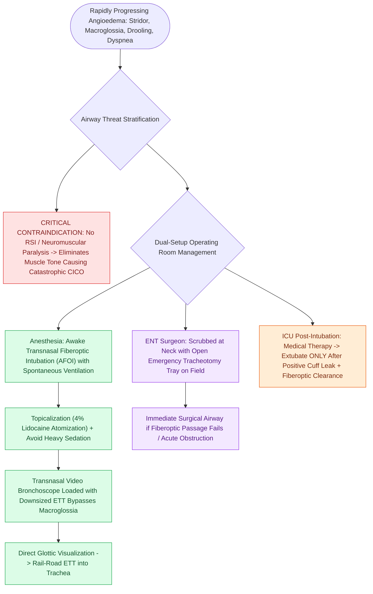

# Awake fiberoptic intubation is the preferred airway technique for angioedema with impending obstruction

## Active Recall

> [!question]- Why is rapid sequence induction with neuromuscular blockade contraindicated in patients with severe angioedema-induced stridor?
> *Answer / Clinical Rationale*: Neuromuscular blockade eliminates dynamic pharyngeal muscle tone, causing edematous supraglottic and tongue tissues to collapse completely over the airway inlet, rapidly converting a precarious partial obstruction into an unventilatable, unintubatable CICO emergency.

> [!question]- What is the preferred route and technique for securing the airway in severe tongue base and lingual angioedema?
> *Answer / Clinical Rationale*: **Awake transnasal fiberoptic or videobronchoscopic intubation** under topical local anesthesia while preserving spontaneous ventilation, with the surgical team scrubbed and prepared for immediate emergent surgical airway.

## Core Clinical & Mechanistic Principles
**Angioedema of the upper aerodigestive tract** can progress rapidly from mild mucosal swelling to complete catastrophic asphyxiation within hours. Massive edema preferentially involves the lips, oral tongue, floor of mouth, soft palate, epiglottis, and arytenoids, transforming the upper airway into a distorted, non-compliant space. In patients demonstrating signs of impending obstruction (stridor, muffled "hot potato" voice, inability to swallow secretions, tachypnea, or tripod positioning), establishing a definitive airway must precede extensive diagnostic testing:

- **Why Rapid Sequence Induction (RSI) with Neuromuscular Paralysis is Dangerous**:
  - Paralysis abolishes critical pharyngeal dilator and glossal tone, causing immediate gravitational collapse of the edematous tongue and supraglottis onto the laryngeal inlet.
  - Distorted anatomy eliminates standard landmarks for direct or video laryngoscopy, precipitating a "cannot intubate, cannot oxygenate" (CICO) crisis.
  - Positive-pressure bag-valve-mask (BVM) ventilation frequently fails and can force air into the esophagus or worsen supraglottic distortion.

- **Awake Fiberoptic / Videobronchoscopic Intubation Principles**:
  - **Preservation of Spontaneous Ventilation**: Maintains negative intrathoracic pressure and dynamic airway patency throughout the procedure.
  - **Topical Anesthesia & Secretion Control**: Judicious topicalization using 4% lidocaine spray or atomized 1%–2% lidocaine. Excessive sedation must be strictly avoided.
  - **Nasal vs. Oral Approach**: A transnasal approach with a flexible video bronchoscope (loaded with an appropriately sized, lubricated cuffed endotracheal tube) bypasses massive macroglossia.
  - **Operating Room Environment**: Intubation is safest in the operating room with Anesthesia and Otolaryngology scrubbed and standing by with open tracheotomy trays.

### Key Consultation Supplies
- Flexible video bronchoscope (or video intubation scope) with light source and monitor
- Cuffed endotracheal tubes (sizes 6.0, 6.5, 7.0 mm) with sterile water-soluble lubricant
- Atomized local anesthetic setup (4% lidocaine, 1%–2% lidocaine with phenylephrine or oxymetazoline)
- Mucosal atomization device (MAD) or transtracheal injection setup (22-gauge needle with 2 mL 4% lidocaine)
- Complete open tracheotomy instrument tray scrubbed and opened at bedside
- High-flow suction with Yankauer and flexible catheters

### Surgical Technique & Critical Safety Checks
1. **Double-Setup Readiness**: Whenever attempting awake intubation for severe angioedema, the neck must be prepped and draped with local anesthetic and tracheotomy instruments immediately available.
2. **Cervical Edema Distortion**: Massive subcutaneous cervical edema can obscure the thyroid notch, cricoid cartilage, and tracheal rings, making emergency [[Standard open tracheotomy utilizes horizontal intersinusoidal or Bjork flap entry|open tracheotomy]] significantly more challenging than in elective settings.
3. **Extubation Safeguards**: Following resolution of edema with medical therapy, extubation must occur only after confirming an adequate endotracheal tube cuff leak and direct fiberoptic verification of mucosal recovery.

## References
1. LoVerde, D., Files, D.C., Krishnaswamy, G. (2017). Angioedema. *Crit Care Med*, 45(4):725-735.
2. Tuchman, J.B., Mehta, D.K. (2013). Complex Upper Airway Problems. In Johnson, J.J., Rosen, C.A. (Eds.), *Bailey’s Head and Neck Surgery-Otolaryngology* 5e (pp. 896-907). Baltimore, MD: Lippincott Williams & Wilkins.
3. Sidell, D.R., Messner, A.H. (2020). Evaluation and Management of the Pediatric Airway. In *Cummings Otolaryngology* 7e (pp. 3053-3067).

## Connected Concepts & Graph Traversal
- **Physiological Basis**: [[Mast cell-mediated histaminergic angioedema responds rapidly to epinephrine, antihistamines, and corticosteroids|Angioedema Mechanisms]]
- **Diagnostic Serology**: [[Hereditary angioedema types I through III exhibit distinct C1 esterase inhibitor and C4 complement patterns|HAE Complement Diagnostics]]
- **Targeted Pharmacotherapy**: [[Icatibant and ecallantide provide targeted treatment for bradykinin-mediated angioedema refractory to standard therapy|Bradykinin Receptor Antagonists]]
- **Emergency Surgical Airway**: [[Standard open tracheotomy utilizes horizontal intersinusoidal or Bjork flap entry|Standard Open Tracheotomy]]
- **Alternative Rescue**: [[Emergency cricothyrotomy provides rapid airway access through the cricothyroid membrane|Emergency Cricothyrotomy]]
