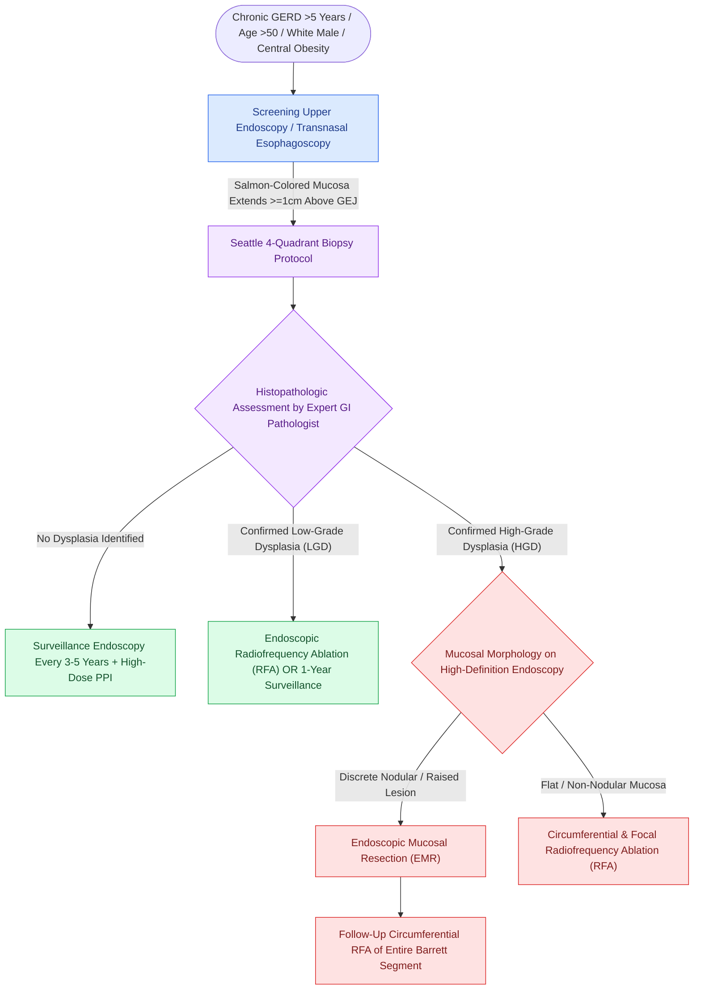

# Barrett esophagus manifests as salmon-colored columnar metaplasia of the distal esophagus requiring surveillance for adenocarcinoma

## Active Recall

> [!question]- What is the pathognomonic endoscopic and histological definition of Barrett esophagus?
> *Answer / Clinical Rationale*: Endoscopically, Barrett esophagus manifests as **salmon-pink, velvety mucosal tongues** extending proximally from the gastroesophageal junction (GEJ) into the tubular esophagus, displacing the normal pale-white squamous mucosa. Histologically, definitive diagnosis strictly requires the demonstration of **specialized columnar metaplasia containing goblet cells** (confirmed via Alcian blue staining) within mucosal biopsies obtained from the tubular esophagus.

> [!question]- How does the Prague C & M criteria standardize endoscopic reporting of Barrett esophagus?
> *Answer / Clinical Rationale*: The **Prague C & M classification** standardizes the extent of metaplastic epithelium above the gastroesophageal junction:
> - **C (Circumferential extent)**: Measures the length (in centimeters) of continuous, circumferential metaplastic mucosa above the GEJ.
> - **M (Maximum extent)**: Measures the maximal proximal reach (in centimeters) of any tongues or islands of metaplastic mucosa above the GEJ.
> Lesions with $M < 3\text{ cm}$ are classified as **Short-Segment Barrett Esophagus (SSBE)**, whereas $M \ge 3\text{ cm}$ represents **Long-Segment Barrett Esophagus (LSBE)**, which carries a significantly higher risk of malignant progression.

> [!question]- What is the annual risk of progression to esophageal adenocarcinoma across non-dysplastic, low-grade, and high-grade Barrett esophagus?
> *Answer / Clinical Rationale*:
> - **Non-dysplastic Barrett esophagus**: Annual risk of esophageal adenocarcinoma is **0.2% to 0.5%** per year.
> - **Low-Grade Dysplasia (LGD)**: Annual progression risk rises to **0.7% to 1.0%** per year.
> - **High-Grade Dysplasia (HGD)**: Annual progression risk escalates sharply to **6% to 10%** per year, carrying up to a 40% risk of synchronous, occult invasive adenocarcinoma if left untreated.

## Core Clinical & Mechanistic Principles

Barrett esophagus is the primary premalignant sequela of chronic, long-standing gastroesophageal reflux disease (GERD) *(Cummings Review, Ch7, p.171–172)*. Repetitive acid and bile acid mucosal injury triggers a phenotypic reprogramming of stem cells at the gastroesophageal junction, replacing vulnerable stratified squamous epithelium with acid-resistant columnar epithelium.

### Endoscopic Recognition & Anatomy *(Cummings p.172, Fig 7.19)*

During flexible or transnasal esophagoscopy (TNE), the gastroesophageal junction is identified by the proximal extent of the gastric rugal folds:
- **Normal Epithelial Transition (Z-line)**: The normal squamocolumnar junction coincides directly with the anatomic GEJ, presenting an abrupt transition between the proximal pale-pink/pearly-white esophageal squamous mucosa and the distal reddish gastric mucosa.
- **Barrett Metaplasia**: The Z-line is displaced proximally. Velvety, salmon-colored columnar mucosa extends upward into the tubular esophagus as circumferential rings, longitudinal tongues, or isolated islands.

---

### The Seattle Four-Quadrant Biopsy Protocol

Definitive diagnosis and dysplasia surveillance mandate systematic tissue sampling according to the **Seattle Protocol**:
1. **Targeted Biopsies**: High-definition white-light endoscopy with narrow-band imaging (NBI) is performed to inspect mucosal pit patterns; any raised nodule, ulcer, or mucosal irregularity is biopsied first in separate specimen containers.
2. **Four-Quadrant Random Biopsies**: Systematic 4-quadrant jumbo biopsies are obtained every **2 cm** throughout the entire length of the non-dysplastic Barrett segment. In known or suspected dysplasia, biopsies are obtained every **1 cm**.

---

### Clinical Surveillance & Eradication Guidelines (ACG / AGA Consensus)

| Histologic Grade | Annual Adenocarcinoma Risk | Recommended Surveillance Interval | Definitive Management |
| :--- | :--- | :--- | :--- |
| **Non-Dysplastic Barrett (NDBE)** | 0.2%–0.5% | Endoscopy with 4-quadrant biopsies every **3 to 5 years** | High-dose daily proton pump inhibitor (PPI) therapy to control reflux. Endoscopic ablation generally not indicated. |
| **Indefinite for Dysplasia** | Intermediate | Repeat endoscopy with optimized high-dose PPI in **3 to 6 months** | Rule out active erosive esophagitis mimicking cellular atypia. |
| **Low-Grade Dysplasia (LGD)** | 0.7%–1.0% | Confirmation by expert GI pathologist. Repeat endoscopy at **6 months** OR proceed to endoscopic ablation | **Radiofrequency Ablation (RFA)** decreases progression risk by >90%. Alternatively, surveillance endoscopy every 12 months. |
| **High-Grade Dysplasia (HGD)** | **6.0%–10.0%** | Immediate confirmation by secondary expert GI pathologist | **Endoscopic Eradication Therapy**: Endoscopic Mucosal Resection (EMR) or ESD for visible nodules followed by circumferential RFA of remaining segment. |
| **Intramucosal Adenocarcinoma (T1a)** | High (malignancy established) | Staging with Endoscopic Ultrasound (EUS) & CT | **Endoscopic Mucosal Resection (EMR)**; curative if negative deep margins and no lymphovascular invasion (lymph node metastasis risk <1–2%). |

Comprehensive physiological and surgical principles connect these findings directly to [[Active reflux and eosinophilic esophagitis compromise airway graft survival|gastroesophageal reflux]].

## Connected Concepts & Graph Traversal
- **Underlying Mechanism**: [[Laryngopharyngeal reflux presents with globus and throat clearing but responds inconsistently to empiric PPIs|Laryngopharyngeal Reflux and GERD]]
- **Anatomical Boundary**: [[Esophageal foreign body locations correspond to anatomic narrowings at the cricopharyngeus, aortic arch, and lower esophageal sphincter|Esophageal Anatomic Constrictions]]
- **Diagnostic Motility**: [[High-resolution manometry classifies achalasia and esophageal motility disorders by the Chicago criteria|High-Resolution Manometry]]
- **Inflammatory Sequelae**: [[Active reflux and eosinophilic esophagitis compromise airway graft survival|Reflux and Mucosal Inflammation]]
- **🔗 Premalignant GI Comparison (Head & Neck) (Head and Neck)**: [[Plummer-Vinson syndrome combines iron deficiency anemia, postcricoid esophageal webs, and mucosal atrophy with malignant potential|Premalignant Upper GI Lesions]]
