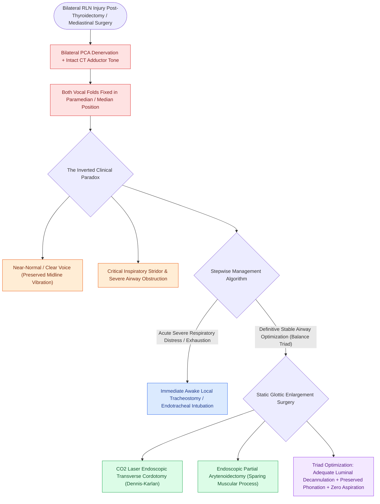

# Bilateral abductor vocal fold paralysis causes acute airway compromise requiring glottic enlargement

## Active Recall

> [!question]- Why do patients with bilateral abductor vocal fold paralysis frequently present with a deceptively normal voice despite critical airway compromise?
> *Answer / Clinical Rationale*: Both vocal folds are paralyzed in the **median or paramedian position**; this provides sufficient midline contact for near-normal phonatory vibration while severely narrowing the glottic cross-sectional area during inspiration.

> [!question]- What are the three competing physiological parameters that must be balanced when performing surgical widening for BVFP?
> *Answer / Clinical Rationale*: **Airway patency** (decannulation), **phonatory quality** (preventing severe breathy aphonia), and **deglutition safety** (preventing chronic aspiration).

## Core Clinical & Mechanistic Principles
**Bilateral Abductor Vocal Fold Paralysis (BVFP)** occurs when both [[The recurrent laryngeal nerve innervates all intrinsic muscles except cricothyroid|recurrent laryngeal nerves]] are injured or denervated (most commonly following bilateral thyroidectomy, mediastinal surgery, or neurodegenerative disorders).

### The Inverted Clinical Paradox (Good Voice, Poor Airway)
- **Denervation of Bilateral PCA Muscles**: Both posterior cricoarytenoid (PCA) muscles are paralyzed, eliminating active glottic abduction during inspiration.
- **Paramedian Fixation**: Passive elasticity and intact [[The cricothyroid muscle elongates vocal folds to elevate pitch|cricothyroid (CT)]] tone pull both vocal folds into the median or paramedian position.
- **Clinical Paradox**: The patient exhibits a **near-normal or only mildly breathy voice**, but suffers from **severe, life-threatening inspiratory stridor, dyspnea, and acute upper airway obstruction**.

## Management Paradigm & The Airway-Voice-Swallow Balance
Surgical intervention requires balancing three competing physiological goals:
1. **Airway Patency**: Providing adequate cross-sectional glottic lumen to allow decannulation and eliminate stridor.
2. **Voice Preservation**: Maintaining anterior vocal fold contact for intelligible phonation.
3. **Aspiration Prevention**: Preserving posterior sphincter competence during deglutition.

### Surgical Interventions
- **Acute Airway Rescue**: Emergent [[Emergency cricothyrotomy provides rapid airway access through the cricothyroid membrane|cricothyrotomy]] or [[Standard open tracheotomy utilizes horizontal intersinusoidal or Bjork flap entry|tracheotomy]].
- **Static Endoscopic Widening (Definitive)**:
  - [[Endoscopic transverse cordotomy widens posterior airway while preserving anterior phonation|Endoscopic Transverse Cordotomy (Dennis-Karlan)]]: Transverse wedge excision anterior to the vocal process.
  - *Endoscopic Partial Arytenoidectomy*: Resection of the vocal process and body of the [[The cricoarytenoid joint moves via coupled rocking and sliding|arytenoid cartilage]] using a [[The CO2 laser vaporizes tissue via 10600 nm water absorption|CO2 laser]].

## Critical Failure Modes & Error Traps
- **Over-resection & Chronic Aspiration**: Overly aggressive posterior cordectomy or total arytenoidectomy creates an excessively wide posterior gap, causing severe breathy aphonia and intractable aspiration during swallowing.

## Connected Concepts & Graph Traversal
- **Causative Muscle Deficit**: [[The posterior cricoarytenoid is the sole vocal fold abductor|Posterior Cricoarytenoid (PCA) Muscle]]
- **Causative Neural Deficit**: [[The recurrent laryngeal nerve innervates all intrinsic muscles except cricothyroid|Recurrent Laryngeal Nerve]]
- **Static Widening Surgery**: [[Endoscopic transverse cordotomy widens posterior airway while preserving anterior phonation|Endoscopic Transverse Cordotomy]]
- **Airway Rescue**: [[Standard open tracheotomy utilizes horizontal intersinusoidal or Bjork flap entry|Standard Open Tracheotomy]]
- **Clinical Management**: [[The cricoarytenoid joint moves via coupled rocking and sliding|Cricoarytenoid (CA) Joint Kinetics]]
