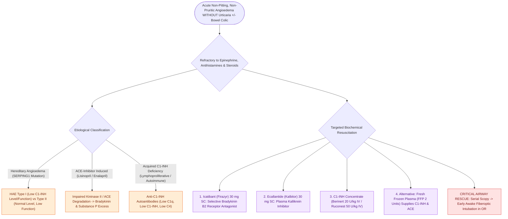

# Bradykinin-mediated angioedema from C1-INH deficiency or ACE inhibitors fails to respond to standard allergic therapies

## Active Recall

> [!question]- Why do epinephrine, antihistamines, and corticosteroids fail to improve acute swelling in bradykinin-mediated angioedema?
> *Answer / Clinical Rationale*: Bradykinin-mediated angioedema is driven by **excess bradykinin binding to endothelial $\text{B}_2$ receptors**, completely independent of mast cells, histamine release, or IgE. Epinephrine and antihistamines target mast cell degranulation and $\text{H}_1/\text{H}_2$ receptors, which play zero pathophysiologic role in this pathway.

> [!question]- What laboratory testing algorithm confirms hereditary angioedema (HAE) during an acute attack?
> *Answer / Clinical Rationale*: **Serum C4 level** (persistently low during attacks in $>95\%$ of cases as a screening tool); if low, assess **antigenic C1-INH protein levels** (low in Type I, normal/elevated in Type II) and **functional C1-INH activity** (low in both Type I and Type II).

> [!question]- What specific rescue pharmacotherapies reverse acute bradykinin-mediated laryngeal edema?
> *Answer / Clinical Rationale*: (1) **Icatibant ($30\text{ mg}$ SC)**: Selective competitive bradykinin $\text{B}_2$ receptor antagonist; (2) **Ecallantide ($30\text{ mg}$ SC)**: Recombinant plasma kallikrein inhibitor; (3) **Purified/Recombinant C1-INH concentrates (Berinert / Ruconest)**; (4) **Fresh Frozen Plasma (FFP, $2\text{ units}$)** if targeted agents are unavailable (provides donor C1-INH and ACE/kininase II enzymes).

## Core Clinical & Mechanistic Principles
**Bradykinin-mediated angioedema** is a non-allergic, life-threatening form of tissue edema arising from excessive generation or impaired degradation of the potent vasoactive nonapeptide **bradykinin**:

- **Etiological Classification**:
  1. **Hereditary Angioedema (HAE)**: Autosomal dominant mutation in *SERPING1* on chromosome 11:
     - *Type I ($85\%$)*: Deficient synthesis of C1-INH protein (low antigenic and functional C1-INH, low C4).
     - *Type II ($15\%$)*: Dysfunctional C1-INH protein (normal/elevated antigenic level, low functional C1-INH activity, low C4).
     - *Type III (Normal C1-INH)*: Gain-of-function mutation in Factor XII or plasminogen (normal C1-INH and C4).
  2. **ACE Inhibitor-Induced Angioedema**: Angiotensin-converting enzyme (ACE / kininase II) is the primary degradation enzyme for bradykinin. ACE inhibition leads to local accumulation of bradykinin and substance P, causing swelling that can occur days to *years* after initiating therapy.
  3. **Acquired Angioedema (AAE)**: Autoantibodies against C1-INH (associated with B-cell lymphoproliferative disorders or autoimmune diseases; low C1q, low C1-INH, low C4).
- **Clinical Hallmarks**:
  - **Absence of Urticaria and Pruritus**: Painless, asymmetric, non-pitting swelling.
  - **Severe Episodic Abdominal Colic**: Caused by transient bowel wall edema (frequently misdiagnosed as an acute surgical abdomen).
  - **Insidious Airway Progression**: Swelling evolves over $12\text{–}36\text{ hours}$ (slower onset than histaminergic anaphylaxis, but highly lethal due to progressive, refractory laryngeal closure).

### Targeted Resuscitation & Rescue Algorithm
1. **Specific Pharmacotherapy First-Line**:
   - **Icatibant (Firazyr®) $30\text{ mg}$ SC** in the abdominal wall.
   - **Ecallantide (Kalbitor®) $30\text{ mg}$ SC** (given as three $10\text{ mg}$ injections; carry risk of anaphylaxis in $3\%$).
   - **C1-INH Concentrate (Berinert® $20\text{ U/kg}$ IV or Ruconest® $50\text{ U/kg}$ IV)**.
   - *If targeted agents are unavailable*: Administer **$2\text{ units}$ of Fresh Frozen Plasma (FFP)**.
2. **Proactive Airway Management**:
   - Because standard medical therapy fails, continuous bedside monitoring with serial flexible fiberoptic exams is mandatory.
   - If laryngeal involvement is present, perform early **[[Awake fiberoptic intubation is the preferred airway technique for angioedema with impending obstruction|awake fiberoptic intubation]]** or prepare for emergency awake tracheostomy / cricothyroidotomy.

## Connected Concepts & Graph Traversal
- **Histaminergic Alternative**: [[Mast cell-mediated histaminergic angioedema responds rapidly to epinephrine, antihistamines, and corticosteroids|Histaminergic Mast Cell Angioedema]]
- **Targeted Bradykinin Blockade**: [[Icatibant and ecallantide provide targeted treatment for bradykinin-mediated angioedema refractory to standard therapy|Icatibant & Ecallantide Regimens]]
- **Complement Diagnostics**: [[Hereditary angioedema types I through III exhibit distinct C1 esterase inhibitor and C4 complement patterns|Hereditary Angioedema Subtypes]]
- **Emergency Airway Management**: [[Awake fiberoptic intubation is the preferred airway technique for angioedema with impending obstruction|Awake Intubation for Angioedema]]
- **Emergency Surgical Airway**: [[Open tracheostomy provides superior exposure and stay suture placement compared to percutaneous technique|Emergency Surgical Tracheostomy]]
