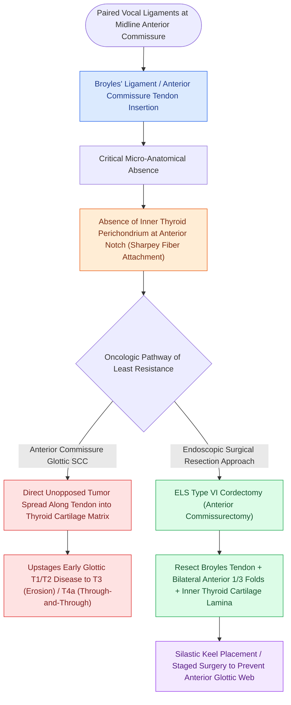

# Broyles' ligament anchors the vocal ligament to thyroid cartilage

## Active Recall

> [!question]- Why do anterior commissure glottic carcinomas have a higher propensity for early thyroid cartilage invasion?
> *Answer / Clinical Rationale*: At the insertion of Broyles' ligament, the internal perichondrium of the thyroid cartilage is absent, allowing direct tumor penetration along the fibrous tendon fibers into the cartilaginous framework.

> [!question]- Which ELS cordectomy classification designates bilateral anterior cordectomy including resection of Broyles' ligament?
> *Answer / Clinical Rationale*: ELS Type VI cordectomy (anterior commissurectomy).

## Core Clinical & Mechanistic Principles
**Broyles' Ligament** (also termed the **anterior commissure tendon**) is a dense fibrous insertion through which the paired [[The vocal ligament comprises intermediate and deep lamina propria|vocal ligaments]] attach directly into the internal perichondrium and cartilage matrix of the thyroid alar lamina at the anterior midline notch.

### Anatomical Absence of Perichondrium
- At the exact point of Broyles' ligament insertion, there is **no intervening inner perichondrium** between the tendon fibers and the [[Thyroplasty cartilage window dimensions differ between males and females|thyroid cartilage]].
- [[Vocal fold scar results from disorganized Type I collagen deposition|Collagen bundles]] from the [[The deep lamina propria provides tensile stiffness via crosslinked collagen|deep lamina propria]] and [[The intermediate lamina propria provides elastic recoil via elastin fibers|intermediate lamina propria]] penetrate directly into the ossifying cartilage matrix (Sharpey's fiber-like attachment).

## Oncologic & Surgical Significance
- **Pathway for Early Cartilage Invasion**: Because there is no internal perichondrium to act as a barrier to tumor spread, squamous cell carcinomas involving the anterior commissure can directly invade the thyroid cartilage via Broyles' ligament, upstaging early glottic tumors to T3 or T4a disease.
- **Anterior Commissurectomy**: An [[The ELS classification categorizes endoscopic cordectomies from Types I to VI|ELS Type VI cordectomy (anterior commissurectomy)]] requires resection of Broyles' ligament along with the anterior third of both vocal folds and inner thyroid perichondrium.
- **Glottic Web Formation**: Resection or deep stripping of both vocal folds at Broyles' ligament without placing a keel or staging the procedure leads to dense anterior glottic webbing.

## Critical Failure Modes & Error Traps
- **Underestimating Anterior Commissure Cancers**: Superficial biopsy of anterior commissure tumors without deep evaluation may miss occult thyroid cartilage invasion traversing Broyles' ligament.

## Connected Concepts & Graph Traversal
- **Ligamentous Architecture**: [[The vocal ligament comprises intermediate and deep lamina propria|Vocal Ligament]]
- **Cancer Spread Space**: [[The pre-epiglottic space enables rapid supraglottic cancer spread|Pre-Epiglottic Space]]
- **Transglottic Route**: [[The paraglottic space facilitates transglottic tumor spread|Paraglottic Space]]
- **Cartilage Framework**: [[Thyroplasty cartilage window dimensions differ between males and females|Thyroid Cartilage Window]]
- **Anterior Commissure Resection**: [[SCPL with CHP resects the epiglottis and vocal folds for supraglottic cancer|Supracricoid Partial Laryngectomy]]
