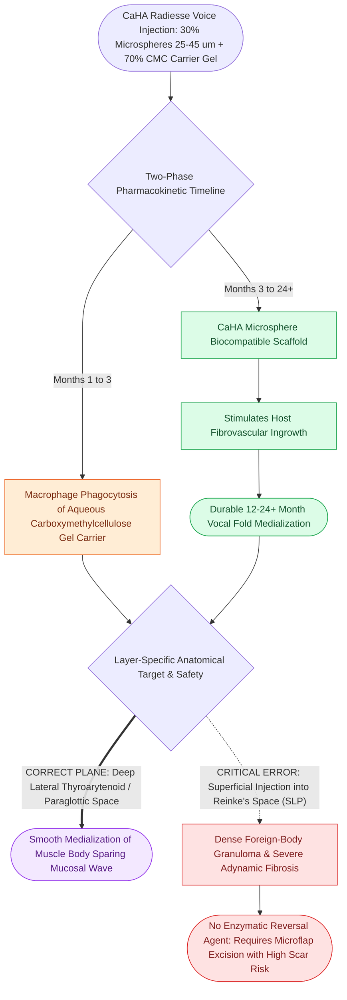

# Calcium hydroxylapatite provides durable medialization but causes granulomas if superficial

## Active Recall

> [!question]- What is the expected clinical duration of vocal fold medialization achieved with micronized CaHA (Radiesse Voice)?
> *Answer / Clinical Rationale*: Approximately **12 to 24 months**, sustained by fibrovascular ingrowth surrounding the biocompatible CaHA microsphere scaffold.

> [!question]- What occurs if CaHA is erroneously injected into Reinke's space?
> *Answer / Clinical Rationale*: It induces an intense, irreversible **foreign-body granuloma** and severe fibrous stiffening of the pliable cover, abolishing the mucosal wave without any chemical enzymatic agent (such as hyaluronidase) available to dissolve it.

## Core Clinical & Mechanistic Principles
**Micronized Calcium Hydroxylapatite (CaHA)** (commercialized as **Radiesse Voice**) consists of synthetic, smooth, spherical CaHA microspheres ($25\text{–}45\text{ µm}$ in diameter) suspended in an aqueous sodium [[Carboxymethylcellulose gel provides short-acting temporary vocal fold augmentation|carboxymethylcellulose gel]] carrier ($30\%$ CaHA particles, $70\%$ carrier gel).

### Pharmacokinetics & Longevity
- **Carrier Resorption**: The aqueous carboxymethylcellulose carrier gel is absorbed by tissue macrophages over the first 1 to 3 months.
- **Fibrovascular Ingrowth & Durability**: The remaining CaHA microspheres act as a biocompatible scaffold, stimulating local fibrovascular tissue ingrowth.
- **Duration of Medialization**: Provides durable vocal fold medialization lasting **12 to 24 months** (or longer), after which the particles undergo slow enzymatic degradation into calcium and phosphate ions.

## Injection Technique & Layer-Specific Delivery
- **Strict Paraglottic Target**: Must be delivered exclusively into the **lateral [[The thyroarytenoid muscle modulates glottal stiffness and adduction|thyroarytenoid muscle]]** or the [[The paraglottic space facilitates transglottic tumor spread|paraglottic space]].
- **Needle Gauge**: Injected through a 25-gauge or 27-gauge needle under flexible endoscopic or direct laryngoscopic visualization.

## Critical Failure Modes & Error Traps
- **Superficial Injection / Reinke's Space Granuloma**: 
  - If CaHA is accidentally injected superficially into the superficial lamina propria (Reinke's space), it incites a severe, non-dissolvable foreign-body granulomatous reaction.
  - The vocal fold develops an ivory-white submucosal nodule, complete loss of the [[The mucosal wave travels as a fluid mechanical displacement|mucosal wave]], and an [[Adynamic vocal fold segments indicate mucosal stiffening, malignancy, or scar|adynamic segment]] with severe breathy/rough dysphonia.
  - *Non-dissolvable Nature*: Unlike [[Hyaluronic acid regulates lamina propria hydration and shock absorption|hyaluronic acid]], CaHA cannot be dissolved with hyaluronidase; removal requires challenging phonomicrosurgical micro-dissection or laser unroofing, often resulting in permanent scar.

## Connected Concepts & Graph Traversal
- **Fat Augmentation Alternative**: [[Autologous fat augmentation requires overcorrection for resorption|Autologous Fat Augmentation]]
- **Temporary Gel Alternative**: [[Carboxymethylcellulose gel provides short-acting temporary vocal fold augmentation|Carboxymethylcellulose Gel]]
- **Hyaluronic Acid Augmentation**: [[Cross-linked hyaluronic acid provides intermediate-duration vocal fold augmentation|Hyaluronic Acid]]
- **Targeted Muscle Site**: [[Injection laryngoplasty requires precise placement into lateral thyroarytenoid muscle|Injection Laryngoplasty]]
- **Framework Medialization Alternative**: [[Type I thyroplasty medializes the vocal fold with conscious voice tuning|Type I Thyroplasty]]
