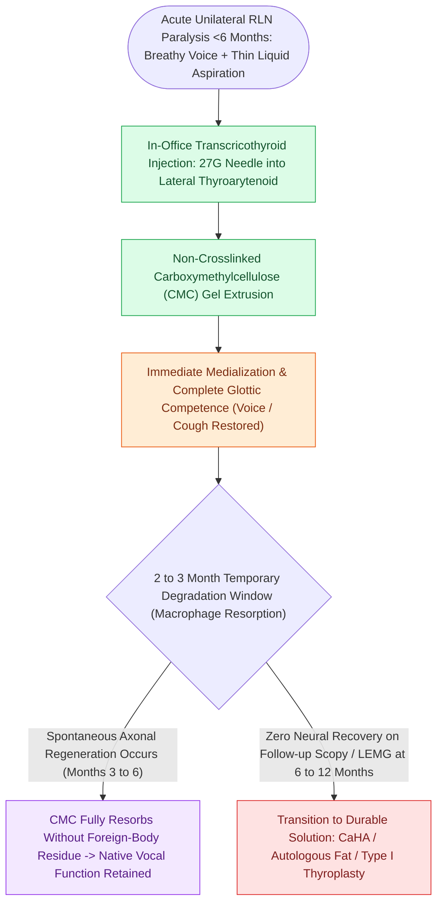

# Carboxymethylcellulose gel provides short-acting temporary vocal fold augmentation

## Active Recall

> [!question]- Why is carboxymethylcellulose gel the optimal injectable material during the initial 6-month observation period of acute vocal fold paralysis?
> *Answer / Clinical Rationale*: It provides immediate [[Glottal closure patterns identify specific laryngeal biomechanical deficits|glottic closure]] and prevents aspiration with an expected duration of **2 to 3 months**, fully resorbing without leaving permanent foreign body residue if spontaneous neural reinnervation occurs.

> [!question]- What is the typical clinical lifespan of a CMC gel injection?
> *Answer / Clinical Rationale*: **2 to 3 months** (6 to 10 weeks).

## Core Clinical & Mechanistic Principles
**Carboxymethylcellulose (CMC)** gel (commercialized as **[[Calcium hydroxylapatite provides durable medialization but causes granulomas if superficial|Radiesse Voice]] Gel**) is a non-crosslinked, high-viscosity synthetic cellulose-based polysaccharide hydrogel.

### Pharmacokinetics & Ideal Diagnostic Bridging
- **Rapid Resorption Profile**: CMC gel is rapidly metabolized and resorbed by tissue macrophages within **2 to 3 months** (typically 6 to 10 weeks).
- **The Ideal "Diagnostic Bridge"**: Following acute [[The recurrent laryngeal nerve innervates all intrinsic muscles except cricothyroid|recurrent laryngeal nerve]] injury (e.g., post-thyroidectomy, thoracic, or skull base surgery), spontaneous axonal regeneration frequently occurs within 3 to 6 months. CMC provides immediate vocal restoration and aspiration protection without creating permanent tissue alterations that might interfere with recovering neural tone.
- **Biocompatibility**: Incites zero foreign-body reaction or tissue capsule formation.

## Injection Technique & Plane
- **Target Injection Plane**: Delivered into the **lateral [[The thyroarytenoid muscle modulates glottal stiffness and adduction|thyroarytenoid muscle]]** or the [[The paraglottic space facilitates transglottic tumor spread|paraglottic space]] via trans-cricothyroid, trans-thyrohyoid, or transoral routes under flexible laryngoscopic visualization.
- **Ease of Extrusion**: Easily extruded through a fine 27-gauge needle under topical clinic anesthesia.

## Critical Failure Modes & Error Traps
- **Premature Expectation of Permanent Fix**: Patients must be explicitly counseled that CMC is a short-acting bridge; voice will return to baseline paretic quality at ~8–12 weeks unless spontaneous nerve recovery has occurred.

## Connected Concepts & Graph Traversal
- **Calcium Hydroxylapatite Alternative**: [[Calcium hydroxylapatite provides durable medialization but causes granulomas if superficial|Calcium Hydroxylapatite]]
- **Autologous Fat Alternative**: [[Autologous fat augmentation requires overcorrection for resorption|Autologous Fat]]
- **Hyaluronic Acid Alternative**: [[Cross-linked hyaluronic acid provides intermediate-duration vocal fold augmentation|Hyaluronic Acid]]
- **Injection Vector**: [[Injection laryngoplasty requires precise placement into lateral thyroarytenoid muscle|Injection Laryngoplasty]]
- **Unilateral Paralysis Indication**: [[Unilateral vocal fold paralysis causes glottic insufficiency, breathiness, and aspiration|Vocal Fold Paralysis]]
