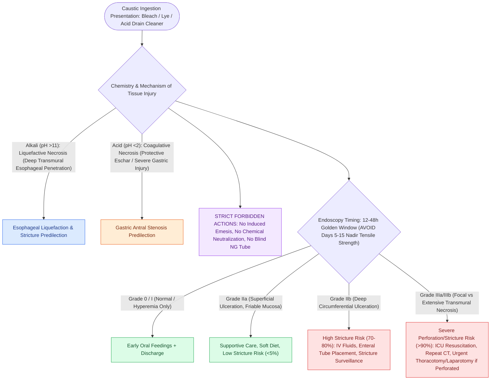

# Caustic ingestion injury is graded endoscopically by the Zargar classification within forty-eight hours

## Active Recall

> [!question]- Why is endoscopy avoided between roughly days five and fifteen?
> *Answer / Clinical Rationale*: Granulation replaces necrotic wall and tensile strength is at its nadir — instrumentation perforates.

> [!question]- Which Zargar grades predict stricture and how does that change disposition?
> *Answer / Clinical Rationale*: IIb and III; they earn nutrition planning, stricture surveillance, and early discussion of dilation programs.

## Core Clinical & Mechanistic Principles
- Chemistry predicts injury: **alkali (pH > 11)** produces liquefactive necrosis that penetrates deep (esophagus-dominant); **acid** produces coagulative eschar (gastric-dominant, though severe acid burns everything); volume, concentration, and intent (adult suicidal ingestions are worse) complete the risk.
- **Zargar grades** at endoscopy (ideally 12-48 hours; avoid days 5-15 when the wall is weakest): 0 normal; I edema/hyperemia; IIa superficial ulceration; IIb deep or circumferential ulceration; IIIa focal necrosis; IIIb extensive necrosis — grade IIb and above drive stricture risk.
- Forbidden reflexes: **no induced emesis, no neutralization, no blind NG placement** — each re-exposes or perforates.
- Late sequelae: strictures (weeks), antral stenosis (acid), and a materially elevated lifetime [[High-resolution manometry classifies achalasia and esophageal motility disorders by the Chicago criteria|esophageal]] carcinoma risk mandating endoscopic surveillance.

### Management & Critical Safety Checks
- Acute algorithm: airway first (drooling/stridor → early controlled airway), NPO, IV resuscitation, cross-sectional imaging if perforation suspected, endoscopy in the window for grading and disposition; steroids only in selected IIb (evidence mixed) — antibiotics with steroids or perforation.
- Stricture era: serial dilations starting after the acute phase; refractory long-segment disease becomes esophageal replacement territory.

## Connected Concepts & Graph Traversal
- **Esophageal Motility Evaluation**: [[High-resolution manometry classifies achalasia and esophageal motility disorders by the Chicago criteria|High-Resolution Manometry]]
- **Airway Dilation Rescue**: [[Endoscopic airway dilation combines radial incisions with balloon bronchoplasty|Endoscopic Airway Dilation]]
- **Penetration/Aspiration Scale**: [[The Rosenbek Scale standardizes the depth of airway penetration and aspiration|Rosenbek Penetration-Aspiration Scale]]
- **Emergency Airway Protocol**: [[Total laryngectomy stomas and tracheostomies require distinct emergency airway resuscitation algorithms|Airway Resuscitation Protocols]]
- **Reflux Complications**: [[Active reflux and eosinophilic esophagitis compromise airway graft survival|Reflux & Esophagitis]]
