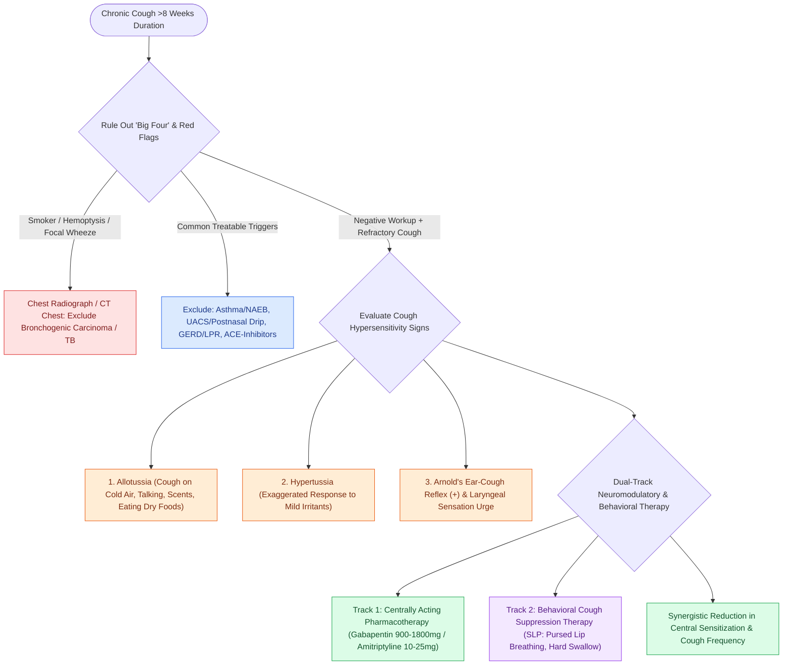

# Chronic refractory cough reflects laryngeal hypersensitivity treated with neuromodulators and behavioral suppression therapy

## Active Recall

> [!question]- What examination finding supports a laryngeal hypersensitivity mechanism at the bedside?
> *Answer / Clinical Rationale*: Tussigenic triggering by non-tussive stimuli (phonation, cold air, odors) and a localized laryngeal urge — allotussia and hypertussia.

> [!question]- Why combine behavioral therapy with neuromodulators rather than choose one?
> *Answer / Clinical Rationale*: They target different limbs — central sensitization (drug) and the cortically modifiable motor response (behavioral) — and trial data show additive benefit.

## Core Clinical & Mechanistic Principles
- **ACCP Timeline Definitions**:
  - *Acute Cough*: $<3\text{ weeks}$ (most commonly viral upper respiratory infections, acute rhinosinusitis, acute bronchitis).
  - *Subacute Cough*: $3\text{ to } 8\text{ weeks}$ (post-infectious airway inflammation, pertussis, resolving tracheobronchitis).
  - *Chronic Cough*: **$>8\text{ weeks}$** duration (refractory to initial empiric therapy or persisting after exclusion of common triggers).
- **Cough Hypersensitivity Syndrome (CHS)**: Peripheral vagal and central sensory neuropathy lowering the cough threshold; characterized by **allotussia** (cough triggered by non-tussive stimuli such as cold air, talking, singing, eating dry foods, or scented perfumes) and **hypertussia** (exaggerated cough response to mild tussive irritants).
- **Bedside Neurologic Reflex Signs**:
  - **Arnold's Ear-Cough Reflex**: Stimulation of the auricular branch of the vagus nerve (Arnold's nerve) in the posterior-inferior external auditory canal triggers an involuntary cough in $\sim 2\text{–}4\%$ of individuals, indicating vagal sensory hypersensitivity.
  - **Laryngeal Paresthesia**: Sensation of tickling, tightness, or foreign body localized to the suprasternal notch or cricoid cartilage.
- **Trial-Supported Pharmacotherapy**:
  - **Gabapentin**: Centrally acting alpha-2-delta ligand that suppresses central sensitization. Initiated at $300\text{ mg}$ PO once daily, titrated upward by $300\text{ mg}$ every 3–5 days to a therapeutic target of **$900\text{ to } 1800\text{ mg/day}$ in divided doses** (demonstrated in double-blind RCTs to significantly reduce cough frequency and improve quality of life).
  - **Amitriptyline**: Tricyclic antidepressant ($10\text{–}25\text{ mg}$ PO at bedtime); highly effective for post-viral vagal neuropathic cough.
  - **Pregabalin**: Alternative alpha-2-delta ligand ($75\text{–}150\text{ mg}$ PO twice daily) when gabapentin causes somnolence or edema.
- **Behavioral Cough Suppression Therapy (BCST)**: Speech-language pathologist-led behavioral intervention focusing on cough suppression techniques (forced swallow, hard candy, breathing through pursed lips/straw), psychoeducation, and vocal fold hydration; RCTs confirm substantial additive efficacy when combined with neuromodulators.

### Management & Critical Safety Checks
- **Mandatory Diagnostic Exclusion**: Before establishing a diagnosis of chronic unexplained/neurogenic cough, rule out the "Big Four" non-laryngeal etiologies: (1) Asthma / Non-Asthmatic Eosinophilic Bronchitis (NAEB), (2) Upper Airway Cough Syndrome (UACS / postnasal drip), (3) Gastroesophageal / [[Laryngopharyngeal reflux presents with globus and throat clearing but responds inconsistently to empiric PPIs|Laryngopharyngeal Reflux]], and (4) ACE-inhibitor pharmacotherapy.
- **Red Flag Screening**: Always obtain a chest radiograph or CT to exclude pulmonary parenchymal disease, bronchogenic carcinoma, tuberculosis, and bronchiectasis in smokers or patients with hemoptysis, weight loss, or persistent focal wheezing.

## Connected Concepts & Graph Traversal
- **LPR Differential**: [[Laryngopharyngeal reflux presents with globus and throat clearing but responds inconsistently to empiric PPIs|Laryngopharyngeal Reflux]]
- **PVFM Overlap**: [[Paradoxical vocal fold motion causes inspiratory stridor from episodic adduction relieved by rescue breathing|Paradoxical Vocal Fold Motion]]
- **Muscle Tension Overlap**: [[Muscle tension dysphonia arises from supraglottic hyperfunction and responds to circumlaryngeal voice therapy|Muscle Tension Dysphonia]]
- **Sensory Nerve Innervation**: [[The superior laryngeal nerve provides supraglottic sensation and cricothyroid motor control|Superior Laryngeal Nerve (SLN)]]
- **Diagnostic Stroboscopy**: [[Videostroboscopy visualizes mucosal wave dynamics and glottal closure|Videostroboscopy]]
