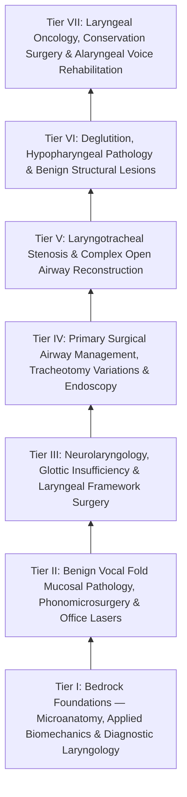
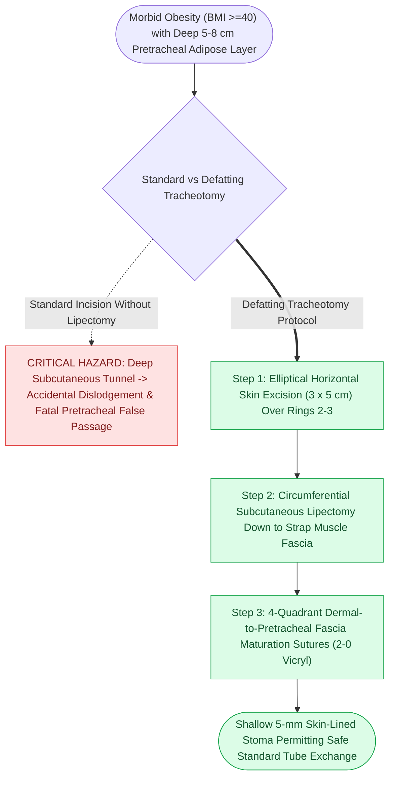

# Comprehensive Laryngology Residency Mastery Curriculum & Self-Assessment Guide

> [!NOTE] **Source Document & Knowledge Hub**
> This is the **original comprehensive curriculum document** from which the entire [[The Laryngology Knowledge Graph provides a structured mastery curriculum|Laryngology Knowledge Graph]] was atomized into 105 interlinked Obsidian wiki notes. Use this document as a complete linear master text; use the Map of Content (MOC) for non-linear graph traversal.



## **Tier I: Bedrock Foundations — Microanatomy, Applied Biomechanics & Diagnostic Laryngology**

### **1. Vocal Fold Layered Microanatomy & Microvascular Architecture**

The biomechanical behavior of the human phonatory source depends on the micro-architecture defined by Minoru Hirano: the vocal fold five-layer architecture. Surgical violation of these distinct layers creates uncorrectable glottic scarring and intractable dysphonia.

| Layer                                                 | Key Histological Elements & ECM Constituents                                                                                                | Biomechanical Properties                                                                                          | Surgical Implications                                                                                                     |
| :---------------------------------------------------- | :------------------------------------------------------------------------------------------------------------------------------------------ | :---------------------------------------------------------------------------------------------------------------- | :------------------------------------------------------------------------------------------------------------------------ |
| **Epithelium**                                        | Stratified squamous, non-keratinizing (5–8 cell layers). Connected via desmosomes and anchored to basement membrane zone (BMZ).             | Provides capsule containment; microvilli maintain surface hydration and tear-film adhesion.                       | Microflap elevation must preserve baseline epithelial edges to prevent web formation.                                     |
| **Superficial Lamina Propria (SLP / Reinke's Space)** | Low cellularity, amorphous ground substance rich in hyaluronic acid (HA), decorin, and fibromodulin; sparse type III collagen.              | Extremely low viscosity, high pliability; acts as the primary shearing fluid bed during mucosal wave propagation. | Primary dissection plane for phonomicrosurgery. Fibroblast stimulation here causes disorganized Type I collagen scarring. |
| **Intermediate Lamina Propria (ILP)**                 | Dense network of longitudinally oriented elastin fibers. Rich in fibulin-1 and elastogenesis scaffolding proteins.                          | Yields elastic recoil along the anterior-posterior phonatory axis.                                                | Forms the superficial boundary of the true vocal ligament; do not violate during benign lesion excision.                  |
| **Deep Lamina Propria (DLP)**                         | Heavily crosslinked, parallel bundles of Type I and Type III collagen inserting into the vocal process and macula flava.                    | High tensile stiffness; resists longitudinal stretching forces during high-pitch register shifts.                 | ILP + DLP constitute the Vocal Ligament. Anchors into anterior commissure via Broyles' ligament.                          |
| **Thyroarytenoid Muscle (Vocalis + Muscularis)**      | Striated skeletal muscle. Medial *Thyrovocalis* (slow-twitch oxidative, fine isometric tuning) and lateral *Thyromuscularis* (fast-twitch). | Regulates active glottal stiffness, body-cover tension decoupling, and dynamic glottic adduction/shortening.      | Target space for injection laryngoplasty (lateral paraglottic space) and Type I medialization thyroplasty implants.       |

**Key Microanatomy Links**: [[Stratified squamous epithelium forms the vocal fold protective cover|Epithelium]] · [[The basement membrane zone anchors epithelium to superficial lamina propria|Basement Membrane Zone (BMZ)]] · [[The superficial lamina propria acts as a pliable shearing fluid bed|Superficial Lamina Propria (Reinke's Space)]] · [[Hyaluronic acid regulates lamina propria hydration and shock absorption|Hyaluronic Acid in ECM]] · [[The intermediate lamina propria provides elastic recoil via elastin fibers|Intermediate Lamina Propria (ILP)]] · [[The deep lamina propria provides tensile stiffness via crosslinked collagen|Deep Lamina Propria (DLP)]] · Vocal Ligament · [[The macula flava cushions the vocal fold to cartilage transition|Macula Flava]] · [[Broyles' ligament anchors the vocal ligament to thyroid cartilage|Broyles' Ligament]] · [[The thyroarytenoid muscle modulates glottal stiffness and adduction|Thyroarytenoid Muscle]] · [[The thyrovocalis muscle provides isometric pitch and tension control|Thyrovocalis]] · [[The thyromuscularis muscle provides rapid vocal fold adduction and shortening|Thyromuscularis]]

### **2. Critical Deep Paraglottic & Pre-Epiglottic Spaces**

> * **[[The paraglottic space facilitates transglottic tumor spread|Paraglottic Space (PGS)]]:** Bounded anterolaterally by the [[Thyroplasty cartilage window dimensions differ between males and females|thyroid cartilage]] alar lamina, medially by the quadrangular membrane and conus elasticus, and posterolaterally by the pyriform sinus mucosa. Contains the thyroarytenoid muscle, [[The lateral cricoarytenoid is the primary membranous fold adductor|lateral cricoarytenoid muscle]], fat, and neurovascular branches. Represents the path of resistance for transglottic tumor progression.  
> * **[[The pre-epiglottic space enables rapid supraglottic cancer spread|Pre-Epiglottic Space (PES)]]:** Bounded superiorly by the hyoepiglottic ligament, anteriorly by the thyrohyoid membrane and upper thyroid cartilage, and posteriorly by the epiglottic cartilage petiole. Connects bilaterally with the paraglottic spaces. Epiglottic cartilage perforations allow rapid tumor transit from the suprahyoid epiglottis directly into the PES.

### **3. Applied Laryngeal Biomechanics, Joint Kinetics & Neuroanatomy**

> * **Cricoarytenoid (CA) Joint Multi-Axis Kinetics:** The CA joint is a cylindrical arthrodial joint that does not simply rotate. Its kinematics involve two distinct coupled vectors:  
>   1. *Rocking:* Anteromedial pivoting of the vocal process downward into the glottic aperture during adduction, and posterolateral pivoting upward during abduction.  
>   2. *Sliding:* Mediolateral translation along the long axis of the cricoid articular facet ($\sim 1.5\text{ to }2.0\text{ mm}$).  
>   3. *Clinical Consequence in Paralysis:* Loss of active LCA/TA tone causes the arytenoid cartilage to tip anteriorly and slump forward, creating vertical level discrepancy between the paralyzed and intact vocal folds.  
> * **Intrinsic Laryngeal Vectors:**  
>   * *[[The posterior cricoarytenoid is the sole vocal fold abductor|Posterior Cricoarytenoid (PCA)]]:* Originates from posterior cricoid lamina; inserts on muscular process. Sole vocal cord abductor. Pulls muscular process inferomedially, rotating vocal process superolaterally.  
>   * *Lateral Cricoarytenoid (LCA):* Originates from superior rim of cricoid arch; inserts on muscular process. Primary adductor of membranous vocal fold.  
>   * *[[The interarytenoid muscle closes the posterior glottic chink|Interarytenoid (Transverse & Oblique IA)]]:* Bridging posterior cartilages; exclusively innervated bilaterally. Primary closer of the cartilaginous posterior glottic chink.  
>   * *[[The cricothyroid muscle elongates vocal folds to elevate pitch|Cricothyroid (CT)]]:* Straight and oblique bellies innervated by [[The superior laryngeal nerve provides supraglottic sensation and cricothyroid motor control|EBSLN]]. Rocks cricoid arch upward toward thyroid cartilage, lengthening and tensing the vocal fold to elevate fundamental frequency ($F_0$).  
> * **Neuroanatomy & Branching Variations:**  
>   * *[[The recurrent laryngeal nerve innervates all intrinsic muscles except cricothyroid|Recurrent Laryngeal Nerve (RLN)]]:* Right nerve loops around right subclavian artery (derived from 4th aortic arch); left loops around aortic arch distal to ligamentum arteriosum (6th branchial arch). Ascends in tracheoesophageal groove, branching extralaryngeally in up to 30% of patients into anterior (motor) and posterior (sensory/IA) branches prior to entering behind the cricothyroid articulation.  
>   * *Superior Laryngeal Nerve (SLN):* Branches into Internal Branch (iSLN, purely sensory above glottic level, pierces thyrohyoid membrane) and External Branch (EBSLN, motor to cricothyroid muscle; travels in close proximity to superior thyroid artery vessels — [[The Cernea classification stages EBSLN risk relative to superior thyroid vessels|Cernea classification]] Type 1, 2a, 2b).

### **4. Office-Based Diagnostic Endoscopy & Videostroboscopy**

Accurate functional evaluation requires systematic visual and stroboscopic documentation under standardized maneuvers using videostroboscopy:

| Endoscopic Parameter | Physiological & Biomechanical Mechanism | Diagnostic Utility & Pathology Identification |
| :---- | :---- | :---- |
| **Glottal Closure Pattern** | Complete vs. Hourglass vs. Spindle (bowing) vs. Posterior Chink vs. Irregular. | Hourglass indicates mid-membranous lesions (nodules/polyps); spindle indicates presbylarynx or sulcus vocalis; posterior gap may indicate incomplete LCA tone or normal female anatomy. |
| **Mucosal Wave Amplitude** | Lateral horizontal excursion of vocal fold margin relative to glottic midline (normal = 50% of fold width). | Diminished in epithelial stiffening (dysplasia, carcinoma), scar, sulcus, or dehydration. Increased in Reinke’s edema. |
| **Periodicity & Symmetry** | Cycle-to-cycle regularity of mucosal displacement; phase symmetry between left and right folds. | Aperiodicity signifies mass differential, mucosal tension mismatch, or uncontrolled aeroacoustic turbulence. |
| **Non-Vibrating Segment (Adynamic Zone)** | Focal absence of mucosal wave propagation across a designated segment of the free margin. | Hallmark of micro-invasive carcinoma invading the vocal ligament/vocalis muscle or focal deep collagenous scar. |

**Key Diagnostic Links**: [[Glottal closure patterns identify specific laryngeal biomechanical deficits|Glottal Closure Patterns]] · [[The mucosal wave travels as a fluid mechanical displacement|Mucosal Wave Dynamics]] · [[Adynamic vocal fold segments indicate mucosal stiffening, malignancy, or scar|Adynamic Non-Vibrating Segments]]

### **5. Laryngeal Electromyography (LEMG)**

> * **Target Muscles & Needle Insertion Vectors:**  
>   * *Cricothyroid (CT) Muscle:* Insert needle $0.5\text{–}1.0\text{ cm}$ lateral to midline at the level of the cricothyroid membrane; direct needle 30° to 45° posterolaterally into the muscle belly. Verify activation via high-pitch phonation (/i/).  
>   * *Thyroarytenoid (TA) Muscle:* Pierce the cricothyroid membrane in the midline or paramedian; direct needle 30° superiorly and 15° laterally into the paraglottic space. Verify activation via low-pitch phonation or sharp sniff/glottal stop.  
>   * *Posterior Cricoarytenoid (PCA) Muscle:* Rotate thyroid cartilage framework laterally; insert needle from the posterior inferior border of the cricoid plate directed anteromedially. Verify activation with deep inspiratory sniff.  
> * **[[LEMG denervation potentials indicate axonal injury within one to six months|LEMG Waveform Analysis & Timing]]:**  
>   * *Denervation Potentials:* Fibrillations (spontaneous single-muscle fiber action potentials) and Positive Sharp Waves indicate active axonal loss (appear 2–3 weeks post-injury).  
>   * *Polyphasic Potentials:* Reinnervation units characterized by broadened, multi-peaked waveforms indicative of collateral axon sprouting.  
>   * *Optimal Testing Window:* 1 to 6 months post-injury. Prior to 3–4 weeks, membrane instability is incomplete; past 6–12 months, motor endplates undergo progressive fibrotic atrophy (see [[Laryngeal electromyography differentiates vocal fold paralysis from joint fixation|LEMG Differentiation of Paralysis vs Fixation]]).

> [!NOTE] **Self-Assessment Checkpoint: Tier I Foundational Concepts**
> 1. **Why does a complete unilateral recurrent laryngeal nerve injury produce vertical vocal fold height discrepancy?**  
>    - *Answer / Clinical Rationale*: The recurrent laryngeal nerve supplies the LCA and TA muscles. Without the LCA/TA pull to rock the arytenoid cartilage anteromedially and glide it down along the cricoid facet, the arytenoid sags backward and tilts laterally, leaving the paralyzed fold elevated and canted relative to the intact side (see UVFP).  
> 2. **Why does superficial lamina propria violation result in irreversible phonatory stiffness?**  
>    - *Answer / Clinical Rationale*: Reinke's space relies on a loose, non-fibrotic matrix of hyaluronic acid. Injury past the basement membrane zone recruits tissue fibroblasts that deposit thick, disorganized bundles of Type I collagen, causing [[Vocal fold scar results from disorganized Type I collagen deposition|vocal fold scar]] that tethers the vibrating cover directly to the vocal ligament.

---

## **Tier II: Benign Vocal Fold Mucosal Pathology, Phonomicrosurgery & Office Laser Applications**

### **1. Pathological Phenotyping of Benign Glottic Lesions**

> * **Vocal Fold Nodules:** Bilateral, symmetric, mid-membranous fibrous thickenings at the junction of the anterior 1/3 and posterior 2/3 (point of maximum vibratory amplitude). Histology reveals thickened basement membrane, stromal hyalinization, and parakeratosis. Primary management: Behavioral Voice Therapy (surgery is contraindicated unless fibrotic nodules persist after compliance).  
> * **[[Vocal fold polyps arise from phonotraumatic microvascular injury in Reinke's space|Vocal Fold Polyps]]:** Typically unilateral, translucent or hemorrhagic, gelatinous lesions originating in the SLP. Frequently precipitated by acute phonotrauma leading to capillary rupture and microvascular thrombosis. Excision via [[The epithelial-sparing microflap preserves native mucosa and prevents glottic webbing|microflap]] is indicated when voice therapy fails to restore closure.  
> * **Intracordal Cysts:**  
>   * *[[Epidermoid cysts adhere to the vocal ligament and require sharp dissection|Epidermoid Cysts]]:* Keratinizing stratified squamous epithelial lining; congenitally entrapped or post-traumatic; frequently adhere directly to the intermediate lamina propria / vocal ligament.  
>   * *[[Mucous retention cysts arise from obstructed glands in superficial lamina propria|Mucous Retention Cysts]]:* Non-keratinizing cuboidal/columnar lining; arise from ductal obstruction of laryngeal subepithelial glands; typically float freely within the SLP.  
> * **[[Sulcus vocalis manifests as mucosal furrowing staged by the Ford classification|Sulcus Vocalis]] & Vocal Fold Scar (Ford Classification):**  
>   * *Type I (Physiological Sulcus):* Epithelial depression with intact SLP and normal mucosal wave; no intervention required.  
>   * *Type II (Sulcus Vergeture):* Linear furrow along the entire length of the membranous fold with severe loss/atrophy of the SLP; mucosal wave severely dampened.  
>   * *Type III (Focal Pit Sulcus):* Deep focal crater invaginating into the vocal ligament or vocalis muscle with intense inflammatory reaction.  
> * **[[Recurrent respiratory papillomatosis is caused by HPV and managed with serial debulking|Recurrent Respiratory Papillomatosis (RRP)]]:** Caused by HPV-6 and HPV-11. Proliferating exophytic warty lesions. Surgical strategy: serial debulking preserving architecture, photoangiolytic [[The KTP laser targets oxyhemoglobin at 532 nm for photoangiolysis|KTP laser]] ablation, and adjuvant medical therapy (systemic/intralesional Bevacizumab [anti-VEGF] or Cidofovir) for aggressive Derkay scores.

### **2. Phonomicrosurgical Principles & Step-by-Step Microflap Cordotomy**

> 1. **Suspension & Alignment:** Place maxillary dental protection. Introduce a large-lumen suspension laryngoscope (e.g., Dedo, Lindholm, Bouchayer). Align microscope with a $400\text{ mm}$ lens to achieve clear binocular stereoscopic illumination of Broyles' ligament / anterior commissure, vocal margins, and subglottis.  
> 2. **[[Subepithelial hydrodissection expands Reinke's space and protects the vocal ligament|Subepithelial Hydrodissection]]:** Inject 1:100,000 epinephrine in normal saline into the superficial lamina propria lateral to the lesion using a 27-gauge or 30-gauge malleable needle. Hydrodissection hydro-elevates the lesion away from the vocal ligament, defines the plane of Reinke’s space, and promotes vasoconstriction.  
> 3. **Epithelial-Sparing Cordotomy:** Using a sickle knife or micro-scissors, perform an incision on the superior lateral surface of the vocal fold. Avoid making incisions directly on the free vibratory margin.  
> 4. **Subepithelial Plane Dissection:** Using micro-elevators and micro-forceps, dissect strictly in Reinke’s space beneath the lesion capsule, avoiding tears to the underlying vocal ligament.  
> 5. **Lesion Evacuation / Marsupialization:** Dissect the cyst/polyp completely. If dissecting a vascular ectasia, isolate and photocoagulate feeder vessels.  
> 6. **Flap Repositioning & Healing:** Redrape the mucosal flap over the dissected bed without sutures. Ensure exact epithelial edge-to-edge alignment to avoid micro-inversion and granulation. Maintain absolute voice rest for 48–72 hours postoperatively.

### **3. Laryngeal Laser Physics & Tissue Dynamics**

| Laser System | Wavelength ($\lambda$) | Primary Chromophore | Mechanism & Tissue Action | Primary Laryngeal Indication |
| :---- | :---- | :---- | :---- | :---- |
| **$\text{CO}_2$ Laser** | $10,600\text{ nm}$ (Far-Infrared) | Intracellular Water | Immediate thermal vaporization; shallow absorption depth ($<0.1\text{ mm}$); high cutting precision. | Transoral laser microsurgery (TLM) for malignancy, subglottic scar radial incisions, cordectomy. |
| **Potassium Titanyl Phosphate (KTP)** | $532\text{ nm}$ (Visible Green) | Oxyhemoglobin | Selective photothermolysis; coagulates subepithelial microvasculature without damaging the overlying epithelium. | Vocal fold ectasias, varices, recurrent respiratory papillomatosis (RRP), glottic dysplasia. |
| **Pulsed Dye Laser (PDL)** | $585\text{ nm}$ | Oxyhemoglobin | Microvascular targeted destruction via selective absorption peak. | In-office treatment of vascular lesions, RRP, and hyperkeratotic dysplasia. |

**Key Laser Links**: CO2 Laser Biophysics · KTP Laser Photoangiolysis · [[The pulsed dye laser targets vascular lesions at 585 nm|Pulsed Dye Laser (PDL)]] · [[Airway fire prevention requires FiO2 below 30 percent and laser-safe tubes|Airway Fire Prevention Protocol]]

```
========================================================================================  
                      OPERATING ROOM AIRWAY FIRE PREVENTION PROTOCOL  
========================================================================================  
1. FiO2 TITRATION: Reduce delivered oxygen concentration to FiO2 <= 30%. Use air/O2 mix.  
2. NITROUS OXIDE: Strictly prohibited (supports combustion).  
3. AIRWAY PROTECTION: Utilize laser-safe dual-cuffed endotracheal tubes (e.g., Laser-Flex).  
   Inflate cuffs with saline tinted with methylene blue (serves as early leak marker).  
4. PATTIES: Place saline-soaked neurosurgical patties around the subglottis and cuff.  
5. FIRE DRILL PROTOCOL (If Ignition Occurs):  
   a. Immediately disconnect circuit and extubate the patient.  
   b. Turn off all gas flows.  
   c. Instill cold saline into the larynx/trachea.  
   d. Mask ventilate with 100% O2, reintubate with standard tube, perform rigid bronchoscopy.  
========================================================================================
```

> [!NOTE] **Self-Assessment Checkpoint: Tier II Phonomicrosurgery**
> 1. **What is the primary difference in tissue handling between an epidermoid cyst and a mucous retention cyst?**  
>    - *Answer / Clinical Rationale*: An epidermoid cyst frequently displays an inflammatory capsule densely adherent to the vocal ligament, requiring sharp micro-dissection off the ligament. A mucous retention cyst typically resides free within the SLP and can be dissected atraumatically using hydrodissection and blunt micro-elevator sweeps.  
> 2. **Why is the KTP laser uniquely suited for treating glottic dysplasia compared to the CO2 laser?**  
>    - *Answer / Clinical Rationale*: The $532\text{ nm}$ wavelength of the KTP laser is absorbed selectively by hemoglobin in abnormal angiogenic feeding vessels of dysplastic mucosa, inducing thermal necrosis of the vessel network while sparing the overlying mucosal wave and underlying vocal ligament matrix.

---

## **Tier III: Neurolaryngology, Glottic Insufficiency & Laryngeal Framework Surgery**

### **1. Glottic Insufficiency: Diagnostic Algorithm & Material Selection**

In unilateral vocal fold paralysis (UVFP), management choice depends on the reversibility of the lesion, time elapsed from injury, glottic gap magnitude, and the presence of vertical level mismatch. Injection laryngoplasty provides immediate medialization:

| Injectable Biomaterial | Duration of Effect | Target Injection Plane | Clinical Advantages & Pitfalls |
| :---- | :---- | :---- | :---- |
| **Carboxymethylcellulose (Radiesse Voice Gel)** | 2 to 3 months | Lateral TA Muscle / Paraglottic Space | Ideal temporary bridge during diagnostic observation window (<6 months post-injury). Rapid resorptive profile. |
| **Cross-linked Hyaluronic Acid (Restylane / Juvederm)** | 4 to 6 months | Deep SLP or Lateral TA Muscle | Favorable viscoelastic match to native vocal fold matrix; can be dissolved with hyaluronidase if over-injected. |
| **Micronized Calcium Hydroxylapatite (Radiesse Voice)** | 12 to 24 months | Strictly Lateral TA Muscle / Paraglottic Space | Long-lasting medialization. **CRITICAL PITFALL:** Injection into the SLP causes irreversible stiffness and granulomatous foreign body reaction. |
| **Autologous Fat** | Permanent (fraction that survives) | Lateral TA Muscle via large-bore (18-gauge) cannula | Completely biocompatible. Requires 30% to 50% initial overcorrection to account for predictable fat resorption. |

**Key Injectable Biomaterial Links**: [[Carboxymethylcellulose gel provides short-acting temporary vocal fold augmentation|Carboxymethylcellulose (CMC Gel)]] · [[Cross-linked hyaluronic acid provides intermediate-duration vocal fold augmentation|Cross-Linked Hyaluronic Acid]] · [[Calcium hydroxylapatite provides durable medialization but causes granulomas if superficial|Calcium Hydroxylapatite (CaHA)]] · [[Autologous fat augmentation requires overcorrection for resorption|Autologous Fat Augmentation]] · Injection Laryngoplasty Technique

### **2. Type I Medialization Thyroplasty: Step-by-Step Surgical Craft**

> 1. **Positioning & Anesthesia:** Place patient in 30° "beach chair" position. Administer local anesthesia (1% lidocaine with 1:100,000 epinephrine) and light conscious sedation (patient must be awake and capable of responsive phonation for dynamic tuning).  
> 2. **Incision & Exposure:** Make a $3\text{–}4\text{ cm}$ horizontal incision centered over the mid-thyroid cartilage lamina in a skin crease. Retract the strap muscles laterally to expose the thyroid cartilage lamina from the midline anterior notch to the oblique line.  
> 3. **Window Mapping & Dimensional Standards:**  
>    * *Male Larynx:* Window is $5\text{–}7\text{ mm}$ posterior to the anterior midline carina, $3\text{–}5\text{ mm}$ superior to the inferior thyroid cartilage margin. Dimensions: $5\text{–}6\text{ mm}$ (height) $\times 10\text{–}12\text{ mm}$ (length).  
>    * *Female Larynx:* Window is $4\text{–}5\text{ mm}$ posterior to the anterior midline, $3\text{–}4\text{ mm}$ superior to the inferior margin. Dimensions: $4\text{–}5\text{ mm}$ (height) $\times 8\text{–}10\text{ mm}$ (length).  
> 4. **Cartilage Window Fenestration:** Incise the outer perichondrium and create the window using a 2-mm cutting burr or ultrasonic bone aspirator. Maintain strict integrity of the inner perichondrium to prevent endolaryngeal mucosal tear and bleeding into the airway.  
> 5. **Inner Perichondrial Elevation:** Elevate the inner perichondrium along the floor of the window superiorly, inferiorly, and posteriorly toward the vocal process using a right-angle elevator.  
> 6. **Implant Sizing & Intraoperative Phonatory Tuning:** Place Silastic (carved block), expanded polytetrafluoroethylene (Gore-Tex ribbon), or titanium / Montgomery implant. Have the patient count, phonate /i/, yell, and speak in conversational tones. Stroboscopy may be performed simultaneously to verify optimal glottic contact without excessive pressing.  
> 7. **Closure:** Secure implant in place; close strap muscles loosely; place passive Penrose or small suction drain; close platysma and skin in anatomical layers.

### **3. Arytenoid Adduction & Adduction Arytenopexy**

> * **[[Arytenoid adduction closes large posterior glottic gaps and corrects height mismatch|Indications & Technique]]:** Indicated for wide posterior glottic gap ($>3\text{ mm}$), pronounced vertical height mismatch, and severe aspiration dysphagia following skull base surgery / vagal sacrifice.  
>   1. Expose posterior border of the thyroid cartilage alar lamina; incise the inferior constrictor muscle.  
>   2. Disarticulate the cricothyroid joint to mobilize the thyroid alar wing anteriorly.  
>   3. Palpate and identify the muscular process of the arytenoid cartilage. Dissect overlying fibers of the PCA and LCA.  
>   4. Place double-armed 3-0 or 4-0 nonabsorbable sutures (Prolene) through the muscular process.  
>   5. Pass sutures through the thyroid cartilage window and anchor them to the anterior thyroid framework, applying an anteromedial traction vector that simulates LCA/TA contraction, medializing and lowering the vocal process.

### **4. Bilateral Vocal Fold Paralysis & Laryngeal Movement Disorders**

> * **[[Bilateral abductor vocal fold paralysis causes acute airway compromise requiring glottic enlargement|Bilateral Abductor Vocal Fold Paralysis]]:** Fixed median/paramedian folds causing stridor and airway compromise. Static widening procedures include [[Endoscopic transverse cordotomy widens posterior airway while preserving anterior phonation|Endoscopic Transverse Cordotomy (Dennis-Karlan approach)]] (transverse wedge excision anterior to vocal process) and Endoscopic Partial Arytenoidectomy. Balance airway patency against phonatory quality and aspiration risk.  
> * **Spasmodic Dysphonia (Focal Laryngeal Dystonia):**  
>   * *[[Adductor spasmodic dysphonia causes strained voice breaks treated with thyroarytenoid Botox|Adductor Spasmodic Dysphonia (ADSD)]]:* Strained-strangled voice breaks during voiced phonemes ("We eat eight eggs"). Targeted electromyographic injection of Botulinum Toxin A ($1.0\text{–}2.5\text{ units}$) into bilateral Thyroarytenoid muscles.  
>   * *[[Abductor spasmodic dysphonia causes breathy voice breaks treated with PCA Botox|Abductor Spasmodic Dysphonia (ABSD)]]:* Breathy breaks and voice dropouts during unvoiced consonants ("Harry has hot soup"). EMG-guided Botulinum Toxin A injection ($1.25\text{–}5.0\text{ units}$) into unilateral or staged bilateral Posterior Cricoarytenoid (PCA) muscles.  
>   * *[[Essential voice tremor causes rhythmic four to eight Hertz phonatory oscillations treated with propranolol, primidone, and botulinum toxin|Essential Voice Tremor (EVT)]]:* Rhythmic $4\text{–}8\text{ Hz}$ frequency and amplitude oscillations prominent on sustained vowel phonation (`/a/`, `/i/`) persisting in connected speech; treated with oral propranolol/primidone and bilateral thyroarytenoid botulinum toxin injections.

> [!NOTE] **Self-Assessment Checkpoint: Tier III Laryngeal Framework Surgery**
> 1. **Why is an isolated Type I thyroplasty insufficient to resolve severe aspiration in high vagal injuries?**  
>    - *Answer / Clinical Rationale*: High vagal paralysis denervates the LCA, TA, IA, and CT muscles, causing loss of vocal fold bulk, vertical level mismatch, and a wide posterior cartilaginous gap. A Type I medialization thyroplasty primarily addresses the anterior 2/3 (membranous vocal fold) but fails to rotate the cartilaginous posterior vocal process or correct vertical level discrepancy without an arytenoid adduction.  
> 2. **What anatomical hazard must be avoided when dissecting the muscular process during an arytenoid adduction?**  
>    - *Answer / Clinical Rationale*: The pyriform sinus hypopharyngeal mucosa lies immediately posterior and lateral to the muscular process. Breaching this mucosal plane converts a clean neck space into a contaminated field communicating with pharyngeal secretions, dramatically elevating the risk of neck abscess, fistula, and implant extrusion (see [[High-stakes laryngeal complications require proactive landmarking and rescue protocols|High-Stakes Complication Matrix]]).

---

## **Tier IV: Primary Surgical Airway Management, Tracheotomy Variations & Operative Endoscopy**

### **1. Standard Open Tracheotomy: Surgical Nuances & Error Traps**

> * **Preoperative Markings & Technique:** Mark horizontal incision $2\text{–}3\text{ cm}$ below the cricoid cartilage in a *neutral or slightly flexed* neck position. **CRITICAL PITFALL:** If marked in maximal hyperextension, the skin drops inferiorly over the sternum when the neck returns to neutral postoperatively, causing excessive caudal traction on the tracheotomy tube and stomal ulceration.  
> * **Midline Raphe & Thyroid Isthmus:** Dissect strictly through the midline linea alba between the strap muscles. Ligate or electrocauterize and divide the thyroid isthmus; do not tear it bluntly. Expose anterior cartilage rings 2 through 4.  
> * **Tracheal Entry Options:**  
>   * *Horizontal Intersinusoidal Slit (Rings 2–3):* Preserves complete cartilage integrity; ideal in young non-calcified rings.  
>   * *[[The Bjork flap facilitates emergency tracheostomy recannulation|Björk Flap]]:* Inferiorly based tracheal flap hinged across ring 3 and sutured to the inferior subcutaneous dermis with 3-0 Prolene. Facilitates safe emergency cannula reinsertion. *Contraindicated in small children due to subglottic stenosis risk.*  
> * **[[Tracheal stay sutures prevent false tract entry during accidental decannulation|Tracheal Stay Sutures]]:** Place bilateral horizontal mattress stay sutures (0-Prolene or 2-0 Silk) through the tracheal rings flanking the stoma; label and tape them to the chest. Traction pulls the trachea directly to the skin surface during accidental decannulation.

### **2. Defatting Tracheotomy (Cohen / Maisel / Rosenthal Technique)**

Indicated in patients with severe morbid obesity, massive pretracheal adipose depth ($>4\text{–}5\text{ cm}$), or short "bull necks" where standard tracheotomy tubes displace into pretracheal subcutaneous tissues, creating fatal false tracts (see Defatting Tracheotomy Protocol).



> 1. **Incision:** Elliptical horizontal skin excision over the 2nd/3rd tracheal ring ($3\text{ cm} \times 5\text{ cm}$).  
> 2. **Lipectomy:** Complete circumferential excision of all subcutaneous adipose tissue down to the anterior surface of the strap muscles, sculpturing a bevel outward to skin edges.  
> 3. **Dermal-Pretracheal Pexy:** Prior to opening the trachea, suture the deep dermis of the skin edges directly to the pretracheal fascia / perichondrium of tracheal rings 2 and 4 using interrupted 2-0 or 3-0 absorbable sutures (Vicryl).  
> 4. **Outcome:** Converts a deep $5\text{-cm}$ tunnel into a shallow $5\text{-mm}$ stoma, allowing the safe placement of a standard length tracheotomy tube without requiring specialty proximal extended tubes.

### **3. Operative Bronchoscopy & Jet Ventilation**

> * **Rigid Bronchoscopy Navigation:** Pass scope over dental protector under direct vision; identify vocal cords in vertical orientation; rotate scope 90° to pass glottis atraumatically. Systematically evaluate mainstem bronchi, bronchus intermedius, and segmental orifices.  
> * **[[Jet ventilation requires unimpeded expiratory egress to prevent barotrauma|Jet Ventilation Safety Mandate]]:**  
>   * High-pressure jet pulses ($20\text{–}50\text{ psi}$) delivered into an open airway system via Venturi effect.  
>   * **SAFETY MANDATE:** Passive chest wall exhalation requires a completely patent, unoccluded glottis/subglottis. If subglottic stenosis is high-grade or instruments occlude the egress path, trapped pressure causes rapid barotrauma, pneumothorax, and pneumomediastinum.

> [!NOTE] **Self-Assessment Checkpoint: Tier IV Airway Management**
> 1. **Why is an emergency cricothyrotomy preferred over an emergency tracheotomy during an acute 'cannot intubate, cannot ventilate' scenario?**  
>    - *Answer / Clinical Rationale*: The cricothyroid membrane is subcutaneous, consistent in anatomical location, devoid of overlying major vascular structures (such as the thyroid isthmus and anterior jugular venous systems), and can be rapidly accessed via a horizontal stab incision and railroaded bougie in under 30 seconds (see [[Emergency cricothyrotomy provides rapid airway access through the cricothyroid membrane|Emergency Cricothyrotomy]]).  
> 2. **What is the primary technical cause of immediate post-tracheotomy subcutaneous emphysema?**  
>    - *Answer / Clinical Rationale*: Closing the skin incision too tightly around the tracheotomy tube in the presence of an open pretracheal dissection plane. Escaping airway air cannot vent externally and is forced into the deep fascial planes of the neck and mediastinum (see [[Subcutaneous emphysema arises when tracheotomy incisions are closed too tightly|Subcutaneous Emphysema]]).

---

## **Tier V: Laryngotracheal Stenosis & Complex Open Airway Reconstruction**

### **1. Staging Systems & Preoperative Optimization**

The management of airway stenosis requires precise classification using the Cotton-Myer System (luminal reduction) and the [[The McCaffrey classification stages laryngotracheal stenosis by anatomical subsite|McCaffrey Classification]] (craniocaudal subsite involvement):

> [!NOTE] **McCaffrey & Cotton-Myer Classification Summaries**
> - **Cotton-Myer System**: Grade I ($0\text{–}50\%$), Grade II ($51\text{–}70\%$), Grade III ($71\text{–}99\%$), Grade IV ($100\%$ complete obstruction).
> - **McCaffrey System**: Stage I (subglottis/trachea $<1\text{ cm}$), Stage II (isolated subglottis $>1\text{ cm}$), Stage III (subglottis + upper trachea), Stage IV (glottic extension with vocal cord involvement).

> * **Mandatory Preoperative Workup:**  
>   * Rigid endoscopy under spontaneous/apneic breathing to measure: (a) distance from vocal cords to stenosis, (b) vertical length of stenosis, (c) distance from lower stenotic border to carina.  
>   * Palpate CA joints for mobility; rule out posterior glottic ankylosis.  
>   * **[[Active reflux and eosinophilic esophagitis compromise airway graft survival|Reflux & Inflammation Control]]:** Active laryngopharyngeal reflux (LPR) or eosinophilic esophagitis (EoE) results in cartilage graft reabsorption, microvascular ischemia, and restenosis. Patients must undergo aggressive high-dose PPI / H2-blocker therapy or Nissen fundoplication prior to reconstruction.

### **2. Endoscopic Airway Dilation & Adjuvant Therapeutics**

> * **[[Endoscopic airway dilation combines radial incisions with balloon bronchoplasty|Endoscopic Radial Dilation Technique]]:** Radial incisions through the fibrotic band at the 3, 9, and 12 o’clock positions using a CO2 laser or cold sickle knife. Avoid incisions at the 6 o’clock position over the membranous tracheoesophageal wall.  
> * **Controlled Radial Balloon Dilation:** Inflate noncompliant balloon bronchoplasty catheter (e.g., $10\text{–}14\text{ mm}$) to nominal pressure for 60 seconds.  
> * **[[Topical mitomycin-C inhibits fibroblast proliferation and collagen deposition|Topical Mitomycin-C Application]]:** Apply neurosurgical cottonoids soaked in Mitomycin-C ($0.4\text{ to }1.0\text{ mg/mL}$) topically for 2 to 3 minutes. Acts as an alkylating agent inhibiting fibroblast proliferation and cross-linked collagen matrix deposition. Copiously irrigate following application.

### **3. Laryngotracheal Reconstruction (LTR) with Costal Cartilage Grafting**

> 1. **[[Laryngotracheal reconstruction expands the airway using carved costal cartilage grafts|Costal Cartilage Harvest & Carving]]:** Harvest 5th, 6th, or 7th rib cartilage leaving internal perichondrium on one side to promote endolaryngeal mucosal epithelialization. Carve graft into a boat-shape with lateral stabilizing flanges to prevent intraluminal displacement.  
> 2. **Anterior Airway Split:** Vertically divide lower 1/3 of thyroid cartilage, cricoid arch in the midline, and stenotic upper tracheal rings.  
> 3. **[[The posterior cricoid split widens the posterior glottis for high-grade stenosis|Posterior Cricoid Split]]:** Completely split the posterior cricoid lamina in the midline down to the hypopharyngeal mucosa. Interpose carved posterior cartilage graft with perichondrium facing the endolarynx; secure with interrupted 4-0 PDS sutures.  
> 4. **Stenting Strategy:**  
>    * *[[Single-stage LTR utilizes an endotracheal tube as a temporary stent avoiding tracheostomy placement|Single-Stage LTR]]:* Endotracheal tube acts as internal stent for 7–14 days in PICU/ICU. Extubation performed in the operating room following direct endoscopic inspection.  
>    * *[[Two-stage LTR maintains a tracheostomy with prolonged endolaryngeal stenting|Two-Stage LTR]]:* Retain tracheostomy; stent reconstruction with an LT-Mold, Aboulker stent, or Montgomery T-tube for 4 to 6 months prior to decannulation.

### **4. Cricotracheal Resection (CTR) & Primary Thyrotracheal Anastomosis**

The definitive procedure for severe Grade III/IV subglottic stenosis where cartilaginous framework is absent or scarred (see Cricotracheal Resection (CTR)).

```
========================================================================================  
                      CRICOTRACHEAL RESECTION (CTR) ANATOMICAL STEPS  
========================================================================================  
1. SKELETONIZATION: Subplatysmal flaps elevated; strap muscles mobilized laterally.  
2. TRACHEAL MOBILIZATION: Dissection confined strictly to anterior 180° of trachea.  
3. RLN PROTECTION: Subperichondrial dissection at posterolateral cricoid / Berry's ligament.  
4. RESECTION LIMITS:  
   - Superior: Resect anterior cricoid arch; preserve posterior cricoid plate & facets.  
   - Inferior: Transect immediately below stenosis; bevel anterior tracheal ring.  
5. ANASTOMOSIS: Interrupted 3-0 PDS / Vicryl sutures; extraluminal knots; posterior mucosal advance.  
6. GUARDIAN SUTURE: Thick chin-to-chest stay suture to maintain cervical flexion for 7-10 days.  
========================================================================================
```

> * **RLN Sparing Technique:** Avoid searching in dense lateral scar. Perform dissection strictly in a subperichondrial plane along the cricoid cartilage. The RLNs enter immediately posterior to the cricothyroid joints.  
> * **Laryngeal Release Maneuvers (to prevent anastomotic tension):**  
>   * *[[Suprahyoid Montgomery release mobilizes the larynx to reduce anastomotic tension|Suprahyoid (Montgomery) Release]]:* Divide mylohyoid, geniohyoid, and hyoglossus muscles off the superior rim of the hyoid bone, preserving lingual neurovascular bundles. Yields $1.5\text{–}2.5\text{ cm}$ of inferior laryngeal drop.  
>   * *[[Tracheal dissection is limited to the anterior 180 degrees to preserve blood supply|Tracheal Mobilization]]:* Bluntly dissect the anterior pretracheal avascular plane into the superior mediastinum down to the carina, strictly avoiding circumferential skeletonization.  
>   * *[[The guardian chin-to-chest suture prevents cervical hyperextension and anastomotic dehiscence|Guardian Suture]]:* Anchor chin to chest to prevent hyperextension dehiscence.

> [!NOTE] **Self-Assessment Checkpoint: Tier V Airway Reconstruction**
> 1. **Why is dissection strictly limited to the anterior 180° of the distal trachea during tracheal mobilization?**  
>    - *Answer / Clinical Rationale*: The tracheal blood supply arrives laterally via segmental branches of the inferior thyroid and bronchial arteries entering within the lateral soft tissue pedicles. Circumferential skeletonization devascularizes the tracheal rings, causing ischemic anastomotic breakdown and recurrent circumferential necrosis (see Anterior 180° Tracheal Dissection).  
> 2. **Why must the posterior cricoid plate be preserved during cricotracheal resection for pure subglottic stenosis?**  
>    - *Answer / Clinical Rationale*: The cricoarytenoid joints and both recurrent laryngeal nerves articulate and insert immediately adjacent to the posterior cricoid lamina. Shaving scarred tissue submucosally off the plate rather than resecting the posterior plate prevents bilateral abductor vocal fold paralysis and loss of laryngeal suspension (see CTR).

---

## **Tier VI: Deglutition, Hypopharyngeal Pathology & Benign Structural Lesions**

### **1. Dynamic Diagnostics of Deglutition**

| Diagnostic Modality | Physiological Focus & Key Metrics | Clinical Strengths & Limitations |
| :---- | :---- | :---- |
| **FEES (Fiberoptic Endoscopic Evaluation of Swallowing)** | • Murray Secretion Scale (pooling). • Base of tongue retraction, epiglottic deflection. • Penetration/aspiration before and after swallow. | Can be performed at bedside with real food without radiation. *Limitation:* "Whiteout" during actual pharyngeal swallow phase. |
| **VFSS / MBS (Videofluoroscopic Swallow Study)** | • Oral transit time, hyolaryngeal elevation. • Rosenbek Penetration-Aspiration Scale (1–8). • Upper Esophageal Sphincter (UES) opening kinetics. | Captures dynamic sub-second phase throughout entire swallow continuum; evaluates cricopharyngeal bar and esophageal dysmotility. |

**Key Deglutition Links**: FEES Diagnostic Protocol · [[VFSS provides continuous radiographic evaluation of all deglutition phases|VFSS / MBS Radiography]] · [[The Rosenbek Scale standardizes the depth of airway penetration and aspiration|Rosenbek Penetration-Aspiration Scale (1-8)]]

### **2. Cricopharyngeal Dysfunction & Zenker's Diverticulum**

> * **Pathophysiology:** Pulsion diverticulum herniating through [[Killian's triangle is a posterior muscular dehiscence above the cricopharyngeus|Killian's Triangle]] (anatomical area of weakness between the oblique fibers of the thyropharyngeus and the transverse fibers of the [[Open diverticulectomy combines pouch resection with cricopharyngeal myotomy|cricopharyngeus muscle]]). Secondary to elevated intrabolus hypopharyngeal opening pressures and failure of CP relaxation (see Zenker's Diverticulum).  
> * **Surgical Interventions:**  
>   * *[[Endoscopic stapler diverticulotomy divides the cricopharyngeal bar and seals mucosa|Transoral Endoscopic Stapler Diverticulotomy]]:* Insert Weerda bivalve diverticuloscope (anterior blade in esophagus, posterior blade in diverticulum). Fire Endo-GIA stapler down the common septum, simultaneously dividing the CP muscle and sealing mucosal edges. Minimum pouch size: $2.5\text{–}3\text{ cm}$.  
>   * *[[Transoral laser diverticulotomy divides small Zenker diverticular common bars|Transoral Laser / Harmonic Scalpel Diverticulotomy]]:* Microscopic laser or electrocautery division of the common bar down to the base of the diverticulum. Indicated for small diverticula ($<2.5\text{ cm}$) not accommodating a stapler anvil.  
>   * *Open Transcervical Excision with CP Myotomy:* Indicated for massive pouches ($>5\text{–}6\text{ cm}$), recurrent scars, or impossible endoscopic exposure. Pouch is dissected and resected with stapler or suspended superiorly (diverticulopexy), accompanied by complete $4\text{-cm}$ CP myotomy.  
>   * *Contrast with [[Killian-Jamieson space is an anterolateral muscular gap traversed by the RLN|Killian-Jamieson Space]]:* Anterolateral gap below CP traversed directly by the RLN, requiring open transcervical surgery.

### **3. Laryngeal Saccular Cysts & Laryngoceles**

> * **Pathology:** Abnormal dilation of the laryngeal saccule (appendix of Morgagni's ventricle).  
>   * *Internal Laryngocele:* Confined medial to the thyroid cartilage alar lamina; presents as submucosal mass bulging the ventricular fold and aryepiglottic fold.  
>   * *[[External laryngoceles herniate through the thyrohyoid membrane into the lateral neck|External Laryngocele]]:* Herniates superiorly through the thyrohyoid membrane at the site of the superior laryngeal nerve/vessel penetration; presents as a compressible lateral neck mass expanding with Valsalva maneuver.  
>   * *Mixed Laryngocele:* Concomitant internal and external components.  
> * **Surgical Management & [[Adult-onset laryngoceles require ventricular biopsy to rule out occult SCC|Occult SCC Biopsy Mandate]]:** Endoscopic marsupialization or microdebrider unroofing for internal cysts. Complete transcervical resection for large external/mixed laryngoceles via superior thyroid cartilage alar window, dissecting the stalk down to its ventricular entry. **MANDATORY:** Rule out underlying occult glottic/supraglottic carcinoma obstructing the saccular orifice via deep ventricular biopsy.

> [!NOTE] **Self-Assessment Checkpoint: Tier VI Deglutition & Hypopharynx**
> 1. **What defines the anatomical boundaries of Killian's Triangle versus Killian-Jamieson space?**  
>    - *Answer / Clinical Rationale*: Killian's Triangle is posterior, located between the thyropharyngeus (inferior constrictor) and cricopharyngeus muscles. Killian-Jamieson space is anterolateral, located below the cricopharyngeus and lateral to the longitudinal tendon of the esophagus, where the recurrent laryngeal nerve enters the larynx.  
> 2. **Why must a patient presenting with an adult-onset laryngocele undergo rigorous endoscopic biopsy of the ventricle?**  
>    - *Answer / Clinical Rationale*: Up to 15% of secondary laryngoceles are caused by an occult ventricular or false vocal fold squamous cell carcinoma obstructing the narrow orifice of the laryngeal appendix, preventing mucus drainage and trapping air under positive glottal pressure (see Adult-Onset Laryngoceles & Occult SCC).

---

## **Tier VII: Laryngeal Oncology, Conservation Surgery & Alaryngeal Voice Rehabilitation**

### **1. Transoral Laser Microsurgery (TLM) & European Laryngological Society (ELS) Cordectomies**

The ELS Cordectomy Classification standardizes transoral endoscopic laser resection depth and oncologic boundaries:

| ELS Cordectomy Class | Anatomical Plane of Resection | Oncologic Indication |
| :---- | :---- | :---- |
| **Type I (Subepithelial)** | Resection of epithelium, preserving underlying superficial lamina propria. | Severe dysplasia, carcinoma in situ (CIS). |
| **Type II (Subligamental)** | Resection of epithelium, SLP, and vocal ligament down to vocalis muscle surface. | Microinvasive T1a glottic carcinoma. |
| **Type III (Transmuscular)** | Resection through the vocalis muscle belly. | Invasive T1a glottic carcinoma without muscle fixation. |
| **Type IV (Total)** | Complete resection of vocal fold from vocal process to anterior commissure down to thyroid perichondrium. | T1a involving whole cord or selected T1b/T2 with normal mobility. |
| **Type V (Extended)** | • Va: Contralateral fold / anterior commissure. • Vb: Arytenoid cartilage. • Vc: Subglottis (<1 cm). • Vd: Ventricular fold (false cord). | Selected T2 lesions extending beyond single membranous fold. |
| **Type VI (Anterior Commissurectomy)** | Bilateral anterior 1/3 cordectomy + anterior commissure tendon resection. | T1b involving anterior commissure without cartilage invasion. |

**Key ELS Oncology Links**: ELS Cordectomy Classes (I-VI) · [[The laryngeal ventricle separates supraglottic and glottic lymphatic pathways|Embryologic Ventricle Boundary]] · Broyles' Ligament in Type VI · CO2 Laser in TLM

### **2. Open Conservation Laryngeal Surgery: Selection & Techniques**

> * **Mandatory Physiological Candidacy Thresholds:**  
>   * Pulmonary Reserve: Forced Expiratory Volume in 1 second ($FEV_1 > 50\%$ predicted); ability to independently climb two flights of stairs without stopping.  
>   * Cognitive / General: Intact baseline swallowing, absent severe neurodegenerative disorders, age typically $<70$ (relative).  
> * **Horizontal Supraglottic Laryngectomy (HSL):**  
>   * *Oncologic Rationale:* Supraglottis originates embryologically from branchial arches 3 and 4 (buccopharyngeal), whereas glottis originates from arch 6 (tracheopulmonary). Tumors respect the laryngeal ventricle boundary early.  
>   * *Resection:* Epiglottis, pre-epiglottic space, false cords, and upper half of thyroid cartilage above the anterior commissure. Preserves true vocal cords, bilateral arytenoids, and cricoid ring.  
>   * *Reconstruction:* Pexy of remaining thyroid cartilage to the hyoid bone / base of tongue.  
> * **Supracricoid Partial Laryngectomy (SCPL):**  
>   * *[[SCPL with CHEP preserves the epiglottis, cricoid, and one mobile arytenoid|SCPL with Cricohyoidoepiglottopexy (CHEP)]]:* Indicated for T1b/T2 glottic cancers. Resection includes entire thyroid cartilage, bilateral true and false cords, and paraglottic spaces. Preserves epiglottis, cricoid ring, and at least one mobile, innervated arytenoid. Cricoid is impacted directly to the hyoid bone and suprahyoid epiglottis with heavy nonabsorbable sutures.  
>   * *[[SCPL with CHP resects the epiglottis and vocal folds for supraglottic cancer|SCPL with Cricohyoidopexy (CHP)]]:* Indicated for supraglottic cancers invading the pre-epiglottic space or glottis. Resection includes epiglottis, pre-epiglottic space, thyroid cartilage, and true/false cords. Cricoid is impacted directly to the hyoid bone.

### **3. Total Laryngectomy: Step-by-Step Surgical Execution**

> 1. **[[Total laryngectomy achieves en bloc laryngeal resection with permanent end-stoma|Incision & Flap Elevation]]:** Apron / U-shaped incision extending from mastoid tip to mastoid tip, crossing inferiorly $2\text{ cm}$ above the sternal notch. Elevate subplatysmal flap superiorly to the hyoid level.  
> 2. **Skeletonization & Thyroid Management:** Divide the strap muscles inferiorly. Dissect sternothyroid and thyrohyoid muscles. Divide thyroid isthmus; mobilize ipsilateral or bilateral lobes depending on subglottic extension / extralaryngeal invasion. Ligate superior laryngeal neurovascular bundle.  
> 3. **Suprahyoid Release:** Skeletonize the upper border of the hyoid bone, dividing geniohyoid, mylohyoid, and digastric tendon insertions.  
> 4. **Pharyngeal Entry:** Enter pharynx *contralateral to tumor origin* via the vallecula or contralateral pyriform sinus. Inspect endolarynx under direct visualization to confirm tumor boundaries.  
> 5. **Larynx Excision:** Extend pharyngeal cuts inferiorly along both pyriform sinuses to the post-cricoid region, maximizing mucosal preservation. Bevel tracheal transection between rings 1–2 or 2–3, angling cut superiorly on the posterior wall.  
> 6. **[[Pharyngeal reconstruction requires a three-layer closure to prevent fistula|Pharyngeal Reconstruction]]:** Perform a 3-layer tension-free closure in a "T" or vertical configuration using continuous inverting Connell mucosal sutures with 3-0 Vicryl, followed by muscularis and adventitial reinforcement layers to prevent pharyngocutaneous fistula.  
> 7. **Tracheostoma Maturation:** Create circular dermal excision in inferior skin flap. Suture beveled trachea to skin with interrupted 3-0 nonabsorbable sutures (e.g., Prolene/Nylon) securing cartilaginous rings to dermis.

### **4. Alaryngeal Voice Rehabilitation & Tracheoesophageal Puncture (TEP)**

| Alaryngeal Modality | Mechanism of Phonation | Clinical Advantages & Primary Failure Modes |
| :---- | :---- | :---- |
| **Electrolarynx (Transoral / Transcutaneous)** | External mechanical vibrating transducer held against submandibular soft tissue. | Immediate postoperative voice; no surgery required. *Pitfalls:* Robotic monotone quality; requires intact manual dexterity. |
| **Esophageal Speech** | Air swallowed/injected into upper esophagus and released across PE segment vibratory source. | Hands-free, no prosthesis required. *Pitfalls:* Steep learning curve ($<20\text{–}30\%$ success rate); short phonation bursts. |
| **Tracheoesophageal Puncture (TEP) Speech** | One-way silicone valve diverts exhaled pulmonary air from trachea directly into neopharynx / PE segment. | Highest acoustic quality, high fluency and intensity. *Pitfalls:* Prosthesis leak (transprosthetic vs periprosthetic), spasm, fungal degradation. |

**Key Alaryngeal Links**: [[The electrolarynx provides immediate mechanical speech via acoustic coupling|Electrolarynx Dynamics]] · [[Esophageal speech utilizes swallowed air across the PE segment for voicing|Esophageal Speech]] · TEP Mechanics & Voice Restoration

> * **Primary vs Secondary TEP Technique:**  
>   * *Primary TEP:* Created at time of total laryngectomy $1.0\text{–}1.5\text{ cm}$ below the superior cut edge of the posterior tracheal wall. Stented with a 14-Fr red rubber catheter or primary voice prosthesis.  
>   * *Secondary TEP (In-Office via TNE or OR via Rigid Scope):* Performed after stoma and pharynx have fully healed. Direct illumination via flexible transnasal esophagoscope or rigid esophagoscope.  
> * **Troubleshooting Voice Prosthesis Complications:**  
>   * *[[Transprosthetic TEP leaks occur through the valve due to Candida biofilm or wear|Transprosthetic Leak (Fluids leak through center of valve)]]:* Caused by Candida biofilm colonization preventing valve closure or mechanical hinge failure. Solution: In-office prosthesis exchange; topical antifungal therapy (Nystatin/Mycelex).  
>   * *[[Periprosthetic TEP leaks occur around the shaft due to tissue atrophy or dilation|Periprosthetic Leak (Fluids leak around the outside shaft)]]:* Caused by radiation necrosis, tissue thinning, oversized puncture, or stricture. Solution: Downsize prosthesis length/diameter; temporary removal with catheter stenting; subepithelial injection of collagen/CaHA around puncture ring; surgical purse-string or secondary closure.  
>   * *[[Pharyngoesophageal segment hypertonicity causes TEP failure treated with Botox or myotomy|PE Segment Hypertonicity / Spasm]]:* High phonatory pressure with poor sound production. Confirmed via videofluoroscopy with modified barium swallow; treated with Botox injection into the PE segment ($50\text{–}100\text{ units}$) or secondary surgical CP myotomy.  
> * **[[Hands-free stomaplasty stabilizes the peristomal contour using fascia lata slings|Hands-Free Stomaplasty]]:** Creation of a flat, recessed peristomal perimeter to seal hands-free speech valves without adhesive breakdown. Utilizes tensor fascia lata (TFL) sling grafts harvested from the lateral thigh and dermal defatting to stabilize the stomal contour.

> [!NOTE] **Self-Assessment Checkpoint: Tier VII Oncology & Alaryngeal Voice**
> 1. **Why is an intact, mobile arytenoid cartilage absolute mandatory for performing a supracricoid partial laryngectomy?**  
>    - *Answer / Clinical Rationale*: SCPL removes both true and false vocal cords and the thyroid cartilage. Postoperative neoglottic competence for swallowing and phonation relies entirely on the remaining cricoid-arytenoid complex rocking anteromedially against the hyoid bone and base of tongue to prevent fatal, intractable aspiration (see SCPL-CHEP and SCPL-CHP).  
> 2. **Differentiate the underlying pathophysiology and immediate bedside management of a transprosthetic vs periprosthetic TEP leak.**  
>    - *Answer / Clinical Rationale*: A transprosthetic leak occurs due to Candida colonization or mechanical breakdown of the one-way silicone flap; management is simple replacement of the prosthesis. A periprosthetic leak represents tissue atrophy, widener tract dilation, or radiation-induced tissue loss around the exterior collar; management requires downsizing shaft length, local tissue bulking injections, or placing a temporary cuffed catheter to protect the airway from chronic aspiration.

---

## **Operative Verification & High-Stakes Complication Matrix**

For complete landmarking, failure modes, and systematic rescue drills across all seven tiers, refer to the master procedural safety note: High-Stakes Laryngeal Complications & Rescue Protocols Matrix.

| Tier | Procedural Milestone | Key Anatomical / Technical Landmark | Failure Mode to Anticipate | Rescue / Prevention Maneuver |
| :---- | :---- | :---- | :---- | :---- |
| **I** | Diagnostic Videostroboscopy & LEMG | Reinke's space vs Vocal ligament; CA joint facet vector | Misinterpreting cricoarytenoid joint ankylosis as true RLN nerve paralysis | Perform intraoperative manual passive palpation of arytenoid mobility under direct laryngoscopy. |
| **II** | Phonomicrosurgical Microflap | Superficial lamina propria plane; anterior commissure tendon | Vocal ligament disruption or bilateral anterior mucosal stripping causing glottic web | Use 1:100,000 epinephrine hydrodissection; stage bilateral anterior commissure lesions 6 weeks apart. |
| **III** | Type I Medialization Thyroplasty | $5\text{–}7\text{ mm}$ posterior to midline, $3\text{–}5\text{ mm}$ superior to inferior border | Perforation of inner perichondrium or window placed superior to vocal fold level | Elevate perichondrium under local anesthesia with active voice checking; confirm true cord level with 70° scope. |
| **IV** | Emergent / Defatting Tracheotomy | Dermal-to-tracheal pexy; pretracheal fat debridement | Creation of pretracheal false passage and fatal loss of airway during first tube exchange | Perform full lipectomy; secure dermis to pretracheal fascia with 2-0 Vicryl; place labeled stay sutures. |
| **V** | Cricotracheal Resection (CTR) | Subperichondrial plane at Berry's ligament; posterior cricoid plate | Bilateral RLN transection; anastomotic dehiscence from excessive tension | Stay strictly subperichondrial; perform suprahyoid release; place chin-to-chest guardian suture. |
| **VI** | Endoscopic Zenker Diverticulotomy | Common CP septum; fundus of diverticulum | Incomplete division causing dysphagia recurrence, or deep pouch perforation causing mediastinitis | Endoscopic stapler application down to within $1\text{–}2\text{ mm}$ of pouch base; post-op water-soluble swallow study if fever develops. |
| **VII** | Supracricoid Partial Laryngectomy | $\ge 1$ functional cricoarytenoid unit; cricoid-hyoid impaction pexis | Intractable aspiration and persistent decannulation failure | Enforce strict pulmonary candidacy ($FEV_1 > 50\%$); perform exact midline impaction; aggressive swallow therapy. |

**Key Rescue & Safety Links**: Comprehensive Multi-Tier Complication Matrix · Airway Fire Emergency Protocol · Subcutaneous Emphysema & Tension Relief · Guardian Suture · Pharyngeal Fistula Prevention

---

## Connected Concepts & Graph Traversal

> [!TIP] **Navigate the Atomized Knowledge Graph**
> Every section of this linear source document has been atomized into individual, hyperlinked Obsidian wiki notes. Use the links below to jump directly into specific knowledge nodes.

- **Master Map of Content**: [[The Laryngology Knowledge Graph provides a structured mastery curriculum|Laryngology MOC — Full Graph Hub]]
- **Tier I — Bedrock Foundations**:
  - [[The vocal fold comprises five distinct histological layers|Vocal fold five-layer microanatomy]]
  - [[The superficial lamina propria acts as a pliable shearing fluid bed|Reinke's space (SLP)]]
  - [[The vocal ligament comprises intermediate and deep lamina propria|Vocal ligament]]
  - [[The paraglottic space facilitates transglottic tumor spread|Paraglottic space]]
  - [[The pre-epiglottic space enables rapid supraglottic cancer spread|Pre-epiglottic space]]
  - [[The cricoarytenoid joint moves via coupled rocking and sliding|Cricoarytenoid joint kinetics]]
  - [[The recurrent laryngeal nerve innervates all intrinsic muscles except cricothyroid|Recurrent laryngeal nerve]]
  - [[The superior laryngeal nerve provides supraglottic sensation and cricothyroid motor control|Superior laryngeal nerve]]
  - [[The Cernea classification stages EBSLN risk relative to superior thyroid vessels|Cernea classification]]
  - [[Videostroboscopy visualizes mucosal wave dynamics and glottal closure|Videostroboscopy]]
  - [[Glottal closure patterns identify specific laryngeal biomechanical deficits|Glottal closure patterns]]
  - [[The mucosal wave travels as a fluid mechanical displacement|Mucosal wave dynamics]]
  - [[Adynamic vocal fold segments indicate mucosal stiffening, malignancy, or scar|Adynamic vocal fold segments]]
  - [[Laryngeal electromyography differentiates vocal fold paralysis from joint fixation|LEMG diagnostics]]
  - [[LEMG denervation potentials indicate axonal injury within one to six months|LEMG denervation waveforms]]
- **Tier II — Benign Pathology & Lasers**:
  - [[Vocal fold nodules are bilateral mid-membranous lesions treated with voice therapy|Vocal fold nodules]]
  - [[Vocal fold polyps arise from phonotraumatic microvascular injury in Reinke's space|Vocal fold polyps]]
  - [[Epidermoid cysts adhere to the vocal ligament and require sharp dissection|Epidermoid cysts]]
  - [[Mucous retention cysts arise from obstructed glands in superficial lamina propria|Mucous retention cysts]]
  - [[Sulcus vocalis manifests as mucosal furrowing staged by the Ford classification|Sulcus vocalis (Ford classification)]]
  - [[Vocal fold scar results from disorganized Type I collagen deposition|Vocal fold scar]]
  - [[Recurrent respiratory papillomatosis is caused by HPV and managed with serial debulking|Recurrent respiratory papillomatosis (RRP)]]
  - [[Phonomicrosurgery requires suspension laryngoscopy and stereoscopic magnification|Phonomicrosurgery]]
  - [[Subepithelial hydrodissection expands Reinke's space and protects the vocal ligament|Hydrodissection]]
  - [[The epithelial-sparing microflap preserves native mucosa and prevents glottic webbing|Epithelial-sparing microflap]]
  - [[The CO2 laser vaporizes tissue via 10600 nm water absorption|CO2 laser]]
  - [[The KTP laser targets oxyhemoglobin at 532 nm for photoangiolysis|KTP laser]]
  - [[The pulsed dye laser targets vascular lesions at 585 nm|Pulsed dye laser (PDL)]]
  - [[Airway fire prevention requires FiO2 below 30 percent and laser-safe tubes|Airway fire protocol]]
- **Tier III — Neurolaryngology & Framework Surgery**:
  - [[Unilateral vocal fold paralysis causes glottic insufficiency, breathiness, and aspiration|UVFP]]
  - [[Injection laryngoplasty requires precise placement into lateral thyroarytenoid muscle|Injection laryngoplasty]]
  - [[Carboxymethylcellulose gel provides short-acting temporary vocal fold augmentation|CMC gel]]
  - [[Cross-linked hyaluronic acid provides intermediate-duration vocal fold augmentation|Cross-linked HA]]
  - [[Calcium hydroxylapatite provides durable medialization but causes granulomas if superficial|Calcium hydroxylapatite (CaHA)]]
  - [[Autologous fat augmentation requires overcorrection for resorption|Autologous fat]]
  - [[Type I thyroplasty medializes the vocal fold with conscious voice tuning|Type I thyroplasty]]
  - [[Thyroplasty cartilage window dimensions differ between males and females|Thyroplasty window dimensions]]
  - [[Arytenoid adduction closes large posterior glottic gaps and corrects height mismatch|Arytenoid adduction]]
  - [[Bilateral abductor vocal fold paralysis causes acute airway compromise requiring glottic enlargement|Bilateral abductor paralysis]]
  - [[Endoscopic transverse cordotomy widens posterior airway while preserving anterior phonation|Dennis-Karlan cordotomy]]
  - [[Adductor spasmodic dysphonia causes strained voice breaks treated with thyroarytenoid Botox|Adductor spasmodic dysphonia (ADSD)]]
  - [[Abductor spasmodic dysphonia causes breathy voice breaks treated with PCA Botox|Abductor spasmodic dysphonia (ABSD)]]
- **Tier IV — Surgical Airway Management**:
  - [[Standard open tracheotomy utilizes horizontal intersinusoidal or Bjork flap entry|Standard open tracheotomy]]
  - [[The Bjork flap facilitates emergency tracheostomy recannulation|Björk flap]]
  - [[Tracheal stay sutures prevent false tract entry during accidental decannulation|Tracheal stay sutures]]
  - [[Defatting tracheotomy secures the airway in morbidly obese patients|Defatting tracheotomy]]
  - [[Rigid bronchoscopy requires 90-degree rotation through the glottis|Rigid bronchoscopy]]
  - [[Jet ventilation requires unimpeded expiratory egress to prevent barotrauma|Jet ventilation]]
  - [[Emergency cricothyrotomy provides rapid airway access through the cricothyroid membrane|Emergency cricothyrotomy]]
  - [[Subcutaneous emphysema arises when tracheotomy incisions are closed too tightly|Subcutaneous emphysema]]
- **Tier V — Airway Reconstruction**:
  - [[The Cotton-Myer classification grades subglottic stenosis by luminal reduction|Cotton-Myer classification]]
  - [[The McCaffrey classification stages laryngotracheal stenosis by anatomical subsite|McCaffrey classification]]
  - [[Active reflux and eosinophilic esophagitis compromise airway graft survival|Reflux & EoE in airway reconstruction]]
  - [[Endoscopic airway dilation combines radial incisions with balloon bronchoplasty|Endoscopic balloon dilation]]
  - [[Topical mitomycin-C inhibits fibroblast proliferation and collagen deposition|Topical Mitomycin-C]]
  - [[Laryngotracheal reconstruction expands the airway using carved costal cartilage grafts|LTR with costal cartilage]]
  - [[The posterior cricoid split widens the posterior glottis for high-grade stenosis|Posterior cricoid split]]
  - [[Single-stage LTR utilizes an endotracheal tube as a temporary stent avoiding tracheostomy placement|Single-stage LTR]]
  - [[Two-stage LTR maintains a tracheostomy with prolonged endolaryngeal stenting|Two-stage LTR]]
  - [[Cricotracheal resection removes subglottic stenosis while sparing posterior cricoid and RLNs|Cricotracheal resection (CTR)]]
  - [[Tracheal dissection is limited to the anterior 180 degrees to preserve blood supply|Anterior 180° tracheal mobilization]]
  - [[Suprahyoid Montgomery release mobilizes the larynx to reduce anastomotic tension|Suprahyoid Montgomery release]]
  - [[The guardian chin-to-chest suture prevents cervical hyperextension and anastomotic dehiscence|Guardian chin-to-chest suture]]
- **Tier VI — Deglutition & Hypopharyngeal Pathology**:
  - [[FEES assesses pharyngeal secretions and aspiration under direct vision|FEES]]
  - [[VFSS provides continuous radiographic evaluation of all deglutition phases|VFSS / MBS]]
  - [[The Rosenbek Scale standardizes the depth of airway penetration and aspiration|Rosenbek Scale]]
  - [[Zenker's diverticulum herniates through Killian's triangle due to elevated pulsion pressure|Zenker's diverticulum]]
  - [[Killian's triangle is a posterior muscular dehiscence above the cricopharyngeus|Killian's triangle]]
  - [[Killian-Jamieson space is an anterolateral muscular gap traversed by the RLN|Killian-Jamieson space]]
  - [[Endoscopic stapler diverticulotomy divides the cricopharyngeal bar and seals mucosa|Endoscopic stapler diverticulotomy]]
  - [[Transoral laser diverticulotomy divides small Zenker diverticular common bars|Transoral laser diverticulotomy]]
  - [[Open diverticulectomy combines pouch resection with cricopharyngeal myotomy|Open diverticulectomy with CP myotomy]]
  - [[Internal laryngoceles present as supraglottic masses medial to thyroid cartilage|Internal laryngoceles]]
  - [[External laryngoceles herniate through the thyrohyoid membrane into the lateral neck|External laryngoceles]]
  - [[Adult-onset laryngoceles require ventricular biopsy to rule out occult SCC|Adult-onset laryngoceles & occult SCC]]
- **Tier VII — Oncology & Alaryngeal Voice**:
  - [[The ELS classification categorizes endoscopic cordectomies from Types I to VI|ELS cordectomies (Types I to VI)]]
  - [[The laryngeal ventricle separates supraglottic and glottic lymphatic pathways|Laryngeal ventricle boundary]]
  - [[Horizontal supraglottic laryngectomy resects supraglottic cancer while preserving vocal folds|Horizontal supraglottic laryngectomy (HSL)]]
  - [[SCPL with CHEP preserves the epiglottis, cricoid, and one mobile arytenoid|SCPL with CHEP]]
  - [[SCPL with CHP resects the epiglottis and vocal folds for supraglottic cancer|SCPL with CHP]]
  - [[Total laryngectomy achieves en bloc laryngeal resection with permanent end-stoma|Total laryngectomy]]
  - [[Pharyngeal reconstruction requires a three-layer closure to prevent fistula|Three-layer pharyngeal closure]]
  - [[The electrolarynx provides immediate mechanical speech via acoustic coupling|Electrolarynx]]
  - [[Esophageal speech utilizes swallowed air across the PE segment for voicing|Esophageal speech]]
  - [[Tracheoesophageal puncture diverts pulmonary air through a one-way valve into the neopharynx|Tracheoesophageal puncture (TEP)]]
  - [[Transprosthetic TEP leaks occur through the valve due to Candida biofilm or wear|Transprosthetic TEP leaks]]
  - [[Periprosthetic TEP leaks occur around the shaft due to tissue atrophy or dilation|Periprosthetic TEP leaks]]
  - [[Pharyngoesophageal segment hypertonicity causes TEP failure treated with Botox or myotomy|PE segment hypertonicity & Botox]]
  - [[Hands-free stomaplasty stabilizes the peristomal contour using fascia lata slings|Hands-free stomaplasty]]
  - [[High-stakes laryngeal complications require proactive landmarking and rescue protocols|High-Stakes Complication Matrix]]

---

## **Tier S: Laryngeal Hypersensitivity, Trauma & Motility**
- **Laryngopharyngeal Reflux**: [[Laryngopharyngeal reflux presents with globus and throat clearing but responds inconsistently to empiric PPIs|Laryngopharyngeal Reflux (LPR)]] presents with globus, throat clearing, and posterior laryngitis, requiring pH-impedance testing.
- **Chronic Refractory Cough**: [[Chronic refractory cough reflects laryngeal hypersensitivity treated with neuromodulators and behavioral suppression therapy|Chronic Refractory Cough]] represents central/peripheral hypersensitivity treated with gabapentin/amitriptyline and cough suppression therapy.
- **Paradoxical Vocal Fold Motion**: [[Paradoxical vocal fold motion causes inspiratory stridor from episodic adduction relieved by rescue breathing|Paradoxical Vocal Fold Motion (PVFM/ILO)]] causes episodic inspiratory stridor relieved by pursed-lip rescue breathing and speech therapy.
- **Muscle Tension Dysphonia**: [[Muscle tension dysphonia arises from supraglottic hyperfunction and responds to circumlaryngeal voice therapy|Muscle Tension Dysphonia (MTD)]] manifests with supraglottic squeezing (lateral/AP) responsive to circumlaryngeal manual therapy.
- **Presbyphonia**: [[Presbyphonia reflects vocal fold atrophy and bowing managed with therapy before augmentation|Presbyphonia (Aging Voice)]] features spindle-shaped glottic insufficiency from lamina propria thinning managed with voice therapy prior to injection augmentation.
- **External Laryngeal Trauma**: [[External laryngeal trauma is staged by the Schaefer classification directing tracheostomy and open repair|External Laryngeal Trauma (Schaefer)]] stages blunt/penetrating trauma directing awake tracheotomy and open cartilaginous framework repair.
- **Caustic Ingestion**: [[Caustic ingestion injury is graded endoscopically by the Zargar classification within forty-eight hours|Caustic Ingestion (Zargar)]] stratifies mucosal injury within 24–48 hours to direct observation vs surgical resection.
- **Button Battery Impaction**: [[Pediatric esophageal button battery impaction causes liquefaction necrosis within two hours and mandates emergent endoscopic extraction|Esophageal Button Battery Impaction]] requires emergency rigid endoscopic removal within 2 hours with intraoperative acetic acid irrigation.
- **High-Resolution Manometry & Achalasia**: [[High-resolution manometry classifies achalasia and esophageal motility disorders by the Chicago criteria|High-Resolution Manometry (Chicago Criteria)]] evaluates integrated relaxation pressure (IRP) and esophageal peristalsis.
