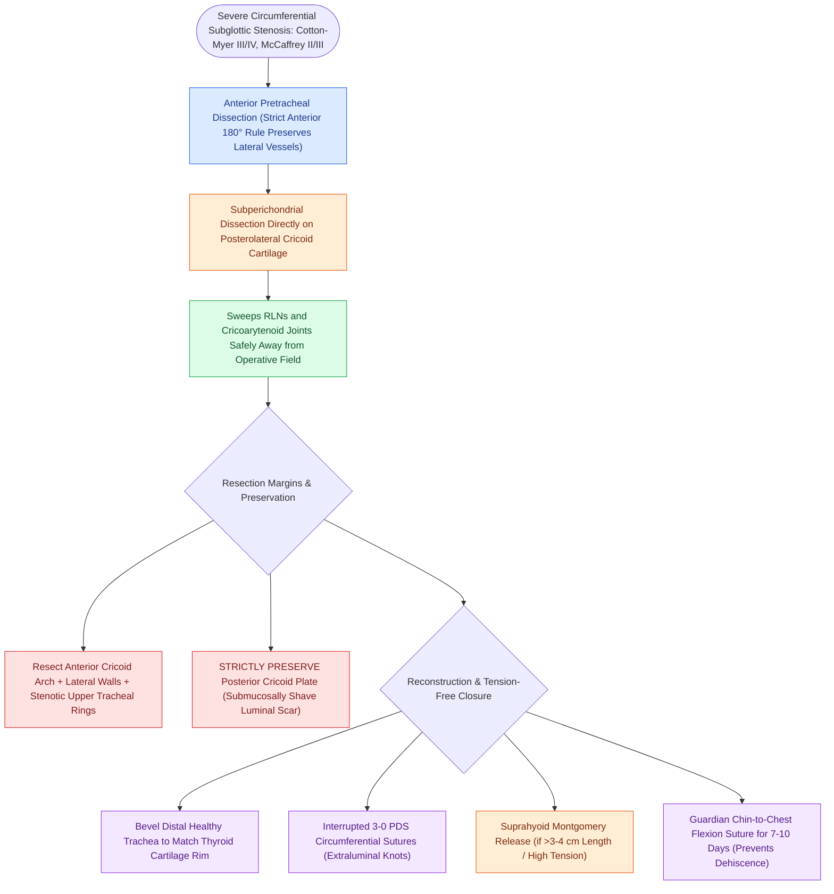

# Cricotracheal resection removes subglottic stenosis while sparing posterior cricoid and RLNs

## Active Recall

> [!question]- Why must the posterior cricoid plate be preserved during cricotracheal resection for subglottic stenosis?
> *Answer / Clinical Rationale*: The cricoarytenoid joints and bilateral recurrent laryngeal nerves articulate and insert immediately adjacent to the posterior cricoid lamina; resecting the posterior plate causes permanent bilateral vocal fold paralysis and loss of laryngeal suspension.

> [!question]- What dissection plane must be maintained along the posterolateral cricoid cartilage to protect the RLN?
> *Answer / Clinical Rationale*: The **subperichondrial plane** directly on the cartilage surface, which sweeps the RLNs safely away from the resection margin without entering dense scar.

## Core Clinical & Mechanistic Principles
**Cricotracheal Resection (CTR)** (pioneered by Hermes Grillo and Philippe Monnier) is the definitive open surgical procedure for severe, circumferential subglottic and upper tracheal stenosis ([[The Cotton-Myer classification grades subglottic stenosis by luminal reduction|Cotton-Myer Grade III and IV]], [[The McCaffrey classification stages laryngotracheal stenosis by anatomical subsite|McCaffrey Stage II and III]]).

### The Anatomical Preservation Mandate
Unlike simple tracheal resection, subglottic stenosis involves the complete cartilaginous ring of the cricoid. However, resecting the posterior cricoid plate would destroy both [[The cricoarytenoid joint moves via coupled rocking and sliding|cricoarytenoid joints]] and bilateral [[The recurrent laryngeal nerve innervates all intrinsic muscles except cricothyroid|recurrent laryngeal nerves (RLNs)]].
- **Partial CTR Concept**:
  - The **anterior cricoid arch and lateral cricoid rings** are completely resected along with the stenotic upper tracheal rings.
  - The **posterior cricoid plate and articular facets are strictly preserved**.
  - Scar tissue on the anterior surface of the posterior plate is meticulously shaved or drilled submucosally down to healthy cartilage without penetrating the posterior lamina.

## Step-by-Step Surgical Execution
1. **Skeletonization**: Elevate subplatysmal flaps; mobilize strap muscles laterally.
2. **Tracheal Mobilization (Anterior 180° Rule)**: Dissect strictly in the anterior pretracheal avascular plane down to the carina; never dissect laterally around the trachea (see [[Tracheal dissection is limited to the anterior 180 degrees to preserve blood supply|anterior 180° tracheal mobilization]]).
3. **Subperichondrial RLN Protection**: At the posterolateral cricoid border and Berry's ligament, perform dissection strictly in a **subperichondrial plane** directly on the cartilage, pushing the RLNs laterally and posteriorly away from harm without direct neural skeletonization.
4. **Resection Limits**:
   - *Superior*: Transect horizontally through the cricothyroid membrane; resect anterior cricoid arch.
   - *Inferior*: Transect healthy trachea immediately below the stenosis. Bevel the anterior tracheal ring to match the wider [[Thyroplasty cartilage window dimensions differ between males and females|thyroid cartilage]] rim.
5. **Tension-Free Anastomosis**:
   - If tension is present, perform a [[Suprahyoid Montgomery release mobilizes the larynx to reduce anastomotic tension|suprahyoid Montgomery release]].
   - Advance the healthy posterior tracheal mucosa over the shaved cricoid plate.
   - Place interrupted **3-0 PDS or Vicryl sutures** around the circumference (knots tied extraluminally).
6. **The Guardian Suture**: Place heavy chin-to-chest sutures to enforce cervical flexion for 7 to 10 days (see guardian suture).

## Critical Failure Modes & Error Traps
- **Bilateral RLN Transection**: Dissecting through dense lateral scar instead of staying strictly subperichondrial on the cricoid leads to bilateral RLN transection and irreversible vocal fold paralysis.
- **Anastomotic Dehiscence**: Excessive tension on the anastomosis causes complete dehiscence, mediastinitis, and fatal loss of airway.

## Connected Concepts & Graph Traversal
- **Vascular Preservation Rule**: [[Tracheal dissection is limited to the anterior 180 degrees to preserve blood supply|Anterior 180° Tracheal Mobilization]]
- **Tension Release**: [[Suprahyoid Montgomery release mobilizes the larynx to reduce anastomotic tension|Suprahyoid Montgomery Release]]
- **Cervical Immobilization**: [[The guardian chin-to-chest suture prevents cervical hyperextension and anastomotic dehiscence|Guardian Chin-to-Chest Suture]]
- **Alternative Open Procedure**: [[Laryngotracheal reconstruction expands the airway using carved costal cartilage grafts|Laryngotracheal Reconstruction (LTR)]]
- **Protected Neuroanatomy**: [[The recurrent laryngeal nerve innervates all intrinsic muscles except cricothyroid|Recurrent Laryngeal Nerve]]
