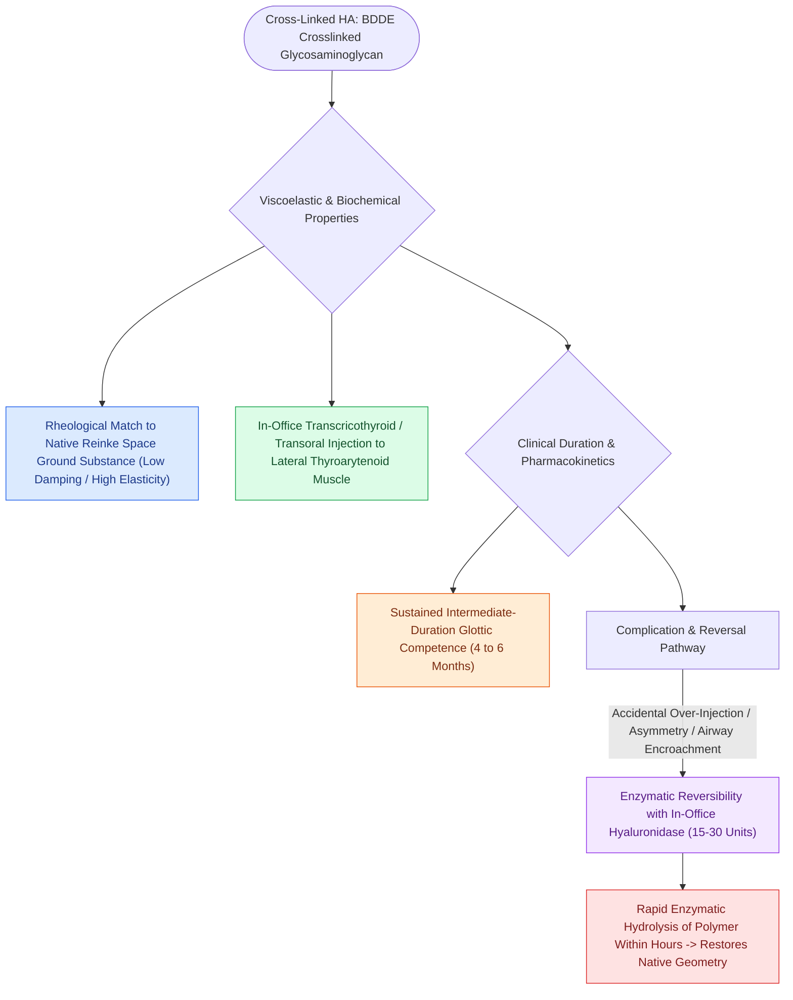

# Cross-linked hyaluronic acid provides intermediate-duration vocal fold augmentation

## Active Recall

> [!question]- What major safety advantage does cross-linked hyaluronic acid have over all other vocal fold injectable biomaterials?
> *Answer / Clinical Rationale*: It is **100% enzymatically reversible**; any over-injection or contour deformity can be rapidly degraded by injecting **hyaluronidase**.

> [!question]- What is the typical clinical duration of medialization with cross-linked HA?
> *Answer / Clinical Rationale*: Approximately **4 to 6 months**.

## Core Clinical & Mechanistic Principles
**Cross-Linked [[Hyaluronic acid regulates lamina propria hydration and shock absorption|Hyaluronic Acid]] (HA)** preparations (such as Restylane, Juvederm, or Hylaform) are synthetic or bacterially synthesized glycosaminoglycans cross-linked with 1,4-butanediol diglycidyl ether (BDDE) to retard enzymatic degradation.

### Rheological Match & Viscoelastic Harmony
- **Native Ground Substance Match**: Native hyaluronic acid is the primary glycosaminoglycan of [[The superficial lamina propria acts as a pliable shearing fluid bed|Reinke's space]]. Exogenous cross-linked HA provides an ideal rheological match to human vocal fold extracellular matrix.
- **Duration of Effect**: Cross-linking prolongs in vivo tissue residence, providing effective medialization for **4 to 6 months**.
- **Enzymatic Reversibility with Hyaluronidase**: HA is the only vocal fold injectable biomaterial that can be completely and rapidly dissolved enzymatically. If over-injection, asymmetry, or airway encroachment occurs, injecting **hyaluronidase** (e.g., 15–30 units) rapidly degrades the cross-linked polymer within hours.

## Injection Planes & Applications
- **Target Injection Plane**: Can be placed into the lateral [[The thyroarytenoid muscle modulates glottal stiffness and adduction|thyroarytenoid muscle]] or the deep layer of the lamina propria.
- **Superficial Placement Tolerance**: While deep paraglottic placement is preferred, accidental superficial placement of HA is far better tolerated than [[Calcium hydroxylapatite provides durable medialization but causes granulomas if superficial|CaHA]], because HA integrates into the native ground substance and can be dissolved with hyaluronidase if a contour deformity arises.

## Critical Failure Modes & Error Traps
- **Underestimating Resorption Rate**: In active, high-demand vocalists, HA may undergo accelerated enzymatic clearance, requiring re-injection or transition to permanent framework surgery.

## Connected Concepts & Graph Traversal
- **Temporary Gel Counterpart**: [[Carboxymethylcellulose gel provides short-acting temporary vocal fold augmentation|Carboxymethylcellulose Gel]]
- **Durable Mineral Counterpart**: [[Calcium hydroxylapatite provides durable medialization but causes granulomas if superficial|Calcium Hydroxylapatite]]
- **Autologous Tissue Alternative**: [[Autologous fat augmentation requires overcorrection for resorption|Autologous Fat]]
- **Lateral TA Injection Target**: [[Injection laryngoplasty requires precise placement into lateral thyroarytenoid muscle|Injection Laryngoplasty]]
- **Glottic Insufficiency**: [[Unilateral vocal fold paralysis causes glottic insufficiency, breathiness, and aspiration|Vocal Fold Paralysis]]
