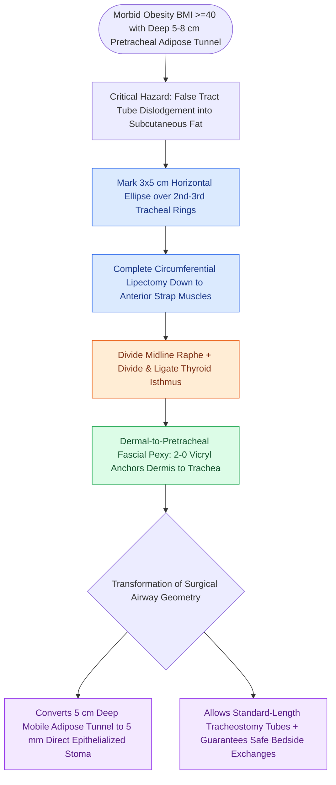

# Defatting tracheotomy secures the airway in morbidly obese patients

## Active Recall

> [!question]- What is the primary anatomical objective of a defatting tracheotomy in a morbidly obese patient?
> *Answer / Clinical Rationale*: To resect the thick subcutaneous pretracheal fat pad and suture the skin dermis directly to the pretracheal fascia, converting a deep $5\text{-cm}$ adipose tunnel into a shallow, safe $5\text{-mm}$ stoma that accommodates standard-length tracheotomy tubes.

> [!question]- What fatal complication does defatting tracheotomy prevent?
> *Answer / Clinical Rationale*: It prevents **pretracheal false tract displacement** and catastrophic loss of airway during tube dislodgement or early routine tube exchanges.

## Core Clinical & Mechanistic Principles
**Defatting Tracheotomy** (also known as **cervical lipectomy tracheostomy**, pioneered by Cohen, Maisel, and Rosenthal) is a specialized surgical airway technique designed for patients with **morbid obesity ($\text{BMI} \ge 40\text{ kg/m}^2$)**, massive pretracheal adipose depth ($>4\text{–}5\text{ cm}$), or short, heavily adipose "bull necks."

### The Deep Tunnel Failure Mode
- In [[Standard open tracheotomy utilizes horizontal intersinusoidal or Bjork flap entry|standard tracheotomy]] performed through massive adipose depth, the distance between the skin surface and anterior tracheal wall can exceed $5\text{–}8\text{ cm}$.
- Standard tracheotomy tubes cannot traverse this depth; their flanges abut the thick skin while the tip dislodges into pretracheal subcutaneous tissues, creating fatal pretracheal false tracts and loss of airway.
- Even proximal extended-length tracheostomy tubes (e.g., Shiley XLT) can slip out during routine patient repositioning.

## Step-by-Step Surgical Craft
1. **Elliptical Skin Excision**: Mark a generous horizontal ellipse ($3\text{ cm}\times 5\text{ cm}$) centered over the 2nd and 3rd tracheal rings.
2. **Cervical Lipectomy**: Perform a complete, circumferential excision of all subcutaneous adipose tissue down to the anterior surface of the strap muscles, beveling the dissection outward toward the skin margins.
3. **Midline Strap Dissection & Isthmusectomy**: Dissect strictly in the midline raphe, divide the thyroid isthmus, and skeletonize anterior tracheal rings 2 to 4.
4. **Dermal-to-Pretracheal Fascial Pexy**: Prior to incising the trachea, suture the deep dermis of the skin edges directly to the pretracheal fascia / tracheal perichondrium flanking rings 2 and 4 using interrupted **2-0 or 3-0 absorbable sutures (Vicryl)**.
5. **Tracheal Entry & Tube Placement**: Make the tracheal incision, place [[Tracheal stay sutures prevent false tract entry during accidental decannulation|stay sutures]], and insert a standard-length cuffed tracheotomy tube (e.g., standard Shiley #6 or #8).

## Primary Clinical Advantages
- Converts a deep, dangerous $5\text{-cm}$ tunnel into a shallow, direct $5\text{-mm}$ epithelialized funnel stoma.
- Eliminates the need for specialty proximal extended tubes.
- Enables safe, direct bedside tube exchanges.

## Critical Failure Modes & Error Traps
- **Omission of Dermal Pexy**: Performing lipectomy without suturing the dermis to the pretracheal fascia allows thick mobile adipose tissue to collapse back over the stoma, recreating the dangerous tunnel.

## Connected Concepts & Graph Traversal
- **Standard Baseline Procedure**: [[Standard open tracheotomy utilizes horizontal intersinusoidal or Bjork flap entry|Standard Open Tracheotomy]]
- **Adjunctive Safety Suture**: [[Tracheal stay sutures prevent false tract entry during accidental decannulation|Tracheal Stay Sutures]]
- **Alternative Flap**: [[The Bjork flap facilitates emergency tracheostomy recannulation|The Björk Flap]]
- **Subcutaneous Complication**: [[Subcutaneous emphysema arises when tracheotomy incisions are closed too tightly|Subcutaneous Emphysema]]
- **Clinical Management**: [[Adult tracheostomy tube exchange at one week requires a mature tract, tracheal stay sutures, and bougie guidance|Tracheostomy Tube Exchange]]
