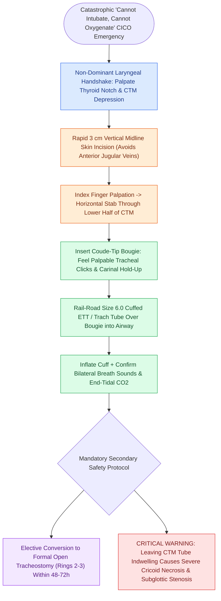

# Emergency cricothyrotomy provides rapid airway access through the cricothyroid membrane

## Active Recall

> [!question]- Why is an emergency surgical cricothyrotomy preferred over an emergency tracheotomy in a 'cannot intubate, cannot oxygenate' scenario?
> *Answer / Clinical Rationale*: The cricothyroid membrane is superficial, consistently palpable, and virtually devoid of overlying major vascular structures (such as the thyroid isthmus), allowing rapid, bloodless airway entry in under 30–45 seconds.

> [!question]- Why must a surgical cricothyrotomy be electively converted to an open tracheotomy after patient stabilization?
> *Answer / Clinical Rationale*: Prolonged tube placement across the narrow cricothyroid space induces pressure necrosis of the cricoid cartilage and severe **iatrogenic subglottic stenosis**.

## Core Clinical & Mechanistic Principles
**Emergency Surgical Cricothyrotomy** (cricothyroidotomy) is the ultimate rescue airway procedure in a catastrophic **"Cannot Intubate, Cannot Oxygenate / Ventilate" (CICO / CICV)** emergency.

### Anatomical Rationale Over Emergency Tracheotomy
- **Subcutaneous Location**: The **cricothyroid membrane (CTM)** is situated immediately beneath the skin in the midline, bounded superiorly by the inferior border of the [[Thyroplasty cartilage window dimensions differ between males and females|thyroid cartilage]] and inferiorly by the [[Cricotracheal resection removes subglottic stenosis while sparing posterior cricoid and RLNs|cricoid cartilage]] arch.
- **Absence of Major Vascular Structures**: Unlike the pretracheal space (which contains the richly vascular thyroid isthmus, inferior thyroid veins, and anterior jugular venous plexuses), the CTM is superficial and virtually avascular in the midline (aside from tiny transverse cricothyroid arterial anastomoses near the superior border).
- **Speed of Access**: Can be executed reliably in **under 30 to 45 seconds** using a scalpel, finger, and bougie, whereas emergency tracheotomy in an un-intubated, hypoxic patient takes significantly longer and carries severe bleeding risks.

## Step-by-Step Scalpel-Finger-Bougie Technique
1. **Laryngeal Hand Shake & Stabilization**: Non-dominant hand stabilizes the larynx, palpating the thyroid notch, thyroid lamina, and the soft depression of the cricothyroid membrane.
2. **Vertical Skin Incision**: A rapid $3\text{-cm}$ vertical midline skin incision is made over the CTM (vertical orientation avoids lateral anterior jugular veins).
3. **Horizontal Membrane Puncture**: The index finger palpates the membrane; the scalpel makes a horizontal stab incision through the lower half of the CTM (staying low to avoid the transverse cricothyroid artery).
4. **Bougie Railroading**: Insert an angled gum-elastic bougie through the incision into the trachea; confirm tracheal clicks and hold-up at the carina.
5. **Tube Placement**: Railroad a lubricated **cuffed 6.0-mm endotracheal or tracheotomy tube** over the bougie into the airway, inflate the cuff, and ventilate.

## Mandatory Elective Conversion
- Cricothyrotomy is an emergency life-saving bridge.
- Leaving a tube across the cricothyroid membrane for >48–72 hours causes pressure necrosis of the cricoid cartilage perichondrium and high-grade [[The Cotton-Myer classification grades subglottic stenosis by luminal reduction|subglottic stenosis]].
- The patient should undergo formal conversion to an [[Standard open tracheotomy utilizes horizontal intersinusoidal or Bjork flap entry|elective open tracheotomy]] (rings 2–3) once stabilized.

## Critical Failure Modes & Error Traps
- **False Passage into Pre-epiglottic Space**: Inadvertently making the incision superior to the thyroid cartilage notch plunges the tube into the thyrohyoid membrane and pre-epiglottic space, failing to enter the airway.

## Connected Concepts & Graph Traversal
- **Permanent Airway Conversion**: [[Standard open tracheotomy utilizes horizontal intersinusoidal or Bjork flap entry|Standard Open Tracheotomy]]
- **Cartilage Landmark**: [[The cricothyroid muscle elongates vocal folds to elevate pitch|Cricothyroid Anatomy]]
- **Underlying Airway Complication if Unconverted**: [[The Cotton-Myer classification grades subglottic stenosis by luminal reduction|Subglottic Stenosis]]
- **Pretracheal Hazard Avoided**: [[Defatting tracheotomy secures the airway in morbidly obese patients|Pretracheal Anatomy in Obesity]]
- **Clinical Management**: [[Cricotracheal resection removes subglottic stenosis while sparing posterior cricoid and RLNs|Cricotracheal Resection (CTR)]]
