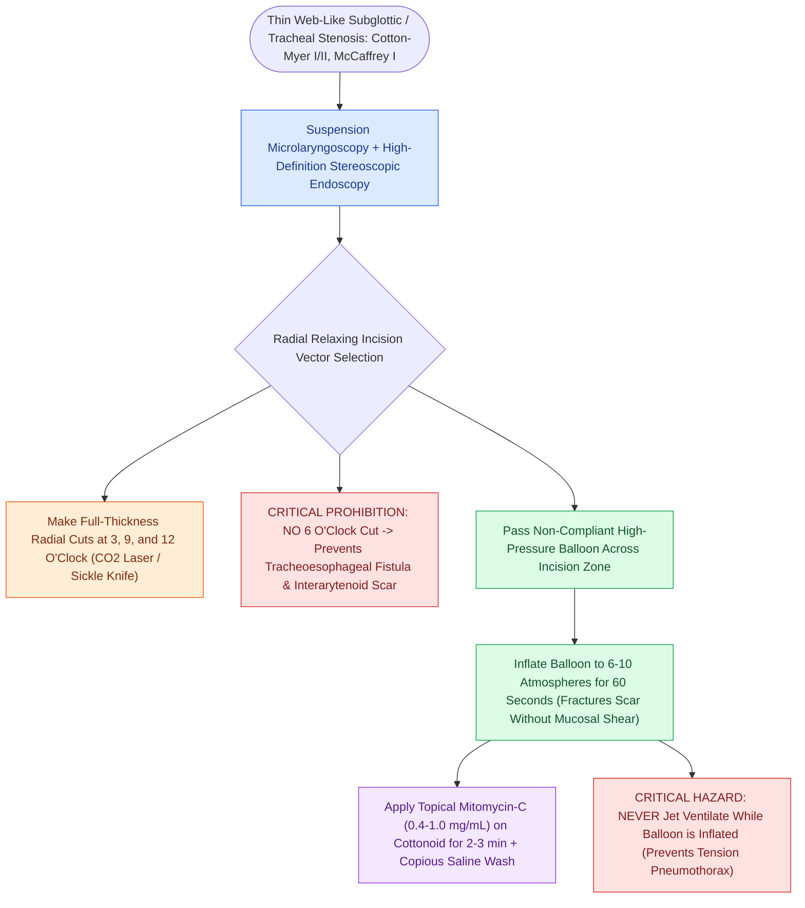

# Endoscopic airway dilation combines radial incisions with balloon bronchoplasty

## Active Recall

> [!question]- Why is making a radial incision at the 6 o'clock position strictly avoided during endoscopic subglottic dilation?
> *Answer / Clinical Rationale*: The 6 o'clock position represents the posterior membranous wall separating the trachea from the esophagus; incising here risks creating a **tracheoesophageal fistula** or deep [[The interarytenoid muscle closes the posterior glottic chink|interarytenoid]] scar tethering.

> [!question]- What are the three standard radial incision positions used in subglottic dilation?
> *Answer / Clinical Rationale*: The **3, 9, and 12 o'clock positions** (anterior midline and bilateral lateral walls).

## Core Clinical & Mechanistic Principles
**Endoscopic Airway Dilation** is a minimally invasive, organ-preserving technique indicated for immature, soft, thin web-like subglottic or tracheal stenosis ([[The Cotton-Myer classification grades subglottic stenosis by luminal reduction|Cotton-Myer Grades I and II]], or [[The McCaffrey classification stages laryngotracheal stenosis by anatomical subsite|McCaffrey Stage I]]).

### Step-by-Step Multi-Modality Protocol
1. **Suspension & Laryngeal Exposure**: Perform [[Phonomicrosurgery requires suspension laryngoscopy and stereoscopic magnification|suspension laryngoscopy]]; visualize the stenotic ring under stereoscopic magnification.
2. **Radial Relaxing Incisions (The 3, 9, and 12 O'Clock Rule)**:
   - Using a micro-spot [[The CO2 laser vaporizes tissue via 10600 nm water absorption|CO2 laser]] or cold sickle knife, make three radial incisions through the full thickness of the scar band at the **3, 9, and 12 o'clock positions**.
   - *Critical Safety Mandate*: **Strictly avoid making an incision at the 6 o'clock position** (posterior midline) to prevent dividing the thin membranous tracheoesophageal wall and causing a tracheoesophageal fistula or posterior scar fixation.
3. **Controlled Radial Expansion (Balloon Bronchoplasty)**:
   - Insert a noncompliant, high-pressure balloon catheter (e.g., $10\text{–}14\text{ mm}$ outer diameter in adults, sized appropriately in pediatrics) across the incision lines.
   - Inflate the balloon with saline to nominal pressure ($6\text{–}10\text{ atmospheres}$) and hold for **60 seconds**.
   - Radial expansion gently fractures the cut scar margins without shearing or tearing the longitudinal mucosa.
4. **Topical Antifibrotic Application**:
   - Apply [[Topical mitomycin-C inhibits fibroblast proliferation and collagen deposition|Topical Mitomycin-C]] ($0.4\text{ to }1.0\text{ mg/mL}$) on soaked neurosurgical cottonoids directly to the dilated bed for 2 to 3 minutes, followed by copious saline irrigation.

## Primary Indications vs Limitations
- **Ideal Candidates**: Thin webs ($<1\text{ cm}$ in length), mature membranous scars, idiopathic subglottic stenosis (early phase), and mild anastomotic strictures.
- **Contraindications**: Dense, thick cartilaginous collapse, complete atresia (Cotton-Myer Grade IV), or loss of structural framework, which requires open [[Laryngotracheal reconstruction expands the airway using carved costal cartilage grafts|LTR]] or [[Cricotracheal resection removes subglottic stenosis while sparing posterior cricoid and RLNs|CTR]].

## Critical Failure Modes & Error Traps
- **Barotrauma during Dilation**: Never fire a [[Jet ventilation requires unimpeded expiratory egress to prevent barotrauma|jet ventilator]] while the dilation balloon is inflated, as the occluded lumen prevents expiratory egress, causing fatal tension pneumothorax.

## Connected Concepts & Graph Traversal
- **Cotton-Myer Grading**: [[The Cotton-Myer classification grades subglottic stenosis by luminal reduction|Cotton-Myer Classification]]
- **McCaffrey Subsite Staging**: [[The McCaffrey classification stages laryngotracheal stenosis by anatomical subsite|McCaffrey Staging]]
- **Laser Resection Tools**: [[The CO2 laser vaporizes tissue via 10600 nm water absorption|CO2 Laser in Airway]]
- **Open Surgical Reconstruction**: [[Two-stage LTR maintains a tracheostomy with prolonged endolaryngeal stenting|Two-Stage LTR]]
- **Cricotracheal Resection**: [[Cricotracheal resection removes subglottic stenosis while sparing posterior cricoid and RLNs|Cricotracheal Resection]]
