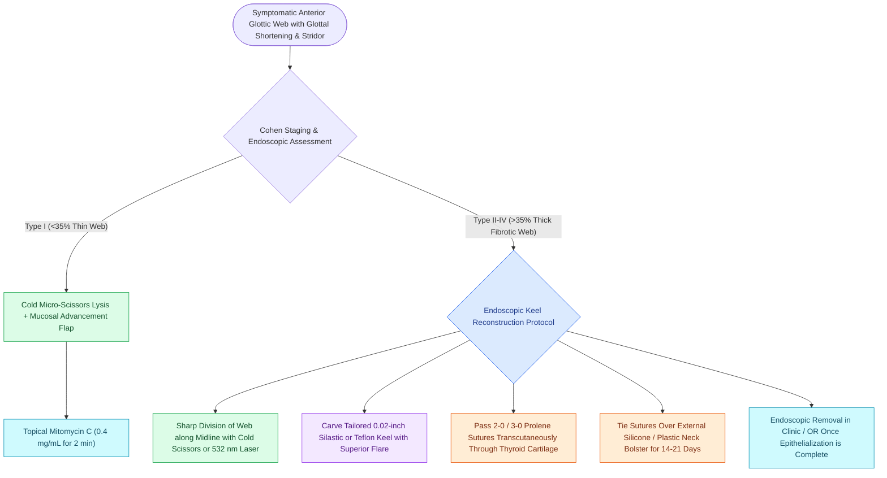

# Endoscopic anterior glottic web repair requires cold microdivision and endolaryngeal silastic keel stenting to prevent recurrent synechia

## Active Recall

> [!question]- Why is the anterior commissure uniquely prone to recurrent web formation following simultaneous bilateral mucosal dissection?
> *Answer / Clinical Rationale*: The true vocal folds converge at the acute angle of the anterior commissure without intervening subcutaneous tissue. When opposing raw de-epithelialized mucosal surfaces touch, fibrin bridging and rapid myofibroblastic contracture fuse the anterior folds into a cicatricial web.

> [!question]- How is an endolaryngeal Silastic keel secured in place to prevent migration while anterior commissure re-epithelialization occurs?
> *Answer / Clinical Rationale*: The keel is placed between the divided vocal folds and secured with **transcricothyroid and transthyroid monofilament sutures** passed through the skin of the neck and tied over an external plastic or silicone button bolster.

## Core Clinical & Mechanistic Principles
An **anterior glottic web** is an abnormal sheet of scar tissue spanning the anterior glottic aperture between the true vocal folds. While congenital webs represent failure of endolaryngeal recanalization during the 10th week of embryogenesis, $>90\%$ of adult glottic webs are iatrogenic, resulting from bilateral surgical trauma, deep laser vaporization, or aggressive mucosal stripping crossing the anterior commissure.

### Cohen Classification of Glottic Webs
- **Type I (Mild)**: Thin, translucent mucosal web involving $<35\%$ of the anterior glottic lumen; minimal airway restriction, mild dysphonia.
- **Type II (Moderate)**: Involves $35\%\text{ to }50\%$ of the glottis; thicker fibrotic bridge causing moderate exercise intolerance and hoarseness.
- **Type III (Severe)**: Thick fibrotic web involving $50\%\text{ to }75\%$ of the glottic lumen, frequently extending into the subglottis and causing severe dyspnea and biphasic stridor.
- **Type IV (Complete / Complex)**: Dense, thick fibrous or cartilaginous web obliterating $>75\%$ of the glottic airway, completely fusing true and false folds and requiring tracheostomy dependence.

### Pathomechanics of Iatrogenic Webbing & Surgical Prevention
- **The Anterior Angle Hazard**: At the anterior commissure, Broyles' ligament anchors the vocal folds directly to the thyroid cartilage. Any surgical maneuver that strips mucosa from both opposing vocal folds simultaneously leaves two bare, bleeding surfaces that appose during swallowing and phonation.
- **Primary Prevention**: During surgery for bilateral pathology (such as papillomatosis or polyps), the surgeon must practice strict [[The epithelial-sparing microflap preserves native mucosa and prevents glottic webbing|anterior commissure mucosal preservation]], leaving a $2\text{ to }3\text{ mm}$ mucosal bridge on one side, or staging the procedure by 6 to 8 weeks.

### Endoscopic Surgical Craft: Microdivision & Keel Stenting
1. **Lysis Modality**:
   - The web is placed under tension using an anterior commissure suspension laryngoscope.
   - Division is executed sharply down the anatomical midline to the inner thyroid perichondrium using fine micro-scissors or the [[The KTP laser targets oxyhemoglobin at 532 nm for photoangiolysis|532 nm KTP laser]] on minimal pulse settings. Thermal vaporization with the continuous [[The CO2 laser vaporizes tissue via 10600 nm water absorption|CO2 laser]] is minimized to prevent lateral zone-of-injury collateral thermal damage.
2. **Silastic Keel Placement & Suture Fixation**:
   - For all webs involving $>35\%$ of the glottis, simple division without stenting fails in $>80\%$ of cases due to rapid re-fusion.
   - A soft medical-grade Silastic sheet ($0.02\text{ inch}$ thick) is carved into a tailored kite- or wedge-shape. The superior border is notched to seat beneath the petiole of the epiglottis, while the anterior blade separates the vocal fold apices.
   - Using a Lichtenberger keel needle or hollow 18-gauge spinal needles, two double-armed 2-0 or 3-0 polypropylene (Prolene) sutures are passed from the external anterior neck, through the thyroid cartilage lamina, through the keel eyelets endolaryngeally, and retrieved back through the neck.
   - The sutures are tied over an external silicone button or dental roll bolster on the anterior cervical skin under gentle tension, fixing the keel firmly against the anterior commissure.
3. **Adjuvant Antifibrotic Pharmacotherapy**:
   - Pledgets soaked in [[Topical mitomycin-C inhibits fibroblast proliferation and collagen deposition|topical mitomycin-C]] ($0.4\text{ mg/mL}$) are applied to the raw vocal fold margins for 2 to 4 minutes before keel fixation, rinsing copiously with saline to suppress myofibroblast migration.
4. **Stent Removal & Healing Window**:
   - The keel remains in situ for **14 to 21 days**, which corresponds to the complete physiological window for migratory re-epithelialization across the vocal fold margins. The keel is retrieved endoscopically, revealing fully mucosalized, separate vocal folds and an acute anterior commissure.

## Critical Failure Modes & Error Traps
- **Over-Tightening the External Bolster Suture**: Excessive pressure on the anterior neck skin leads to ischemic pressure necrosis, chondritis of the thyroid cartilage, and unsightly cutaneous scarring.
- **Premature Keel Removal (<10 Days)**: Removing the stent before complete re-epithelialization allows denuded vocal fold edges to re-adhere, resulting in full recurrence of the web.

## Connected Concepts & Graph Traversal
- **Intubation Airway Damage**: [[Prolonged intubation beyond seven to ten days increases glottic stenosis and ventilator-associated pneumonia risk|Intubation Webbing Risk]]
- **Anterior Insertion Anchor**: [[Broyles' ligament anchors the vocal ligament to thyroid cartilage|Broyles' Ligament Insertion]]
- **Papilloma Stripping Hazard**: [[Recurrent respiratory papillomatosis is caused by HPV and managed with serial debulking|Papilloma Anterior Stripping Hazard]]
- **Vocal Microarchitecture**: [[The vocal fold comprises five distinct histological layers|Layered Glottic Microarchitecture]]
- **Cicatricial Remodeling**: [[Vocal fold scar results from disorganized Type I collagen deposition|Iatrogenic Glottic Scarring]]
