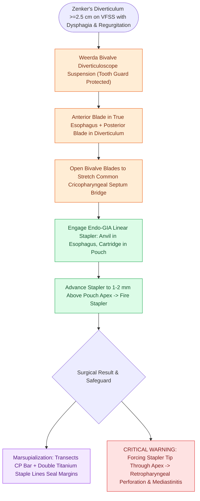

# Endoscopic stapler diverticulotomy divides the cricopharyngeal bar and seals mucosa

## Active Recall

> [!question]- Why is endoscopic stapler diverticulotomy contraindicated for Zenker diverticula smaller than 2.5 cm?
> *Answer / Clinical Rationale*: The distal non-cutting tip of the linear stapler anvil measures $8\text{–}10\text{ mm}$; in a small pouch ($<2.5\text{ cm}$), the stapler cannot engage the full height of the cricopharyngeus muscle, leaving a substantial residual bar that results in persistent dysphagia.

> [!question]- What instrument is used to visualize and stabilize the common cricopharyngeal septum during transoral stapling?
> *Answer / Clinical Rationale*: A **Weerda bivalve diverticuloscope**, whose anterior blade enters the esophagus and posterior blade enters the diverticulum to splay the common tissue bridge.

## Core Clinical & Mechanistic Principles
**Transoral Endoscopic Stapler Diverticulotomy** (pioneered by Collard and Martin-Hirsch in 1993) is the primary first-line surgical procedure for moderate-to-large **[[Zenker's diverticulum herniates through Killian's triangle due to elevated pulsion pressure|Zenker's diverticula]] ($\ge 2.5\text{–}3.0\text{ cm}$ in vertical depth)**.

### The Simultaneous Division-and-Sealing Mechanism
- **The Common Septum / Tissue Bridge**: The wall separating the esophageal lumen anteriorly from the diverticular pouch posteriorly is composed of the hypertonic **[[Open diverticulectomy combines pouch resection with cricopharyngeal myotomy|cricopharyngeus muscle]]** covered on both sides by mucosa.
- **Endoscopic Stapling Action**: An endoscopic linear cutting stapler (e.g., Endo-GIA with a $30\text{-mm}$ or $35\text{-mm}$ vascular/tissue cartridge) applies parallel rows of titanium staples while a central blade transects the tissue bridge between them.
- **Marsupialization**: Dividing the cricopharyngeus muscle eliminates the functional outflow obstruction and incorporates the diverticular pouch into the upper cervical esophageal lumen (marsupialization).

## Step-by-Step Surgical Execution
1. **Diverticuloscope Insertion**: Under general endotracheal anesthesia with complete muscle relaxation, introduce a **Weerda bivalve diverticuloscope** or modified Benjamin scope over a silicone tooth guard.
2. **Septum Engagement**: Advance the **anterior blade into the true esophageal lumen** and the **posterior blade into the diverticular pouch**. Open the bivalve blades to expose and stretch the common cricopharyngeal bridge.
3. **Stapler Application**: Introduce the endoscopic linear cutting stapler. Seat the narrow anvil into the esophagus and the cartridge into the diverticulum. Advance the stapler fully until it abuts the fundus of the pouch ($1\text{–}2\text{ mm}$ above the apex).
4. **Firing & Inspection**: Close and fire the stapler. Inspect the divided bridge to confirm complete muscle transection and hemostasis along the staple lines.

## Minimum Pouch Size Requirement
- **Size Limitation**: Requires a minimum diverticulum depth of **$\ge 2.5\text{ cm}$** to accommodate the non-cutting distal tip ($8\text{–}10\text{ mm}$) of the stapler anvil. For smaller pouches ($<2.5\text{ cm}$), the stapler leaves an excessively long residual cricopharyngeal bar, prompting use of [[Transoral laser diverticulotomy divides small Zenker diverticular common bars|transoral laser diverticulotomy]].

## Critical Failure Modes & Error Traps
- **Fundus Perforation & Mediastinitis**: Forcing the stapler tip through the delicate fundus of the diverticulum perforates into the retropharyngeal space, causing severe [[Subcutaneous emphysema arises when tracheotomy incisions are closed too tightly|subcutaneous emphysema]], deep neck abscess, and fatal descending mediastinitis.

## Connected Concepts & Graph Traversal
- **Primary Disease Treated**: [[Zenker's diverticulum herniates through Killian's triangle due to elevated pulsion pressure|Zenker's Diverticulum]]
- **Anatomical Site**: [[Killian's triangle is a posterior muscular dehiscence above the cricopharyngeus|Killian's Triangle]]
- **Alternative for Small Pouches**: [[Transoral laser diverticulotomy divides small Zenker diverticular common bars|Transoral Laser Diverticulotomy]]
- **Alternative for Giant Pouches / Recurrence**: [[Open diverticulectomy combines pouch resection with cricopharyngeal myotomy|Open Transcervical Diverticulectomy]]
- **Diagnostic Radiography**: [[VFSS provides continuous radiographic evaluation of all deglutition phases|Videofluoroscopic Swallow Study (VFSS)]]
