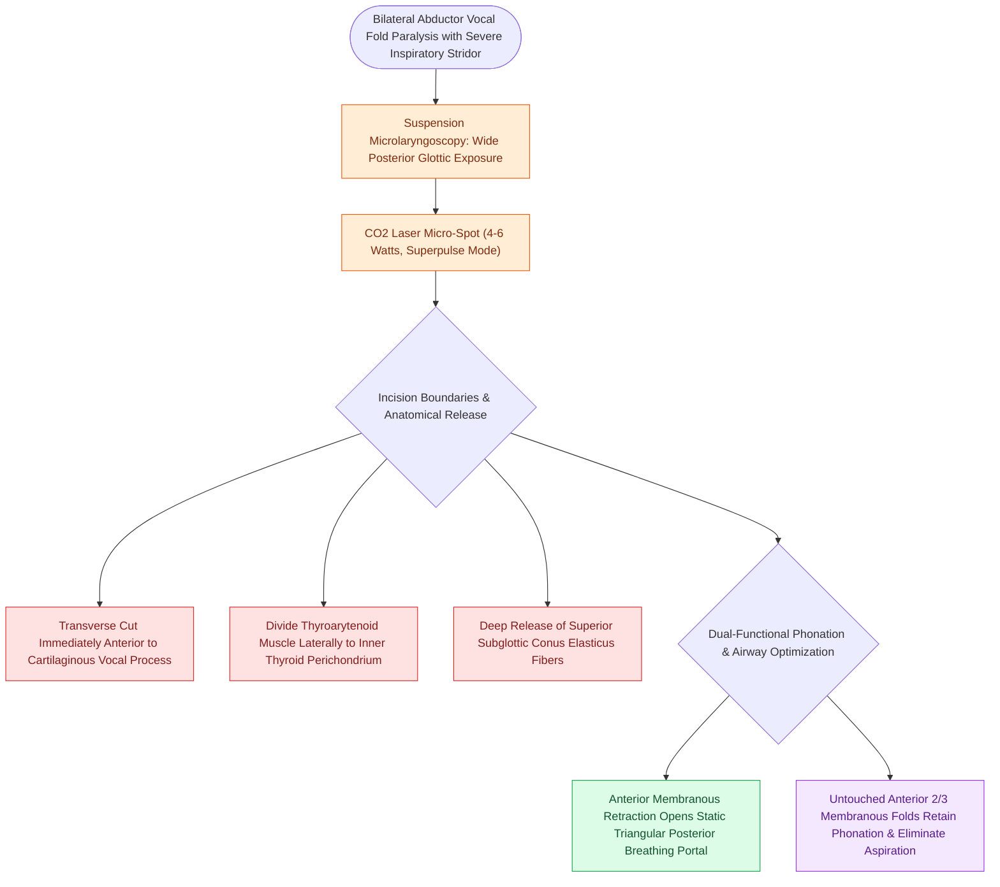

# Endoscopic transverse cordotomy widens posterior airway while preserving anterior phonation

## Active Recall

> [!question]- What is the anatomical location and depth of the incision in a Dennis-Karlan transverse cordotomy?
> *Answer / Clinical Rationale*: It is placed immediately **anterior to the vocal process** of the arytenoid cartilage and carried **transversely across the thyroarytenoid muscle laterally to the thyroid cartilage perichondrium**, extending down to the subglottis.

> [!question]- How does transverse cordotomy preserve phonation while relieving upper airway obstruction?
> *Answer / Clinical Rationale*: It creates a static triangular breathing portal strictly in the **posterior glottis**, while leaving the anterior two-thirds of the membranous vocal fold untouched for phonatory mucosal contact.

## Core Clinical & Mechanistic Principles
**Endoscopic Transverse Cordotomy** (first described by Dennis and Karlan) is a minimally invasive endoscopic procedure performed to treat [[Bilateral abductor vocal fold paralysis causes acute airway compromise requiring glottic enlargement|bilateral abductor vocal fold paralysis (BVFP)]] by creating a static posterior airway channel while preserving anterior vocal fold contact for voice production.

### Anatomical Basis & Surgical Vector
- **Transverse C-Wedge Incision**: Performed using a [[The CO2 laser vaporizes tissue via 10600 nm water absorption|CO2 laser]] or cold micro-scissors immediately anterior to the vocal process of the [[The cricoarytenoid joint moves via coupled rocking and sliding|arytenoid cartilage]].
- **Muscle Division**: The incision extends transversely through the [[The thyroarytenoid muscle modulates glottal stiffness and adduction|thyroarytenoid muscle]] laterally down to the internal perichondrium of the [[Thyroplasty cartilage window dimensions differ between males and females|thyroid cartilage alar lamina]].
- **Wound Retraction**: Normal anterior muscle pull causes the divided edge of the membranous vocal fold to retract anteriorly, while the posterior cartilaginous segment retracts posterolaterally, opening a stable triangular posterior airway triangle.

## Step-by-Step Surgical Technique
1. **Suspension Laryngoscopy**: Place a large-lumen operating laryngoscope to fully expose the posterior glottis and arytenoid bodies (see [[Phonomicrosurgery requires suspension laryngoscopy and stereoscopic magnification|suspension laryngoscopy]]).
2. **Laser Application**: Utilize a micro-spot CO2 laser ($4\text{–}6\text{ Watts}$, continuous or superpulse).
3. **Incision Limits**:
   - Medial start: Free edge immediately anterior to the tip of the vocal process.
   - Lateral extent: Carried across the entire width of the vocal fold to the thyroid alar perichondrium.
   - Depth: Extends down to the subglottic shelf, releasing the conus elasticus fibers.
4. **Preservation of Anterior 2/3**: The anterior membranous vocal fold is completely untouched to preserve baseline phonatory closure.

## Critical Failure Modes & Error Traps
- **Granulation & Cicatricial Restenosis**: Secondary intention healing can form exuberant granulation tissue at the lateral apex of the incision, resulting in restenosis. Topical [[Topical mitomycin-C inhibits fibroblast proliferation and collagen deposition|mitomycin-C]] or postoperative steroid administration helps prevent web reformation.

## Connected Concepts & Graph Traversal
- **Primary Clinical Indication**: [[Bilateral abductor vocal fold paralysis causes acute airway compromise requiring glottic enlargement|Bilateral Abductor Vocal Fold Paralysis (BVFP)]]
- **Surgical Laser Utilized**: [[The CO2 laser vaporizes tissue via 10600 nm water absorption|CO2 Laser Biophysics]]
- **Muscle Incised**: [[The thyroarytenoid muscle modulates glottal stiffness and adduction|Thyroarytenoid Muscle Complex]]
- **Alternative Open Airway Procedure**: [[Standard open tracheotomy utilizes horizontal intersinusoidal or Bjork flap entry|Tracheotomy]]
- **Adjuvant Antifibrotic**: [[Topical mitomycin-C inhibits fibroblast proliferation and collagen deposition|Topical Mitomycin-C]]
