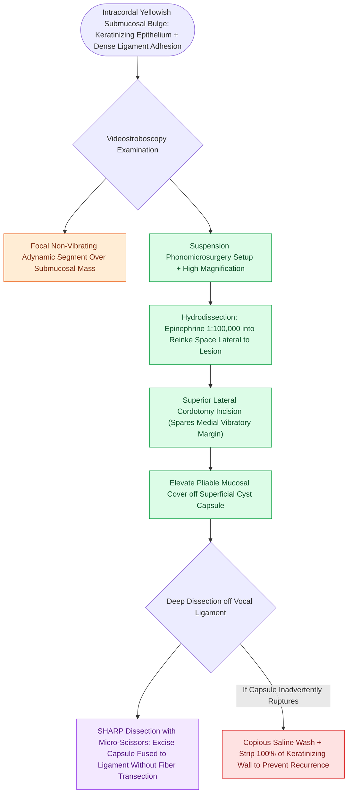

# Epidermoid cysts adhere to the vocal ligament and require sharp dissection

## Active Recall

> [!question]- Why does an epidermoid cyst require sharp dissection compared to a [[Mucous retention cysts arise from obstructed glands in superficial lamina propria|mucous retention cyst]]?
> *Answer / Clinical Rationale*: Epidermoid cysts trigger a chronic inflammatory reaction that forms dense fibrous adhesions directly to the vocal ligament, whereas mucous retention cysts float freely in the loose superficial lamina propria.

> [!question]- What is the histological lining and content of an epidermoid cyst?
> *Answer / Clinical Rationale*: It is lined by **keratinizing stratified squamous epithelium** and filled with lamellated keratin debris.

## Core Clinical & Mechanistic Principles
**Intracordal Epidermoid Cysts** are benign, epithelial-lined cystic lesions located within the vocal fold lamina propria.

### Etiology & Histopathology
- **Lining**: Lined by true **keratinizing [[Stratified squamous epithelium forms the vocal fold protective cover|stratified squamous epithelium]]** with an active stratum granulosum.
- **Content**: Filled with laminated, cheesy keratinaceous debris and cholesterol crystals.
- **Pathogenesis**: Arise either congenitally from entrapped embryonic squamous rests during 4th/6th branchial arch fusion or secondarily from traumatic micro-invagination of surface epithelium following [[Vocal fold nodules are bilateral mid-membranous lesions treated with voice therapy|phonotrauma]] or surgical laceration.
- **Vocal Ligament Adhesion**: Characteristically incite a chronic foreign-body inflammatory reaction around their capsule, causing the cyst wall to adhere densely and fibrously to the [[The intermediate lamina propria provides elastic recoil via elastin fibers|intermediate lamina propria]] and vocal ligament.

## Diagnostic & Stroboscopic Features
- **Yellowish/White Submucosal Mass**: Appears as an ivory or yellowish well-demarcated submucosal bulge along the medial vibrating edge.
- **Marked Wave Dampening**: The [[The mucosal wave travels as a fluid mechanical displacement|mucosal wave]] is severely restricted or absent over the cyst due to the inflammatory adherence to the vocal ligament.

## Surgical Nuances & Step-by-Step Dissection
1. **Suspension & Hydrodissection**: Infiltrate 1:100,000 epinephrine into [[The superficial lamina propria acts as a pliable shearing fluid bed|Reinke's space]] lateral to the cyst to define the capsule.
2. **Superior Lateral Cordotomy**: Incise the mucosa on the superior surface, preserving the vibratory edge.
3. **Capsule Preservation**: Elevate the mucosal flap carefully off the superior and medial aspects of the cyst capsule.
4. **Sharp Dissection off Vocal Ligament**: Because the deep capsule is densely fused to the elastin/collagen fibers of the vocal ligament, blunt dissection will rupture the cyst. The surgeon must use sharp micro-scissors or micro-knives to dissect the cyst wall cleanly off the ligament fibers without transecting the longitudinal ligament bundles.
5. **Rupture Management**: If the cyst ruptures, copiously irrigate with saline, dissect the remaining wall meticulously to prevent recurrence, or marsupialize the bed.

## Critical Failure Modes & Error Traps
- **Incomplete Capsule Excision**: Leaving fragments of the keratinizing cyst wall leads to high recurrence rates or persistent inflammatory foreign-body granulomas.

## Connected Concepts & Graph Traversal
- **Contrasting Pathology**: [[Mucous retention cysts arise from obstructed glands in superficial lamina propria|Intracordal Mucous Retention Cysts]]
- **Adherent Anatomical Structure**: [[The vocal ligament comprises intermediate and deep lamina propria|The Vocal Ligament]]
- **Surgical Technique**: [[The epithelial-sparing microflap preserves native mucosa and prevents glottic webbing|Phonomicrosurgical Microflap Technique]]
- **Diagnostic Finding**: [[Adynamic vocal fold segments indicate mucosal stiffening, malignancy, or scar|Adynamic Segment on Stroboscopy]]
- **Clinical Management**: [[The mucosal wave travels as a fluid mechanical displacement|Mucosal Wave Dynamics]]
