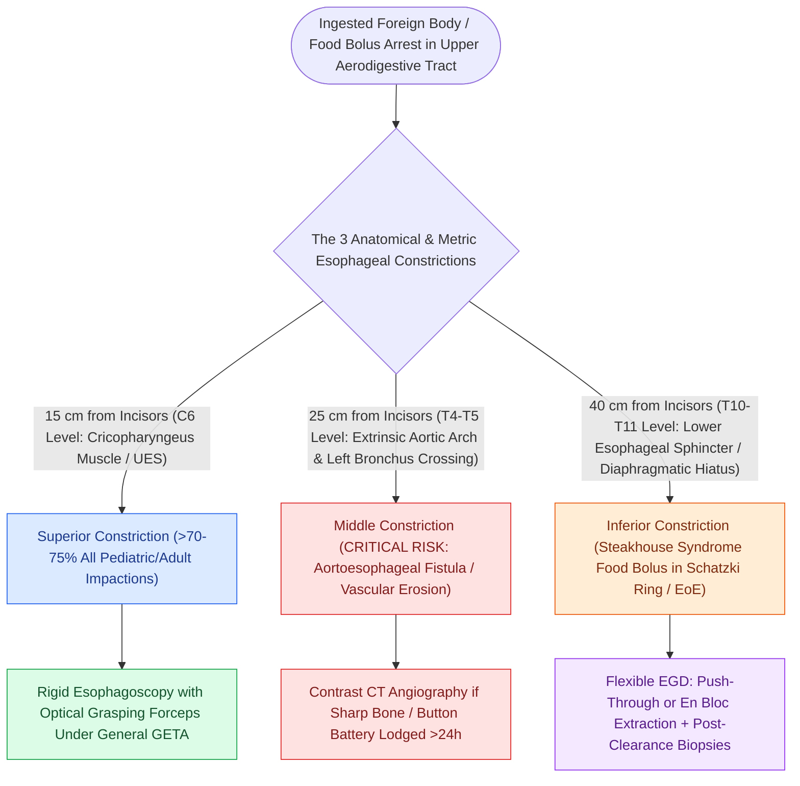

# Esophageal foreign body locations correspond to anatomic narrowings at the cricopharyngeus, aortic arch, and lower esophageal sphincter

## Active Recall

> [!question]- What is the most common anatomical site for foreign body impaction in the esophagus, and what structure defines it?
> *Answer / Clinical Rationale*: The **cricopharyngeus muscle (upper esophageal sphincter)** at the level of **C6** (~15 cm from incisors), which is the physiologically narrowest segment of the entire gastrointestinal tract.

> [!question]- Why does an impacted foreign body at 25 cm from the incisors carry a significantly higher mortality risk than one at 15 cm?
> *Answer / Clinical Rationale*: At 25 cm (T4–T5), the esophagus directly abuts the **aortic arch**; prolonged mucosal necrosis from a sharp object or button battery can erode directly into the aortic lumen, producing an exsanguinating, often fatal **aortoesophageal fistula**.

## Core Clinical & Mechanistic Principles
The esophagus is a muscular tube extending from the inferior border of the cricoid cartilage to the gastric cardia. Ingested foreign bodies and food boluses do not lodge randomly; rather, their sites of impaction directly correlate with **three predictable anatomical and physiological narrowings** where the luminal diameter is constrained by intrinsic muscular sphincters or extrinsic skeletal and vascular structures:

- **The Three Anatomic Esophageal Constrictions**:
  1. **Superior Constriction (Upper Esophageal Sphincter / Cricopharyngeus Muscle)**:
     - *Vertebral Level & Metric*: **C6**, situated approximately **15 cm from the upper incisors** in adults.
     - *Biomechanics*: Formed by the transverse fibers of the cricopharyngeus muscle (part of the inferior pharyngeal constrictor). It constitutes the **narrowest point of the entire gastrointestinal tract** (resting luminal transverse caliber $\approx 14\text{ mm}$).
     - *Clinical Significance*: Accounts for **>70% to 75% of all esophageal foreign body impactions** in both pediatric and adult populations.
  2. **Middle Constriction (Aortic Arch & Left Main Bronchus Crossing)**:
     - *Vertebral Level & Metric*: **T4 to T5**, situated approximately **25 cm from the incisors**.
     - *Biomechanics*: Caused by extrinsic anterior compression from the aortic arch as it sweeps posterolaterally over the left side of the esophagus, immediately followed by the crossing of the left mainstem bronchus.
     - *Clinical Significance*: High-risk zone for catastrophic vascular erosion, pseudoaneurysm formation, or fatal aortoesophageal fistula when sharp bones or [[Pediatric esophageal button battery impaction causes liquefaction necrosis within two hours and mandates emergent endoscopic extraction|button batteries]] lodge at this level.
  3. **Lower Esophageal Sphincter (LES) / Diaphragmatic Hiatus** ($\approx 40\text{ cm}$ from incisors; $T_{10}\text{–}T_{11}$):
     - Physiologic high-pressure zone where food bolus impactions (steakhouse syndrome) frequently arrest in adults with underlying peptic strictures, Schatzki rings, or eosinophilic esophagitis.

### Endoscopic Removal Craft & Principles
- **Airway Protection**: General endotracheal anesthesia with a cuffed endotracheal tube is mandatory for upper and mid-esophageal foreign body extraction to prevent airway contamination or loss of the foreign body into the trachea upon withdrawal.
- **Rigid vs. Flexible Esophagoscopy**:
  - *Rigid Esophagoscopy*: Gold standard for sharp, impacted, or complex foreign bodies in the proximal and cervical esophagus, providing superior optical control and wide working channels for robust grasping forceps.
  - *Flexible Endoscopy*: Preferred for distal foreign bodies (LES/stomach) and for clearing soft food bolus impactions.

### Pediatric vs. Adult Etiological Profiles
- **Pediatric Presentations**: Almost universally involve **smooth, inorganic objects (coins, disc batteries, toy parts)** lodged at the cricopharyngeus in an anatomically normal esophagus.
- **Adult Presentations**: Dominated by **poorly masticated meat boluses ("steakhouse syndrome") or sharp animal bones (fish, poultry)**. Adults presenting with distal esophageal food impaction warrant formal post-extraction mucosal biopsies and barium esophagram to evaluate for eosinophilic esophagitis, Schatzki rings, or strictures.

## References
1. Friedman, E.M. (2016). Videos in Clinical Medicine: Removal of Foreign Bodies from the Ear and Nose. *N Engl J Med*, 374(7):e7.
2. Sidell, D.R., Messner, A.H. (2020). Evaluation and Management of the Pediatric Airway. In *Cummings Otolaryngology Head and Neck Surgery* 7e (pp. 3053-3067). Philadelphia, PA: Elsevier.
3. Tuchman, J.B., Mehta, D.K. (2013). Complex Upper Airway Problems. In Johnson, J.J., Rosen, C.A. (Eds.), *Bailey’s Head and Neck Surgery-Otolaryngology* 5e (pp. 896-907). Baltimore, MD: Lippincott Williams & Wilkins.

## Connected Concepts & Graph Traversal
- **🔗 Critical Battery Emergency (Pediatrics)**: [[Pediatric esophageal button battery impaction causes liquefaction necrosis within two hours and mandates emergent endoscopic extraction|Button Battery Extraction]]
- **Airway Foreign Bodies**: [[Rigid bronchoscopy technique for pediatric airway foreign body removal requires systematic distal-to-proximal examination|Pediatric Airway Foreign Bodies]]
- **Pharyngeal Diverticulum**: [[Killian's triangle is a posterior muscular dehiscence above the cricopharyngeus|Killian Triangle Anatomy]]
- **🔗 Vascular Erosion Complication (Head and Neck)**: [[Carotid blowout syndrome is classified into threatened, impending, and acute hemorrhage|Vascular Erosion & Blowout]]
- **🔗 Endoscopic Overview (Pediatrics)**: [[Tracheobronchial foreign body aspiration presents with choking and air trapping requiring rigid bronchoscopy|Aerodigestive Foreign Bodies]]
