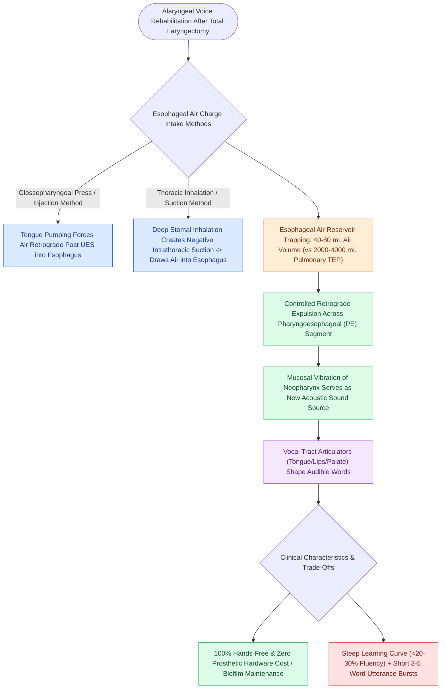

# Esophageal speech utilizes swallowed air across the PE segment for voicing

## Active Recall

> [!question]- What anatomical structure serves as the vibratory sound source in esophageal speech?
> *Answer / Clinical Rationale*: The **Pharyngoesophageal (PE) Segment**, composed of the mucosal and muscular folds of the neopharynx and upper esophagus.

> [!question]- Why are phrase lengths in esophageal speech much shorter than in [[Tracheoesophageal puncture diverts pulmonary air through a one-way valve into the neopharynx|TEP]] speech?
> *Answer / Clinical Rationale*: Esophageal speech relies on a tiny air reservoir of **$40\text{–}80\text{ mL}$** trapped in the esophagus, whereas TEP speech utilizes the entire pulmonary vital capacity (**$2000\text{–}4000\text{ mL}$**).

## Core Clinical & Mechanistic Principles
**Esophageal Speech** is an unassisted alaryngeal voice rehabilitation modality in which the patient learns to insufflate or inject air into the upper esophagus and expel it in a controlled retrograde fashion across the **pharyngoesophageal (PE) segment**, which vibrates to serve as the new pseudoglottic sound source.

### Air Intake Mechanisms
1. **Injection Method (Tongue Pumping / Glossopharyngeal Press)**: The tongue compresses air in the oral cavity and forces it backward past the [[VFSS provides continuous radiographic evaluation of all deglutition phases|upper esophageal sphincter]] into the cervical esophagus.
2. **Inhalation Method (Negative Intrathoracic Suction)**: Rapid expansion of the thoracic cavity (inhalation through the tracheostoma) lowers intrathoracic esophageal pressure, sucking ambient air into the esophagus across a relaxed [[Pharyngoesophageal segment hypertonicity causes TEP failure treated with Botox or myotomy|PE segment]].
3. **Controlled Retrograde Egress**: The patient gently compresses the chest and abdomen to force the trapped $40\text{–}80\text{ mL}$ of esophageal air back up through the compliant PE segment, generating mucosal vibrations shaped by normal articulators.

## Primary Clinical Advantages vs Pitfalls
- **Advantages**:
  - **100% Hands-Free Speech**: Requires no manual occlusion of the tracheostoma or handheld devices.
  - **No Prosthetic Hardware**: Zero cost of replacement valves, zero risk of [[Transprosthetic TEP leaks occur through the valve due to Candida biofilm or wear|prosthetic leaks]], and no secondary surgical procedures.
- **Pitfalls**:
  - **Steep Learning Curve**: High failure rate ($<20\text{–}30\%$ of [[Total laryngectomy achieves en bloc laryngeal resection with permanent end-stoma|total laryngectomy]] patients achieve fluent, functional conversational speech).
  - **Low Phonatory Volume & Short Bursts**: Limited esophageal air reservoir ($40\text{–}80\text{ mL}$ vs $2000\text{–}3000\text{ mL}$ pulmonary vital capacity) permits only 3 to 5 words per air charge.
  - **Gastric Distention & Aerophagia**: Swallowing air causes bloating and flatulence.

## Connected Concepts & Graph Traversal
- **TEP Voicing Gold Standard**: [[Tracheoesophageal puncture diverts pulmonary air through a one-way valve into the neopharynx|Tracheoesophageal Puncture (TEP)]]
- **Electrolarynx Alternative**: [[The electrolarynx provides immediate mechanical speech via acoustic coupling|Electrolarynx Device]]
- **PE Segment Hypertonicity**: [[Pharyngoesophageal segment hypertonicity causes TEP failure treated with Botox or myotomy|PE Segment Dysfunction]]
- **Total Laryngectomy Context**: [[Total laryngectomy achieves en bloc laryngeal resection with permanent end-stoma|Total Laryngectomy]]
- **Stoma Management**: [[Hands-free stomaplasty stabilizes the peristomal contour using fascia lata slings|Hands-Free Stomaplasty]]
