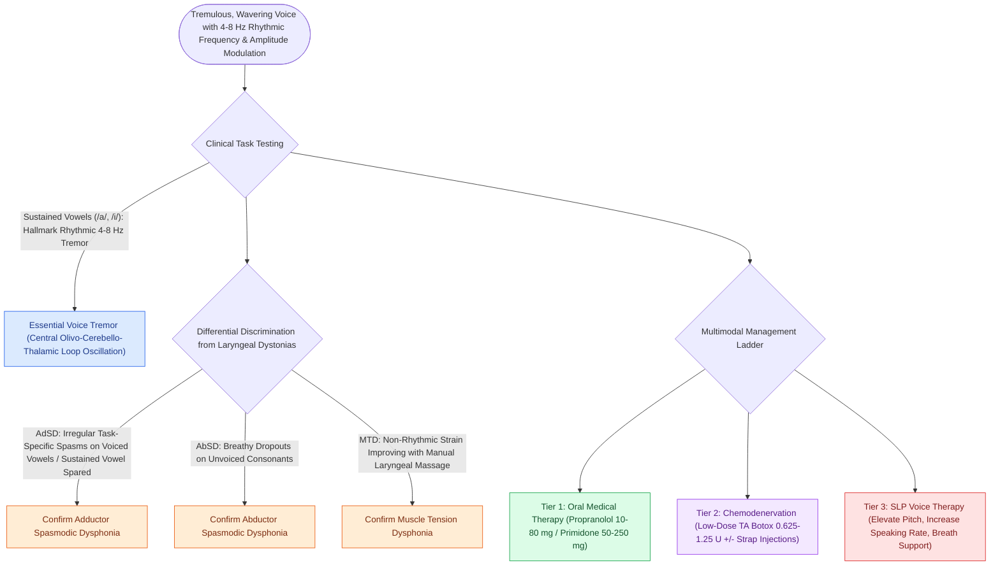

# Essential voice tremor causes rhythmic four to eight Hertz phonatory oscillations treated with propranolol, primidone, and botulinum toxin

## Active Recall

> [!question]- What is the characteristic frequency of vocal fold oscillation in essential voice tremor, and during which phonatory task is it most pronounced?
> *Answer / Clinical Rationale*: **$4\text{–}8\text{ Hz}$ rhythmic modulation**, which is most pronounced during **sustained vowel phonation (`/a/`, `/i/`)**.

> [!question]- How is essential voice tremor differentiated from adductor spasmodic dysphonia on clinical voice testing?
> *Answer / Clinical Rationale*: **EVT is rhythmic ($4\text{–}8\text{ Hz}$) and most severe during sustained vowels**, whereas **ADSD causes irregular phonatory breaks on voiced connected speech** (e.g., counting 80–89) with relative sparing of sustained vowels, whispering, and singing.

> [!question]- What are the first-line oral medical therapies and chemodenervation options for essential voice tremor?
> *Answer / Clinical Rationale*: Oral **propranolol** and **primidone**; chemodenervation consists of **Botulinum toxin A injection into the thyroarytenoid muscles** ($\pm$ strap muscles if vertical laryngeal bobbing is present).

## Core Clinical & Mechanistic Principles
**Essential Voice Tremor (EVT)** is an action-induced, central neurological movement disorder characterized by involuntary, rhythmic oscillations of the phonatory apparatus:

- **Neurophysiology & Tremor Frequency**:
  - EVT produces regular, rhythmic **$4\text{–}8\text{ Hz}$ modulations in fundamental frequency ($F_0$ / pitch) and amplitude (intensity)** during active phonation.
  - It is driven by abnormal central oscillatory networks in the **olivo-cerebello-thalamo-cortical loop**.
  - May occur as an isolated focal dystonic tremor or as part of generalized essential tremor ($>50\%$ have concomitant hand or head tremor).

- **Clinical Assessment & Differential Diagnosis**:
  - **Sustained Vowel Phonation (`/a/`, `/i/`)**: The **hallmark diagnostic test** for EVT. The $4\text{–}8\text{ Hz}$ rhythmic tremor is most prominent, regular, and easily heard on sustained vowels.
  - **Connected Speech**: Often sounds like a tremulous, wavering vocal quality, which can sometimes be masked by rapid conversational speech rates.
  - **Differentiation from Spasmodic Dysphonia (SD) & Muscle Tension Dysphonia (MTD)**:
    - *[[Adductor spasmodic dysphonia causes strained voice breaks treated with thyroarytenoid Botox|Adductor Spasmodic Dysphonia (ADSD)]]*: Exhibits task-specific **irregular phonatory breaks / strangles** during voiced sound production (e.g., counting from "80 to 89"), with **near-normal voice on sustained vowels**, falsetto, laughing, or singing.
    - *[[Abductor spasmodic dysphonia causes breathy voice breaks treated with PCA Botox|Abductor Spasmodic Dysphonia (ABSD)]]*: Exhibits sudden **breathy voice drop-outs** during voiceless consonant transitions (e.g., counting from "60 to 69").
    - *Muscle Tension Dysphonia (MTD)*: Non-rhythmic, continuous supraglottic squeezing without regular $4\text{–}8\text{ Hz}$ modulation; improves with manual circumlaryngeal massage.

### Medical, Pharmacological & Chemodenervation Management
1. **First-Line Pharmacotherapy**:
   - **Propranolol**: Non-selective beta-adrenergic blocker ($10\text{–}80\text{ mg}$ daily); reduces peripheral adrenergic tremor component (effective in $40\text{–}50\%$ of patients).
   - **Primidone**: Anticonvulsant ($50\text{–}250\text{ mg}$ nightly); potent centrally acting tremor suppressant.
2. **Targeted Botulinum Toxin A Injection**:
   - **Intrinsic Laryngeal Injection**: Bilateral or unilateral **thyroarytenoid (TA) muscle injections ($0.625\text{–}2.5\text{ units}$ per cord)** to weaken glottic adductory tremor.
   - **Extrinsic Strap Muscle Injections**: In patients with prominent vertical laryngeal bobbing / excursion, inject the sternohyoid and thyrohyoid muscles.
3. **Voice Therapy**: SLP-directed pitch elevation (tremor is less audible at higher frequencies), increased speaking rate, and abdominal breath support.

## Connected Concepts & Graph Traversal
- **Adductor Spasmodic Dysphonia**: [[Adductor spasmodic dysphonia causes strained voice breaks treated with thyroarytenoid Botox|ADSD Differentiation & TA Botox]]
- **Abductor Spasmodic Dysphonia**: [[Abductor spasmodic dysphonia causes breathy voice breaks treated with PCA Botox|ABSD Differentiation & PCA Botox]]
- **Muscle Tension Dysphonia**: [[Muscle tension dysphonia arises from supraglottic hyperfunction and responds to circumlaryngeal voice therapy|Muscle Tension Dysphonia (MTD)]]
- **Thyroarytenoid Neuromuscular Craft**: [[The thyroarytenoid muscle modulates glottal stiffness and adduction|Thyroarytenoid Functional Anatomy]]
- **Videostroboscopy Diagnostics**: [[Videostroboscopy visualizes mucosal wave dynamics and glottal closure|Videostroboscopic Evaluation]]
- **Differential Diagnosis**: [[Oculopalatopharyngeal myoclonus causes continuous one to three Hertz branchial contractions persisting in sleep due to Guillain-Mollaret triangle disruption|Oculopalatopharyngeal Myoclonus]]
