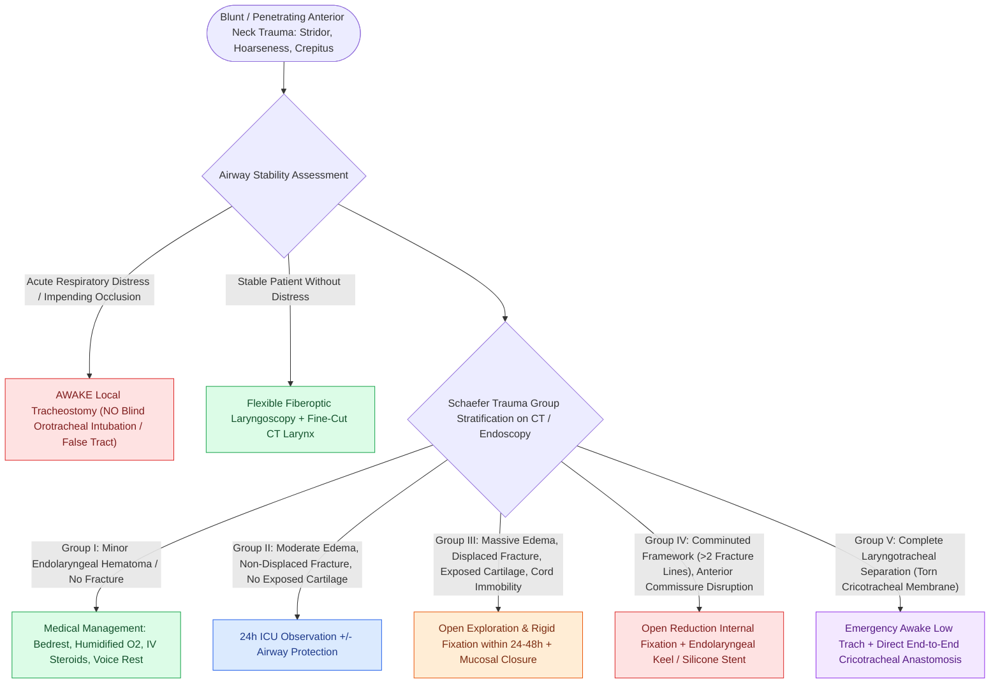

# External laryngeal trauma is staged by the Schaefer classification directing tracheostomy and open repair

## Active Recall

> [!question]- Why is orotracheal intubation specifically dangerous in suspected laryngotracheal separation?
> *Answer / Clinical Rationale*: The tube can convert partial separation to complete, pass into a false passage, and destroy the remaining airway — awake tracheostomy below the injury is the doctrine.

> [!question]- Which findings promote a Schaefer II to a III?
> *Answer / Clinical Rationale*: Exposed cartilage in a mucosal tear, a displaced fracture, or vocal fold immobility — each mandates open repair rather than observation.

## Core Clinical & Mechanistic Principles
- **Schaefer groups**: I minor hematoma/laceration without fracture; II edema/hematoma or minor mucosal disruption without exposed cartilage, nondisplaced fracture; III massive edema, mucosal tears with exposed cartilage, displaced fracture, or cord immobility; IV group III with two or more fracture lines or anterior commissure/massive instability; V complete laryngotracheal separation.
- Hard warning signs: subcutaneous emphysema, loss of laryngeal landmarks/crepitus, hemoptysis, dysphonia-to-aphonia progression, stridor — a deceptively comfortable patient can occlude within hours as edema matures.
- **Airway doctrine: awake [[Standard open tracheotomy utilizes horizontal intersinusoidal or Bjork flap entry|tracheostomy]] under local** for unstable groups; endotracheal intubation risks completing a partial laryngotracheal separation or creating false passage — the tube is the enemy of the fractured larynx.
- Sequence: secure airway → flexible laryngoscopy → CT (only in the stable) → panendoscopy with esophagoscopy (concomitant esophageal injury travels with penetrating and high-energy blunt trauma).

### Management & Critical Safety Checks
- Groups I-II: humidified air, head elevation, steroids, reflux prophylaxis, serial exams. Groups III-V: **open exploration and repair within 24-48 hours** — mucosal closure, fracture fixation (miniplates), stenting only for anterior commissure disruption or unstable frameworks (group IV-V).
- Late repair is the enemy of voice and airway: granulation, stenosis, and fixed cords are the price of delay.

## Connected Concepts & Graph Traversal
- **Airway Fire & Safety**: [[Airway fire prevention requires FiO2 below 30 percent and laser-safe tubes|Airway Fire Safety]]
- **Open Tracheostomy Rescue**: [[Open tracheostomy provides superior exposure and stay suture placement compared to percutaneous technique|Open Tracheostomy]]
- **Cricoarytenoid Dislocation**: [[The cricoarytenoid joint moves via coupled rocking and sliding|Cricoarytenoid Joint]]
- **Broyles Ligament Avulsion**: [[Broyles' ligament anchors the vocal ligament to thyroid cartilage|Broyles' Ligament]]
- **High-Stakes Rescue**: [[High-stakes laryngeal complications require proactive landmarking and rescue protocols|Laryngeal Rescue Protocols]]
