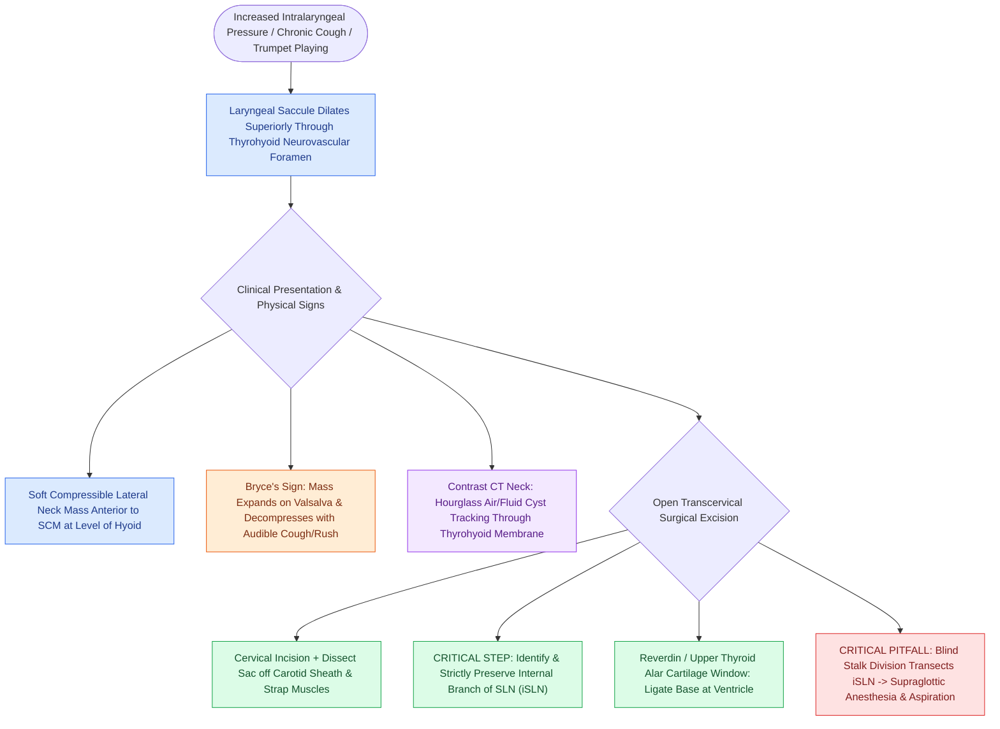

# External laryngoceles herniate through the thyrohyoid membrane into the lateral neck

## Active Recall

> [!question]- Through which anatomical structure does an external laryngocele herniate to enter the neck?
> *Answer / Clinical Rationale*: Through the **thyrohyoid membrane**, at the neurovascular aperture where the internal branch of the superior laryngeal nerve and superior laryngeal vessels enter the larynx.

> [!question]- What physical examination sign is pathognomonic for an external air-filled laryngocele?
> *Answer / Clinical Rationale*: **Bryce's sign**; a lateral cervical mass that expands noticeably during a Valsalva maneuver or sustained coughing, and decompresses with manual palpation.

## Core Clinical & Mechanistic Principles
An **External Laryngocele** (or the external component of a **mixed/combined laryngocele**) is an abnormal dilation of the [[Internal laryngoceles present as supraglottic masses medial to thyroid cartilage|laryngeal saccule]] that has expanded superiorly and herniated **out of the laryngeal framework through the thyrohyoid membrane** into the lateral neck.

### Path of Herniation & Anatomical Relations
- **Herniation Portal**: The saccule expands upward and penetrates through the **thyrohyoid membrane** at the specific neurovascular aperture where the [[The superior laryngeal nerve provides supraglottic sensation and cricothyroid motor control|internal branch of the superior laryngeal nerve (iSLN)]] and superior laryngeal artery pierce the membrane.
- **Physical Presentation**: Presents as a soft, non-tender, smooth, **compressible lateral neck mass** located anterior to the sternocleidomastoid muscle at the level of the [[Suprahyoid Montgomery release mobilizes the larynx to reduce anastomotic tension|hyoid bone]].
- **Valsalva Expansion (Bryce's Sign)**: The mass characteristically **expands during positive-pressure maneuvers** (coughing, trumpet/glass-blowing, Valsalva) and can be decompressed with manual pressure (often accompanied by an audible rush of air or sudden cough as air/mucus decompresses into the airway).

## Diagnostic & Radiographic Findings
- **Contrast-Enhanced CT Neck**: Gold standard imaging; demonstrates an air- or fluid-filled cystic lesion in the lateral neck with a narrow "hourglass stalk" tracking through the thyrohyoid membrane into the supraglottic [[The paraglottic space facilitates transglottic tumor spread|paraglottic space]].

## Surgical Management
- **Open Transcervical Excision**:
  - Horizontal skin crease incision over the thyrohyoid membrane.
  - Subplatysmal flap elevation; retract strap muscles.
  - Carefully dissect the external cyst sac off the carotid sheath and strap muscles.
  - **Identify and preserve the internal branch of the superior laryngeal nerve (iSLN)** and superior laryngeal vessels as they traverse the thyrohyoid membrane adjacent to the neck of the sac.
  - Create a window in the upper third of the [[Thyroplasty cartilage window dimensions differ between males and females|thyroid cartilage alar lamina]] to follow the stalk down to its origin at the laryngeal ventricle, ligating the base flush with the mucosa.

## Critical Failure Modes & Error Traps
- **iSLN Laceration**: Dividing the stalk blindly at the thyrohyoid membrane without identifying the iSLN results in permanent supraglottic anesthesia and chronic aspiration.

## Connected Concepts & Graph Traversal
- **Internal Counterpart**: [[Internal laryngoceles present as supraglottic masses medial to thyroid cartilage|Internal Laryngoceles]]
- **Protected Neuroanatomy**: [[The superior laryngeal nerve provides supraglottic sensation and cricothyroid motor control|Internal Branch of Superior Laryngeal Nerve (iSLN)]]
- **Mandatory Biopsy Rule**: [[Adult-onset laryngoceles require ventricular biopsy to rule out occult SCC|Ventricular Biopsy for Occult Carcinoma]]
- **Anatomical Space**: [[The paraglottic space facilitates transglottic tumor spread|Paraglottic Space]]
- **Clinical Management**: [[Thyroplasty cartilage window dimensions differ between males and females|Thyroplasty Window Dimensions]]
