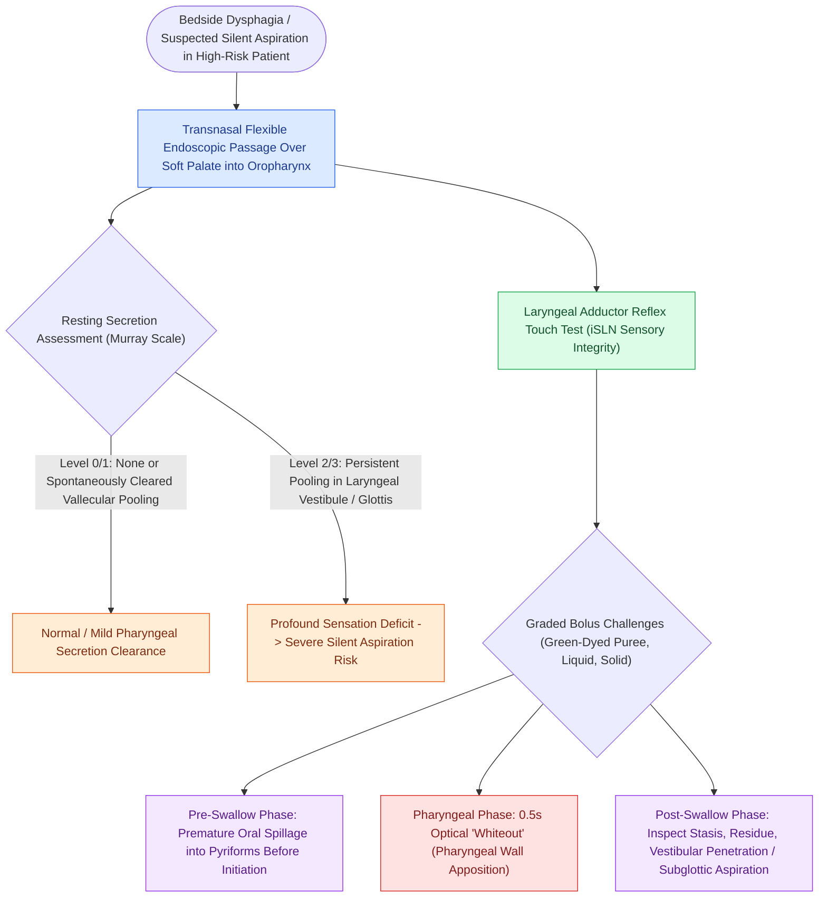

# FEES assesses pharyngeal secretions and aspiration under direct vision

## Active Recall

> [!question]- What is the primary technical limitation of FEES during the pharyngeal phase of swallowing?
> *Answer / Clinical Rationale*: **Pharyngeal "whiteout"**; bolus transit and epiglottic retroflexion cause the pharyngeal mucosa to contact the lens, temporarily obscuring visualization for ~0.5 seconds during the actual swallow.

> [!question]- What does a Murray Secretion Scale Level 3 indicate?
> *Answer / Clinical Rationale*: Severe, un-cleared secretional pooling directly within the **laryngeal vestibule and glottic aperture**, signifying profound sensory/motor deficits and a very high risk of silent aspiration.

## Core Clinical & Mechanistic Principles
**Fiberoptic Endoscopic Evaluation of Swallowing (FEES)** (first described by Susan Langmore in 1988) is a portable, bedside endoscopic diagnostic procedure that provides direct optical visualization of the pharyngeal and laryngeal anatomy before, during, and after deglutition.

### Evaluative Metrics & The Murray Secretion Scale
1. **Resting Secretion Assessment**:
   - Quantified using the **Murray Secretion Scale**:
     - *Level 0*: Normal; no secretions in pyriforms or laryngeal vestibule.
     - *Level 1*: Secretions transiently pooling in valleculae / pyriform sinuses, clearing spontaneously.
     - *Level 2*: Secretions pooling in valleculae / pyriforms with delayed clearing, or transient laryngeal vestibule entry.
     - *Level 3*: Profound, continuous pooling in the laryngeal vestibule and glottis with absent clearing (*high risk of [[The Rosenbek Scale standardizes the depth of airway penetration and aspiration|silent aspiration]]*).
2. **Structural & Sensorimotor Evaluation**:
   - Evaluates vocal fold mobility, base of tongue retraction, pharyngeal squeeze, and [[The superior laryngeal nerve provides supraglottic sensation and cricothyroid motor control|iSLN]] laryngeal adductor sensory reflex (touch test).
3. **Bolus Testing**: Administers real food consistencies (puree, nectar-thick, thin liquid, solids) tinted with green/blue food coloring.

## Clinical Strengths vs Limitations
- **Strengths**:
  - Performed at the bedside without ionizing radiation exposure.
  - Utilizes real food and liquid boluses.
  - Directly assesses laryngeal mucosal anatomy, secretions, and vocal fold paralysis.
- **The "Whiteout" Limitation**: During the actual pharyngeal transit phase, the pharyngeal walls and base of tongue collapse against the endoscope tip, causing a brief $0.5\text{-second}$ optical "whiteout." Events occurring strictly during this instant cannot be seen directly, requiring inference from post-swallow residue or complementary [[VFSS provides continuous radiographic evaluation of all deglutition phases|Videofluoroscopic Swallow Study (VFSS)]].

## Connected Concepts & Graph Traversal
- **Radiographic Deglutition Partner**: [[VFSS provides continuous radiographic evaluation of all deglutition phases|Videofluoroscopic Swallow Study (VFSS)]]
- **Standardized Aspiration Scale**: [[The Rosenbek Scale standardizes the depth of airway penetration and aspiration|Rosenbek Penetration-Aspiration Scale]]
- **Neurological Etiology**: [[Unilateral vocal fold paralysis causes glottic insufficiency, breathiness, and aspiration|Unilateral Vocal Fold Paralysis (UVFP)]]
- **Sensory Innervation Assessed**: [[The superior laryngeal nerve provides supraglottic sensation and cricothyroid motor control|Internal Branch of Superior Laryngeal Nerve (iSLN)]]
- **Associated Pathology**: [[Zenker's diverticulum herniates through Killian's triangle due to elevated pulsion pressure|Zenker's Diverticulum]]
