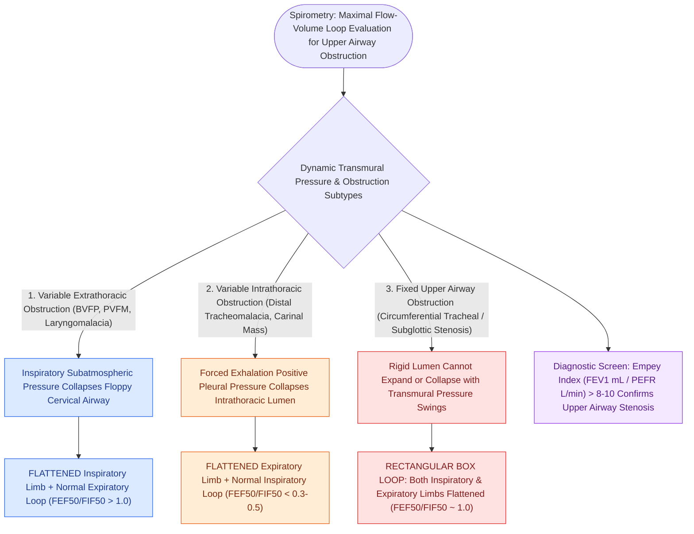

# Flow-volume loops differentiate fixed, variable extrathoracic, and variable intrathoracic upper airway obstruction

## Active Recall

> [!question]- How do the flow-volume loop contours differ among variable extrathoracic, variable intrathoracic, and fixed upper airway obstructions?
> *Answer / Clinical Rationale*: - **Variable Extrathoracic Obstruction (e.g., Bilateral vocal fold paralysis, vocal cord dysfunction, laryngomalacia)**: **Flattened inspiratory limb** with a normal, preserved expiratory curve. (During inspiration, intratracheal pressure falls below atmospheric pressure, causing compliant extrathoracic airway collapse). - **Variable Intrathoracic Obstruction (e.g., Distal tracheal tumor, tracheomalacia in chest)**: **Flattened expiratory limb** with a normal, preserved inspiratory curve. (During forced expiration, positive pleural pressure exceeds intratracheal pressure, collapsing the intrathoracic airway). - **Fixed Airway Obstruction (e.g., Circumferential tracheal stenosis, bulky thyroid goiter, subglottic stenosis)**: **Flattening of BOTH inspiratory and expiratory limbs** because a rigid, non-compliant stenosis does not change caliber with respiratory transmural pressure swings.

> [!question]- What quantitative spirometric ratio (Empey index / FIF50 ratio) defines upper airway obstruction?
> *Answer / Clinical Rationale*: - **Empey Index**: $\frac{\text{FEV}_1\text{ (mL)}}{\text{PEFR}\text{ (L/min)}} > 8\text{–}10$ strongly suggests upper airway obstruction. - **$\text{FEF}_{50} / \text{FIF}_{50}$ (Mid-vital capacity ratio)**: - *Variable Extrathoracic*: $>1.0$ (due to marked reduction in $\text{FIF}_{50}$). - *Variable Intrathoracic*: $<0.3\text{–}0.5$ (due to marked reduction in $\text{FEF}_{50}$). - *Fixed Obstruction*: Approximately $1.0$ (both $\text{FEF}_{50}$ and $\text{FIF}_{50}$ equally depressed).

> [!question]- Why is inspiratory stridor characteristic of extrathoracic lesions whereas expiratory wheeze/stridor indicates intrathoracic lesions?
> *Answer / Clinical Rationale*: The cervical trachea is exposed to **ambient atmospheric pressure**, so negative airway pressure generated on inspiration draws floppy tissues inward, worsening obstruction and creating **inspiratory stridor**. The intrathoracic trachea is surrounded by **pleural pressure**, so forced exhalation increases external pleural pressure, narrowing the intrathoracic lumen and producing **expiratory stridor/wheezing**.

## Core Clinical & Mechanistic Principles
Spirometric **Maximal Flow-Volume Loops (MFVL)** provide a non-invasive functional dynamic assessment of dynamic vs fixed airflow limitation across the upper respiratory tract:

### High-Yield Surgical Considerations
- **Misdiagnosis as Refractory Asthma**: Patients with [[Bilateral abductor vocal fold paralysis causes acute airway compromise requiring glottic enlargement|bilateral vocal fold paralysis]] or post-intubation tracheal stenosis are frequently misdiagnosed with asthma for months; an abnormal flow-volume loop demonstrating a flattened inspiratory or expiratory plateau immediately points to an upper aerodigestive tract structural lesion.

## Connected Concepts & Graph Traversal
- **Laryngeal Immobility**: [[Bilateral abductor vocal fold paralysis causes acute airway compromise requiring glottic enlargement|Bilateral Vocal Fold Paralysis Management]]
- **Subglottic Stenosis**: [[The Cotton-Myer classification grades subglottic stenosis by luminal reduction|Cotton-Myer Grading]]
- **Difficult Airway**: [[Airway assessment classifications predict difficult direct laryngoscopy using anatomical landmarks|Airway Classifications]]
- **🔗 Pediatric Airway Softness (Pediatrics)**: [[Laryngomalacia is the most common cause of congenital pediatric stridor characterized by dynamic supraglottic collapse|Laryngomalacia Dynamics]]
- **Surgical Tracheostomy**: [[Standard open tracheotomy utilizes horizontal intersinusoidal or Bjork flap entry|Surgical Tracheotomy]]
