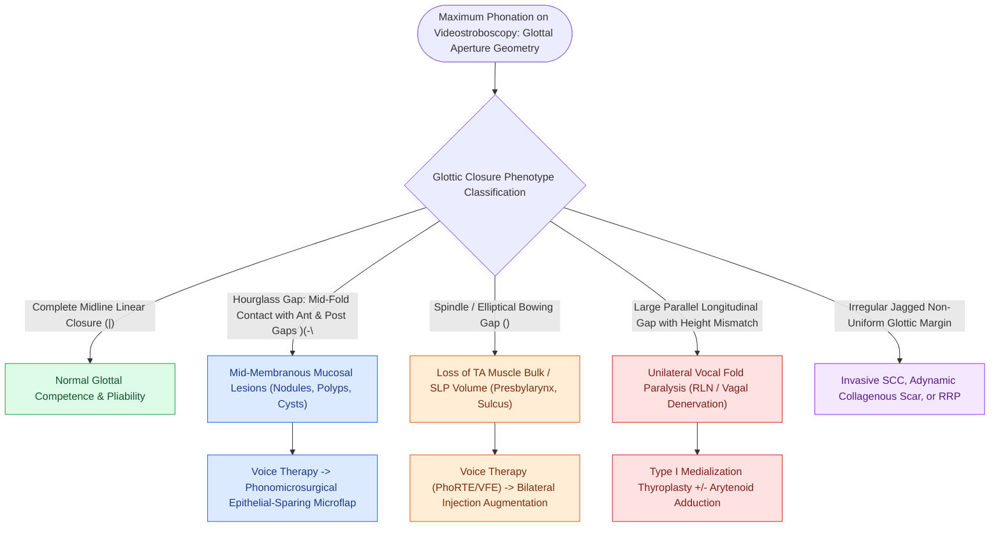

# Glottal closure patterns identify specific laryngeal biomechanical deficits

## Active Recall

> [!question]- What glottal closure configuration is pathognomonic for bilateral vocal fold nodules?
> *Answer / Clinical Rationale*: An **hourglass closure pattern**, where the mid-membranous nodular swellings make contact first, leaving open gaps both anteriorly and posteriorly.

> [!question]- What anatomical deficit produces a spindle-shaped (elliptical) glottic gap?
> *Answer / Clinical Rationale*: Mid-membranous volume loss or atrophy, characteristic of presbylarynx, sulcus vocalis, or denervation atrophy of the [[The thyrovocalis muscle provides isometric pitch and tension control|thyrovocalis muscle]].

## Core Clinical & Mechanistic Principles
During maximum phonatory adduction on [[Videostroboscopy visualizes mucosal wave dynamics and glottal closure|videostroboscopy]], the configuration of the glottic aperture reflects the underlying neuromuscular, structural, and mucosal state of the vocal folds.

### Classic Glottal Closure Phenotypes
| Closure Pattern | Schematic Configuration | Underlying Biomechanical / Pathological Mechanism | Classic Clinical Etiologies |
| :--- | :--- | :--- | :--- |
| **Complete Closure** | `|` (No residual gap) | Normal adductor tone and intact mucosal pliability. | Healthy adult phonation. |
| **Hourglass Gap** | `)(` (Contact at mid-fold; anterior and posterior gaps) | Mid-membranous mucosal mass prevents full anterior/posterior closure. | Vocal fold nodules, large polyps, or cysts. |
| **Spindle / Bowing Gap** | `()` (Contact at anterior commissure and vocal processes; elliptical mid-gap) | Loss of muscle bulk or lamina propria volume in mid-vocal fold. | Presbylarynx (vocal fold atrophy), sulcus vocalis, or chronic TA paresis. |
| **Posterior Chink** | `/ \` (Membranous closure; open posterior cartilaginous gap) | Normal female anatomical variant or incomplete IA / LCA adduction. | Normal female phonation, mild muscle tension dysphonia. |
| **Irregular / Asymmetric** | Non-uniform jagged gap | Irregular mucosal margin, deep scar tethering, or malignant exophytic mass. | Glottic carcinoma, severe vocal fold scar, or RRP. |
| **Large Longitudinal Gap** | Parallel wide gap | Denervation of LCA, TA, and IA muscles with arytenoid lateralization. | Unilateral vocal fold paralysis (UVFP). |

**Key Links**: [[Vocal fold nodules are bilateral mid-membranous lesions treated with voice therapy|Nodules]] · [[Vocal fold polyps arise from phonotraumatic microvascular injury in Reinke's space|Polyps]] · [[Epidermoid cysts adhere to the vocal ligament and require sharp dissection|Cysts]] · [[Sulcus vocalis manifests as mucosal furrowing staged by the Ford classification|Sulcus vocalis]] · [[The thyroarytenoid muscle modulates glottal stiffness and adduction|TA muscle]] · [[The interarytenoid muscle closes the posterior glottic chink|IA muscle]] · [[The lateral cricoarytenoid is the primary membranous fold adductor|LCA muscle]] · [[Vocal fold scar results from disorganized Type I collagen deposition|Vocal fold scar]] · [[Recurrent respiratory papillomatosis is caused by HPV and managed with serial debulking|RRP]] · [[Unilateral vocal fold paralysis causes glottic insufficiency, breathiness, and aspiration|UVFP]]

## Clinical & Surgical Decision Making
- **Hourglass Gap**: Points directly to localized mucosal pathology, treated with voice therapy or [[Phonomicrosurgery requires suspension laryngoscopy and stereoscopic magnification|phonomicrosurgery]].
- **Spindle Gap / Bowing**: Managed with voice therapy (vocal function exercises) or [[Injection laryngoplasty requires precise placement into lateral thyroarytenoid muscle|bilateral injection augmentation]].
- **Wide Longitudinal Gap with Vertical Discrepancy**: Indication for [[Type I thyroplasty medializes the vocal fold with conscious voice tuning|Type I medialization thyroplasty]] with or without [[Arytenoid adduction closes large posterior glottic gaps and corrects height mismatch|arytenoid adduction]].

## Critical Failure Modes & Error Traps
- **Compensatory Ventricular Phonation**: Severe true vocal fold glottal gaps often trigger compensatory hyperadduction of the false vocal cords (ventricular phonation), which obscures the underlying true vocal fold gap on standard laryngoscopy.

## Connected Concepts & Graph Traversal
- **Stroboscopic Visuals**: [[Videostroboscopy visualizes mucosal wave dynamics and glottal closure|Videostroboscopy]]
- **Adductor Muscle Mechanics**: [[The lateral cricoarytenoid is the primary membranous fold adductor|Lateral Cricoarytenoid]]
- **Posterior Chink Adduction**: [[The interarytenoid muscle closes the posterior glottic chink|Interarytenoid Muscle]]
- **Vocal Fold Bowing / Atrophy**: [[Presbyphonia reflects vocal fold atrophy and bowing managed with therapy before augmentation|Presbyphonia]]
- **Unilateral Paralysis Deficit**: [[Unilateral vocal fold paralysis causes glottic insufficiency, breathiness, and aspiration|Unilateral Vocal Fold Paralysis]]
