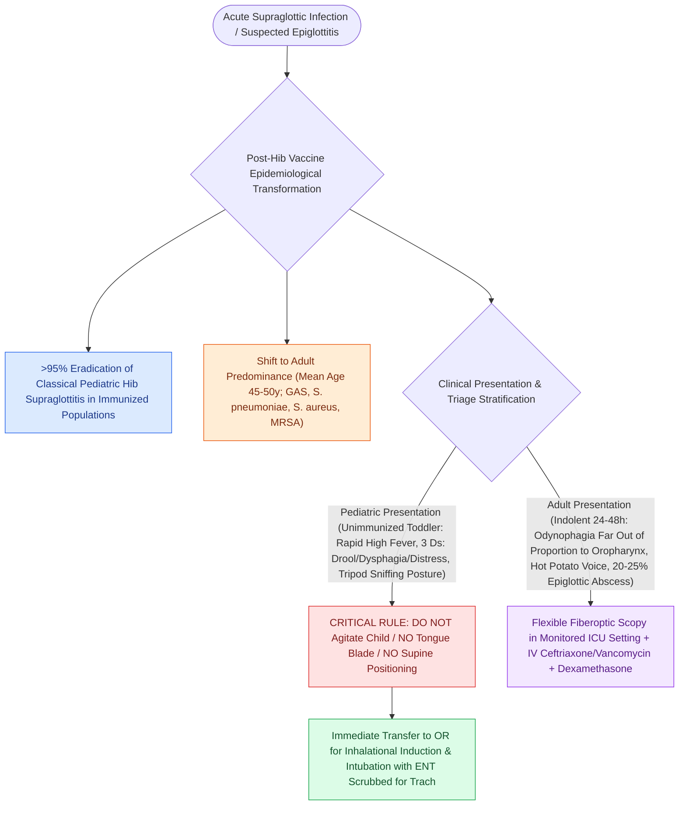

# Haemophilus influenzae type b vaccination dramatically reduced pediatric epiglottitis incidence

## Active Recall

> [!question]- How has the primary microbiology of acute epiglottitis evolved since the introduction of the Hib conjugate vaccine?
> *Answer / Clinical Rationale*: While *Haemophilus influenzae* type b caused >85% of cases historically, modern adult epiglottitis is predominantly caused by **Streptococcus species (Group A Streptococcus and S. pneumoniae)** and **Staphylococcus aureus (including MRSA)**, as well as non-typeable *H. influenzae*.

> [!question]- Why is a tongue blade examination strictly contraindicated in a toddler suspected of having acute epiglottitis?
> *Answer / Clinical Rationale*: Irritation of the pharynx can trigger severe **reflex laryngospasm**, acute vagal reflex, or sudden mechanical displacement of the swollen epiglottis into the glottic aperture, causing instantaneous irreversible asphyxiation.

## Core Clinical & Mechanistic Principles
Prior to the widespread introduction of the **Haemophilus influenzae type b (Hib) conjugate vaccine** in the late 1980s, [[Acute epiglottitis presents with rapid-onset odynophagia, fever, and the tripod sign requiring immediate airway protection|acute epiglottitis]] (supraglottitis) was a classic, life-threatening pediatric emergency predominantly affecting toddlers aged 2 to 4 years. Encapsulated *H. influenzae* type b accounted for >85%–90% of all cases, causing fulminant bacteremia, profound cellulitis of the lingual surface of the epiglottis and aryepiglottic folds, and rapid fatal asphyxiation:

- **The Post-Vaccine Epidemiological Transformation**:
  - **>95% Reduction in Pediatric Cases**: Routine infant conjugate Hib vaccination nearly eradicated classical pediatric epiglottitis in immunized populations.
  - **Shift to Adult Predominance**: In the modern era, epiglottitis is primarily an adult disease (mean age 45–50 years, male-to-female ratio 2:1). Pediatric presentations now occur primarily in unimmunized children, children from regions with low vaccine penetration, or rare vaccine-failure cases.
  - **Emergence of Polymicrobial Adult Pathogens**:
    - *Streptococcus pyogenes* (Group A Streptococcus) and *Streptococcus pneumoniae* (most common adult isolates).
    - *Staphylococcus aureus* (including community-acquired MRSA).
    - Non-typeable *Haemophilus influenzae* and *Haemophilus parainfluenzae*.
    - *Pseudomonas aeruginosa* and *Candida* species (in severely immunocompromised or post-chemoradiation hosts).

- **Pediatric vs. Adult Presentation Dichotomy**:
  - **Pediatric Disease (Classical / Hyperacute)**: Sudden onset (progressing within 6–12 hours), toxic appearance, high fever, the classic **"Three Ds" (Drooling, Dysphagia, Distress)**, inspiratory stridor, and strict adoption of the **"tripod" or "sniffing" posture** (neck hyperextended, chin thrust forward).
  - **Adult Disease (Subacute / Indolent)**: Slower progression over 24–48 hours, severe odynophagia and anterior neck tenderness **dramatically out of proportion to unremarkable oropharyngeal inspection**, muffled "hot potato" voice, and a high frequency of **epiglottic abscess formation** (20%–25% of adult cases).

### Critical Safety Principles in Suspected Pediatric Cases
1. **Never Agitate the Child**: Avoid aggressive pharyngeal examination with a tongue depressor, painful venipuncture, or forcing the child into a supine position in the emergency department; sudden emotional agitation or crying can precipitate total laryngospasm and complete fatal airway closure.
2. **Transfer to Operating Room**: Definite airway examination and intubation must be conducted in the operating room with Anesthesia and Otolaryngology ready for emergent translaryngeal intubation or surgical airway.

## Connected Concepts & Graph Traversal
- **Radiologic Distinction**: [[The lateral neck thumb sign and steeple sign differentiate epiglottitis from croup on plain radiography|Thumb Sign vs Steeple Sign]]
- **Clinical Presentation**: [[Acute epiglottitis presents with rapid-onset odynophagia, fever, and the tripod sign requiring immediate airway protection|Clinical Epiglottitis Management]]
- **🔗 Differential Airway Infection (Pediatrics)**: [[Nebulized racemic epinephrine and oral dexamethasone provide rapid treatment for acute croup|Croup Pathophysiology & Therapy]]
- **Emergency Surgical Airway**: [[Standard open tracheotomy utilizes horizontal intersinusoidal or Bjork flap entry|Emergency Surgical Airway]]
- **Clinical Management**: [[Hereditary angioedema types I through III exhibit distinct C1 esterase inhibitor and C4 complement patterns|HAE Diagnostic Complement Patterns]]
