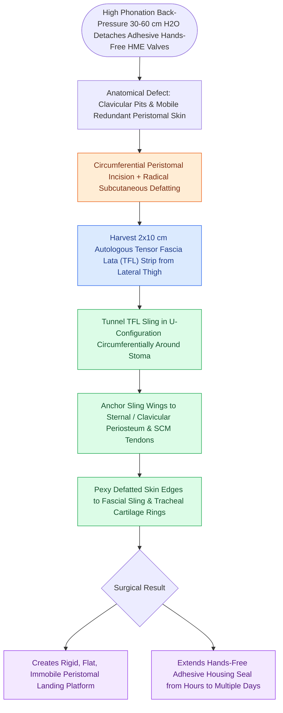

# Hands-free stomaplasty stabilizes the peristomal contour using fascia lata slings

## Active Recall

> [!question]- Why do standard adhesive hands-free speech valves frequently fail in post-laryngectomy patients?
> *Answer / Clinical Rationale*: High phonatory back-pressure ($30\text{–}60\text{ cm H}_2\text{O}$) combined with mobile, irregular, or deeply recessed peristomal skin breaks the adhesive seal, causing air leaks and housing detachment.

> [!question]- How does an autologous tensor fascia lata (TFL) sling resolve peristomal housing failure?
> *Answer / Clinical Rationale*: It provides a **rigid, flat, non-mobile fibrous foundation** anchored to the sternal and clavicular periosteum, eliminating tissue mobility and creating a secure, flat landing zone for the adhesive housing.

## Core Clinical & Mechanistic Principles
**Hands-Free Stomaplasty** is an advanced reconstructive surgical procedure designed to create a flat, rigid, circular, and recessed peristomal contour following [[Total laryngectomy achieves en bloc laryngeal resection with permanent end-stoma|Total Laryngectomy]] to enable successful long-term attachment of **hands-free tracheostoma speech valves (HME valves)**.

### The Biomechanical Challenge of Hands-Free Speech
- **Automatic One-Way Speech Valve**: A hands-free speech valve (e.g., Provox FreeHands) remains open during quiet respiration, but automatically snaps shut under increased expiratory airflow, forcing air across the [[Tracheoesophageal puncture diverts pulmonary air through a one-way valve into the neopharynx|TEP prosthesis]] for speaking without requiring manual digital occlusion.
- **The Adhesive Seal Problem**:
  - The high back-pressure generated during phonation ($30\text{–}60\text{ cm H}_2\text{O}$) exerts intense lateral shear stress on the adhesive peristomal housing.
  - In patients with deep clavicular pits, mobile redundant neck skin, or irregular peristomal scars, adhesive housings constantly leak and detach within minutes to hours.

## Step-by-Step Surgical Technique
1. **Peristomal Incision & Defatting**: Make a circumferential incision around the tracheostoma; elevate skin flaps and resect redundant subcutaneous adipose tissue to create a uniform, flat dermal landing zone.
2. **Tensor Fascia Lata (TFL) Harvest**: Harvest a $2\text{ cm}\times 10\text{ cm}$ strip of autologous tensor fascia lata from the lateral thigh.
3. **Fascial Sling Placement**:
   - Tunnel the TFL sling circumferentially or in a U-configuration around the posterior and lateral borders of the tracheostoma.
   - Anchor the lateral wings of the sling firmly to the sternal periosteum, clavicular heads, and sternocleidomastoid tendons.
4. **Maturation**: Suture the defatted peristomal skin to the fascial sling and tracheal cartilage using interrupted nonabsorbable sutures, creating a shallow, rigid, circular landing platform.

## Primary Clinical Advantages
- Eliminates peristomal skin mobility and deep valleys.
- Extends hands-free adhesive wear time from hours to multiple days.
- Restores true spontaneous, hands-free conversational speech.

## Critical Failure Modes & Error Traps
- **Over-tightening of Sling**: Constricting the tracheal stoma with an excessively tight fascial sling causes progressive stomal stenosis, compromising resting ventilation.

## Connected Concepts & Graph Traversal
- **TEP Voice Restoration**: [[Tracheoesophageal puncture diverts pulmonary air through a one-way valve into the neopharynx|Tracheoesophageal Puncture]]
- **Total Laryngectomy En Bloc**: [[Total laryngectomy achieves en bloc laryngeal resection with permanent end-stoma|Total Laryngectomy]]
- **Periprosthetic Leak Rescue**: [[Periprosthetic TEP leaks occur around the shaft due to tissue atrophy or dilation|Periprosthetic TEP Leaks]]
- **PE Segment Tone**: [[Pharyngoesophageal segment hypertonicity causes TEP failure treated with Botox or myotomy|PE Segment Hypertonicity]]
- **Emergency Stoma Care**: [[Total laryngectomy stomas and tracheostomies require distinct emergency airway resuscitation algorithms|Stoma Emergency Algorithms]]
