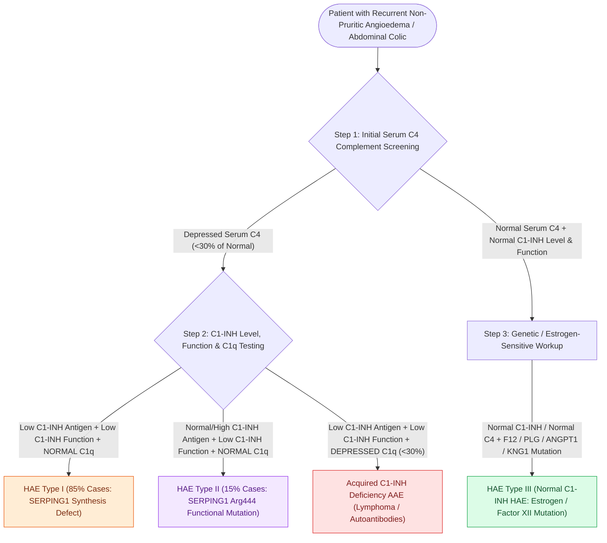

# Hereditary angioedema types I through III exhibit distinct C1 esterase inhibitor and C4 complement patterns

## Active Recall

> [!question]- How do laboratory complement panels distinguish Type I HAE, Type II HAE, and Acquired C1-INH Deficiency?
> *Answer / Clinical Rationale*: Type I HAE demonstrates low C1-INH antigenic levels, low functional activity, low C4, and normal C1q. Type II HAE displays normal or elevated C1-INH antigen with low functional activity, low C4, and normal C1q. Acquired C1-INH deficiency exhibits low C1-INH antigen/function, low C4, and characteristically **low C1q**, reflecting immune-complex complement consumption.

> [!question]- Why is a normal C4 level inadequate to completely rule out hereditary angioedema in a patient with recurrent laryngeal edema?
> *Answer / Clinical Rationale*: Type III HAE (normal C1-INH angioedema, frequently driven by *F12* or *PLG* mutations) exhibits entirely normal C4, C1-INH antigenic, and C1-INH functional levels despite severe bradykinin-mediated clinical attacks.

## Core Clinical & Mechanistic Principles
**[[Mast cell-mediated histaminergic angioedema responds rapidly to epinephrine, antihistamines, and corticosteroids|Hereditary Angioedema]] (HAE)** is an autosomal dominant disorder characterized by episodic, non-pitting, non-pruritic subepithelial and submucosal edema affecting the skin, gastrointestinal tract, and upper airway. Unlike histaminergic edema, HAE results from unregulated activation of the contact-kinin system and excessive bradykinin generation. Establishing the precise subtype through serological complement profiling is essential because clinical presentation overlaps significantly with histaminergic and acquired angioedema:

- **Complement Cascade Screening**:
  - **Serum C4 Level**: Serves as the most sensitive screening test for HAE Types I and II, persistently suppressed (<30% of normal) during attacks and depressed in >95% of patients even during quiescent baseline periods.
  - **C1-Esterase Inhibitor (C1-INH) Antigenic Level**: Quantifies the circulating protein concentration synthesized primarily by hepatocytes.
  - **C1-INH Functional Activity**: Quantifies the enzyme inhibitory activity via chromogenic or ELISA assays.
  - **C1q Protein Level**: Distinguishes congenital HAE from acquired C1-INH deficiency (AAE), as C1q is consumed exclusively in acquired lymphoproliferative or autoimmune states.

- **Subtype Differentiation**:
  1. **Type I HAE (85% of cases)**: Caused by loss-of-function mutations in *SERPING1* leading to defective protein synthesis or secretion. Laboratory evaluation demonstrates **low antigenic C1-INH (<30%)**, **low functional C1-INH**, **low C4**, and **normal C1q**.
  2. **Type II HAE (15% of cases)**: Caused by missense mutations at the *SERPING1* reactive center (arginine-444). A dysfunctional mutant protein circulates, resulting in **normal or elevated antigenic C1-INH**, **low functional C1-INH (<30%)**, **low C4**, and **normal C1q**.
  3. **Type III HAE (Normal C1-INH HAE)**: Primarily female-predominant, estrogen-sensitive disease linked to gain-of-function mutations in coagulation factor XII (*F12* gene), plasminogen (*PLG*), angiopoietin-1 (*ANGPT1*), or kininogen-1 (*KNG1*). Demonstrates **normal antigenic C1-INH**, **normal functional C1-INH**, **normal C4**, and **normal C1q**.
  4. **Acquired C1-INH Deficiency (AAE)**: Caused by autoantibodies against C1-INH or excessive consumption by monoclonal paraproteins (MGUS, B-cell lymphoma). Displays **low C1-INH antigen and function**, **low C4**, and characteristically **low C1q (<30%)**.

### Diagnostic Nuance & Estrogen Exacerbation
## References
1. LoVerde, D., Files, D.C., Krishnaswamy, G. (2017). Angioedema. *Crit Care Med*, 45(4):725-735.
2. Zuraw, B.L. (2008). Clinical practice: Hereditary angioedema. *N Engl J Med*, 359(10):1027-1036.
3. Busse, P.J., Christiansen, S.C. (2020). Hereditary Angioedema. *N Engl J Med*, 382(12):1136-1148.

## Connected Concepts & Graph Traversal
- **Physiological Basis**: [[Mast cell-mediated histaminergic angioedema responds rapidly to epinephrine, antihistamines, and corticosteroids|Angioedema Pathophysiology]]
- **Targeted Therapeutics**: [[Icatibant and ecallantide provide targeted treatment for bradykinin-mediated angioedema refractory to standard therapy|Bradykinin Targeted Rescue]]
- **Emergency Airway Protocol**: [[Awake fiberoptic intubation is the preferred airway technique for angioedema with impending obstruction|Angioedema Airway Management]]
- **Surgical Rescue**: [[Standard open tracheotomy utilizes horizontal intersinusoidal or Bjork flap entry|Emergency Surgical Airway]]
- **Differential Pathology**: [[Acute epiglottitis presents with rapid-onset odynophagia, fever, and the tripod sign requiring immediate airway protection|Supraglottic Infection Differential]]
