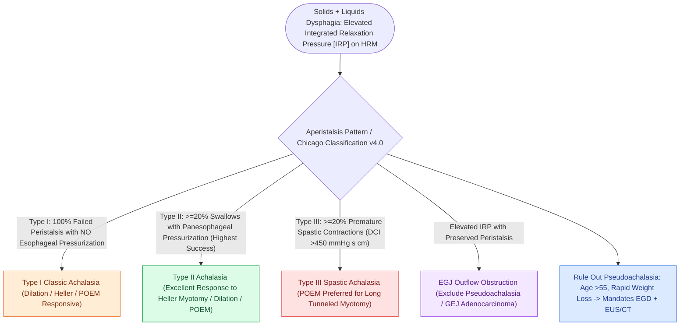

# High-resolution manometry classifies achalasia and esophageal motility disorders by the Chicago criteria

## Active Recall

> [!question]- Which achalasia subtype responds best to therapy and which worst?
> *Answer / Clinical Rationale*: Type II (panesophageal pressurization) best; type III (spastic) worst — and type III favors POEM for its adjustable myotomy length.

> [!question]- What clinical triad forces exclusion of pseudoachalasia?
> *Answer / Clinical Rationale*: Older age at onset, short symptom duration, and significant weight loss — endoscope and image the gastroesophageal junction.

## Core Clinical & Mechanistic Principles
- **Achalasia** = impaired LES relaxation (elevated integrated relaxation pressure) plus absent peristalsis, subtyped: **type I** (no pressurization), **type II** (panesophageal pressurization — best treatment response), **type III** (spastic — worst); the Chicago framework then covers EGJ outflow obstruction, absent contractility, distal esophageal spasm, and hypercontractile (jackhammer) esophagus.
- The otolaryngology-facing presentation: solids-and-liquids dysphagia from onset, regurgitation of undigested food, globus/aspiration referrals, and a bird's-beak esophagram — distinct from the solids-progressing-to-liquids pattern of mechanical stricture.
- **Pseudoachalasia** (GEJ malignancy infiltrating the plexus) mimics it — age over 55, rapid course, weight loss mandate endoscopy and often cross-sectional imaging before labeling.
- The upper sphincter corollary: cricopharyngeal dysfunction/Zenker physiology is the UES cousin — the same manometric logic, one sphincter higher.

### Management & Critical Safety Checks
- Treatment by subtype and fitness: pneumatic dilation, laparoscopic Heller [[Open diverticulectomy combines pouch resection with cricopharyngeal myotomy|myotomy]] with fundoplication, or **POEM** (peroral endoscopic myotomy — length-tailorable, ideal for type III); botulinum toxin to the LES is the frail patient's bridge.
- All effective treatments trade obstruction for reflux; surveillance for it is part of the plan.

## Connected Concepts & Graph Traversal
- **Reflux Complications**: [[Active reflux and eosinophilic esophagitis compromise airway graft survival|Reflux and Esophagitis]]
- **LPR Diagnostic Mimic**: [[Laryngopharyngeal reflux presents with globus and throat clearing but responds inconsistently to empiric PPIs|Laryngopharyngeal Reflux]]
- **Zenker's Pulsion Diverticulum**: [[Zenker's diverticulum herniates through Killian's triangle due to elevated pulsion pressure|Zenker's Diverticulum]]
- **Cricopharyngeal Myotomy**: [[Open diverticulectomy combines pouch resection with cricopharyngeal myotomy|Cricopharyngeal Myotomy]]
- **Penetration/Aspiration Grading**: [[The Rosenbek Scale standardizes the depth of airway penetration and aspiration|Rosenbek Penetration Scale]]
- **Diagnostic Evaluation**: [[Barrett esophagus manifests as salmon-colored columnar metaplasia of the distal esophagus requiring surveillance for adenocarcinoma|Barrett Esophagus Surveillance]]
