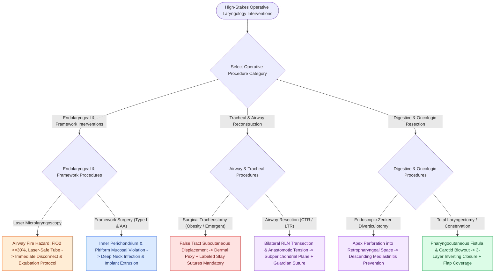

# High-stakes laryngeal complications require proactive landmarking and rescue protocols

## Active Recall

> [!question]- What is the single most critical surgical maneuver to prevent bilateral RLN injury during cricotracheal resection?
> *Answer / Clinical Rationale*: Maintaining dissection strictly in the **subperichondrial plane along the posterolateral cricoid cartilage**, which pushes the RLNs safely away from the surgical margins without dissecting into dense scar tissue.

> [!question]- What three actions must be performed immediately if subcutaneous crepitus rapidly expands following a tracheotomy?
> *Answer / Clinical Rationale*: (1) **Cut and remove all skin sutures immediately** to vent trapped gas externally, (2) **check tracheotomy tube cuff inflation and position**, and (3) **obtain an urgent chest radiograph** to rule out tension pneumothorax.

## Core Clinical & Mechanistic Principles
Surgical procedures within the larynx and upper aerodigestive tract occur in a high-stakes, shared-airway environment where subtle anatomical deviations or technical errors can lead to immediate, irreversible loss of phonation, chronic aspiration, or fatal loss of airway.

### Comprehensive Multi-Tier Complication Matrix

> [!WARNING] **Tier I: LEMG & Diagnostic Endoscopy**
> - **Procedure / Milestone**: [[Laryngeal electromyography differentiates vocal fold paralysis from joint fixation|LEMG]] & Diagnostic Endoscopy
> - **Key Anatomical Landmarks**:
>   - [[The vocal ligament comprises intermediate and deep lamina propria|Vocal ligament]] vs. [[The superficial lamina propria acts as a pliable shearing fluid bed|Reinke's space (SLP)]]
>   - [[The cricoarytenoid joint moves via coupled rocking and sliding|CA joint]] facet kinematic vector
> - **Catastrophic Failure Mode**: Misdiagnosing cricoarytenoid joint ankylosis as [[The recurrent laryngeal nerve innervates all intrinsic muscles except cricothyroid|recurrent laryngeal nerve]] paralysis.
> - **Proactive Prevention & Rescue**: Perform LEMG and intraoperative passive manual palpation of arytenoid mobility under direct [[Phonomicrosurgery requires suspension laryngoscopy and stereoscopic magnification|suspension laryngoscopy]].

> [!CAUTION] **Tier II: Phonomicrosurgical Microflap & Lasers**
> - **Procedure / Milestone**: Phonomicrosurgical Microflap Elevation
> - **Key Anatomical Landmarks**:
>   - SLP (Reinke's space) plane
>   - [[Broyles' ligament anchors the vocal ligament to thyroid cartilage|Broyles' ligament]] / anterior commissure
> - **Catastrophic Failure Mode**: Vocal ligament transection or bilateral anterior mucosal stripping causing anterior glottic web and permanent stiffness.
> - **Proactive Prevention & Rescue**: Infiltrate 1:100,000 epinephrine [[Subepithelial hydrodissection expands Reinke's space and protects the vocal ligament|hydrodissection]]; stage bilateral anterior commissure lesions 6 weeks apart; use [[The epithelial-sparing microflap preserves native mucosa and prevents glottic webbing|epithelial-sparing microflaps]].
>
> ---
>
> - **Procedure / Milestone**: Laser Microlaryngoscopy
> - **Key Anatomical Landmarks**: Airway fuel / oxidizer / ignition triad
> - **Catastrophic Failure Mode**: In-situ ignition of endotracheal tube causing catastrophic [[Airway fire prevention requires FiO2 below 30 percent and laser-safe tubes|airway fire]].
> - **Proactive Prevention & Rescue**: Reduce $\text{FiO}_2 \le 30\%$, prohibit $\text{N}_2\text{O}$, use laser-safe dual-cuffed tube with methylene blue saline, place wet patties; execute immediate fire drill extubation.

> [!IMPORTANT] **Tier III: Framework Surgery & Neurolaryngology**
> - **Procedure / Milestone**: [[Type I thyroplasty medializes the vocal fold with conscious voice tuning|Type I Medialization Thyroplasty]]
> - **Key Anatomical Landmarks**: [[Thyroplasty cartilage window dimensions differ between males and females|Gender-specific window landmarks]], inner perichondrium
> - **Catastrophic Failure Mode**: Perforating inner perichondrium causing airway communication, implant infection, extrusion, or placing window too high.
> - **Proactive Prevention & Rescue**: Elevate perichondrium under conscious local anesthesia with intraoperative voice tuning; verify true vocal cord plane with flexible/70° endoscopy (see Type I thyroplasty).
>
> ---
>
> - **Procedure / Milestone**: [[Arytenoid adduction closes large posterior glottic gaps and corrects height mismatch|Arytenoid Adduction]]
> - **Key Anatomical Landmarks**: Muscular process of arytenoid, pyriform sinus hypopharyngeal mucosa
> - **Catastrophic Failure Mode**: Perforating pyriform sinus mucosa into clean neck field, causing deep neck abscess, fistula, and implant extrusion.
> - **Proactive Prevention & Rescue**: Stay strictly on cartilaginous muscular process; divide [[The posterior cricoarytenoid is the sole vocal fold abductor|PCA]]/[[The lateral cricoarytenoid is the primary membranous fold adductor|LCA]] sharply; dissect mucosal plane laterally with moist sponge (see arytenoid adduction).

> [!CAUTION] **Tier IV: Primary Surgical Airway Management**
> - **Procedure / Milestone**: Emergent & [[Defatting tracheotomy secures the airway in morbidly obese patients|Defatting Tracheotomy]]
> - **Key Anatomical Landmarks**: Pretracheal fat depth, dermal-to-tracheal pexy
> - **Catastrophic Failure Mode**: Creating pretracheal false passage and fatal loss of airway during early accidental decannulation.
> - **Proactive Prevention & Rescue**: Perform cervical lipectomy in obesity; anchor dermis to pretracheal fascia with 2-0 Vicryl; place labeled [[Tracheal stay sutures prevent false tract entry during accidental decannulation|tracheal stay sutures]] (see defatting tracheotomy).
>
> ---
>
> - **Procedure / Milestone**: Operative [[Jet ventilation requires unimpeded expiratory egress to prevent barotrauma|Jet Ventilation]]
> - **Key Anatomical Landmarks**: Glottic egress channel patency
> - **Catastrophic Failure Mode**: Firing jet pulses across an occluded lumen, causing massive barotrauma, pneumomediastinum, and tension pneumothorax.
> - **Proactive Prevention & Rescue**: Ensure completely patent, unoccluded expiratory pathway; pause jetting during dilation balloon inflation (see jet ventilation safety).

> [!WARNING] **Tier V: Complex Airway Reconstruction**
> - **Procedure / Milestone**: [[Cricotracheal resection removes subglottic stenosis while sparing posterior cricoid and RLNs|Cricotracheal Resection (CTR)]]
> - **Key Anatomical Landmarks**: Subperichondrial plane at Berry's ligament, posterior cricoid plate
> - **Catastrophic Failure Mode**: Bilateral RLN transection; devascularizing trachea; anastomotic dehiscence from tension.
> - **Proactive Prevention & Rescue**: Stay strictly subperichondrial on cricoid; limit tracheal mobilization strictly to [[Tracheal dissection is limited to the anterior 180 degrees to preserve blood supply|anterior 180°]]; perform [[Suprahyoid Montgomery release mobilizes the larynx to reduce anastomotic tension|suprahyoid release]]; place [[The guardian chin-to-chest suture prevents cervical hyperextension and anastomotic dehiscence|guardian chin-to-chest suture]] (see CTR).

> [!WARNING] **Tier VI: Hypopharyngeal Pathology & Diverticulotomy**
> - **Procedure / Milestone**: Endoscopic Zenker Diverticulotomy
> - **Key Anatomical Landmarks**: Common CP bridge, fundus of diverticulum
> - **Catastrophic Failure Mode**: Incomplete division causing dysphagia recurrence, or cutting through fundus into retropharyngeal space causing [[Subcutaneous emphysema arises when tracheotomy incisions are closed too tightly|mediastinitis]].
> - **Proactive Prevention & Rescue**: Advance stapler/laser down to within $1\text{–}2\text{ mm}$ of pouch base; obtain post-op water-soluble swallow study if fever/crepitus develops (see [[Endoscopic stapler diverticulotomy divides the cricopharyngeal bar and seals mucosa|stapler diverticulotomy]]).

> [!CAUTION] **Tier VII: Conservation & Total Laryngectomy**
> - **Procedure / Milestone**: Conservation & [[Total laryngectomy achieves en bloc laryngeal resection with permanent end-stoma|Total Laryngectomy]]
> - **Key Anatomical Landmarks**: $\ge 1$ mobile arytenoid in SCPL, 3-layer pharyngeal closure
> - **Catastrophic Failure Mode**: Intractable aspiration; [[Pharyngeal reconstruction requires a three-layer closure to prevent fistula|pharyngocutaneous fistula]]; carotid blowout.
> - **Proactive Prevention & Rescue**: Strict pulmonary candidacy ($\text{FEV}_1 > 50\%$); perform inverting 3-layer mucosal closure; vascularized flap coverage in irradiated necks (see pharyngeal reconstruction).

## Connected Concepts & Graph Traversal
- **Tracheoinnominate Fistula Emergency**: [[Tracheoinnominate fistula presents with sentinel bleeding requiring hyperinflation tamponade and emergency surgical ligation|Tracheoinnominate Fistula]]
- **Airway Fire Prevention**: [[Airway fire prevention requires FiO2 below 30 percent and laser-safe tubes|Airway Fire Protocols]]
- **Subcutaneous Emphysema Risk**: [[Subcutaneous emphysema arises when tracheotomy incisions are closed too tightly|Subcutaneous Emphysema]]
- **Guardian Chin-to-Chest Suture**: [[The guardian chin-to-chest suture prevents cervical hyperextension and anastomotic dehiscence|Guardian Suture]]
- **Stoma vs Trach Resuscitation**: [[Total laryngectomy stomas and tracheostomies require distinct emergency airway resuscitation algorithms|Emergency Airway Resuscitation]]
