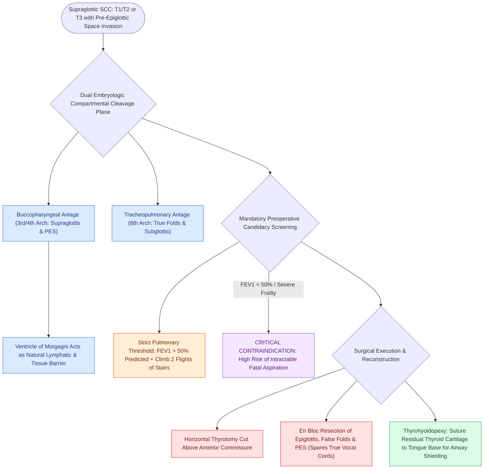

# Horizontal supraglottic laryngectomy resects supraglottic cancer while preserving vocal folds

## Active Recall

> [!question]- What is the embryologic basis that permits horizontal supraglottic laryngectomy without removing the true vocal folds?
> *Answer / Clinical Rationale*: The supraglottis develops from the **buccopharyngeal anlage (3rd/4th branchial arches)**, while the glottis develops from the **tracheopulmonary anlage (6th arch)**; because their lymphatic and mucosal systems are separated by the laryngeal ventricle, early supraglottic cancers respect this horizontal boundary without invading the true vocal cords.

> [!question]- What pulmonary function threshold is mandatory prior to clearing a patient for HSL?
> *Answer / Clinical Rationale*: **$\text{FEV}_1 > 50\%$ of predicted value** and adequate functional exercise tolerance (climbing 2 flights of stairs), required to tolerate post-operative supraglottic swallow rehabilitation.

## Core Clinical & Mechanistic Principles
**Horizontal Supraglottic Laryngectomy (HSL)** (first described by Alonso in 1947) is an open conservation laryngeal surgery designed to achieve en bloc oncologic resection of supraglottic squamous cell carcinomas (T1, T2, and selected T3 tumors with [[The pre-epiglottic space enables rapid supraglottic cancer spread|pre-epiglottic space]] invasion) while **completely preserving the true vocal folds, bilateral cricoarytenoid units, and baseline phonatory function**.

### Embryologic Rationale & Natural Barriers
- **Dual Embryologic Origin**: As established by Tucker and Bocca, the supraglottis arises from the **buccopharyngeal anlage (3rd and 4th branchial arches)**, whereas the glottis and subglottis arise from the **tracheopulmonary anlage (6th branchial arch)** (see [[The laryngeal ventricle separates supraglottic and glottic lymphatic pathways|embryologic boundary at the ventricle]]).
- **The Ventricle Barrier**: Supraglottic carcinomas respect the floor of the laryngeal ventricle and anterior commissure early in their course, allowing a horizontal oncologic plane of cleavage above the true vocal cords.

## Mandatory Physiological Candidacy Thresholds
Because supraglottic resection temporarily compromises airway protection during deglutition, patients must meet strict physiological criteria:
1. **Pulmonary Reserve**: Forced Expiratory Volume in 1 second (**$\text{FEV}_1 > 50\%$ predicted**); independent ability to climb two flights of stairs without stopping.
2. **Cognitive & General Status**: Intact cognitive function, absent severe neurodegenerative disorders, and age typically $<70$ (relative).
3. **Contraindications**: Tumor extension onto the true vocal folds, anterior commissure, [[Cricotracheal resection removes subglottic stenosis while sparing posterior cricoid and RLNs|cricoid cartilage]], or fixed arytenoid.

## Step-by-Step Surgical Execution
1. **Exposure**: Apron incision; elevate subplatysmal flap; retract strap muscles.
2. **Hyoid Skeletonization**: Detach suprahyoid muscles from the superior rim of the hyoid bone (see [[Suprahyoid Montgomery release mobilizes the larynx to reduce anastomotic tension|suprahyoid release]]).
3. **Thyrotomy Cuts**: Make a horizontal saw cut across the [[Thyroplasty cartilage window dimensions differ between males and females|thyroid cartilage lamina]] at the junction of the upper half and lower half (above the anterior commissure).
4. **Pharyngeal Entry**: Enter the pharynx via the **vallecula or contralateral pyriform sinus**; pull the epiglottis forward.
5. **Horizontal Resection**: Under direct visualization, transect horizontally across the laryngeal ventricles immediately superior to the true vocal cords, removing the supraglottis en bloc.
6. **Reconstruction (Thyrohyoidopexy / Pexy)**: Suture the remaining lower half of the thyroid cartilage directly to the base of tongue using heavy nonabsorbable sutures (e.g., 0-Vicryl or 0-Prolene) to elevate and shield the true vocal folds.

## Critical Failure Modes & Error Traps
- **Intractable Aspiration**: Performing HSL on a patient with marginal pulmonary reserve ($\text{FEV}_1 < 50\%$) leads to recurrent life-threatening aspiration pneumonia, necessitating completion [[Total laryngectomy achieves en bloc laryngeal resection with permanent end-stoma|total laryngectomy]].

## Connected Concepts & Graph Traversal
- **Supracricoid Alternative**: [[SCPL with CHP resects the epiglottis and vocal folds for supraglottic cancer|Supracricoid Partial Laryngectomy]]
- **Total Laryngectomy Alternative**: [[Total laryngectomy achieves en bloc laryngeal resection with permanent end-stoma|Total Laryngectomy]]
- **Pre-Epiglottic Space Spread**: [[The pre-epiglottic space enables rapid supraglottic cancer spread|Pre-Epiglottic Space]]
- **Paraglottic Space Boundaries**: [[The paraglottic space facilitates transglottic tumor spread|Paraglottic Space]]
- **Aspiration Scale Assessment**: [[The Rosenbek Scale standardizes the depth of airway penetration and aspiration|Rosenbek Aspiration Scale]]
