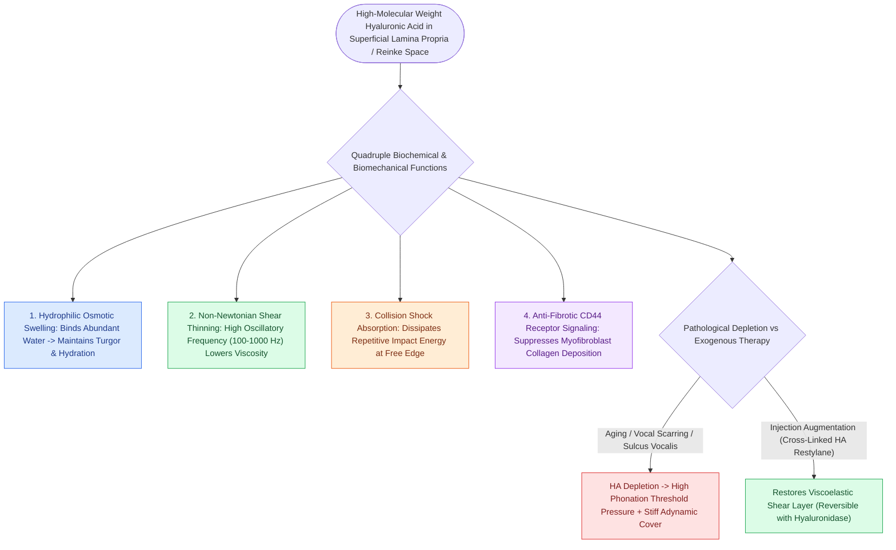

# Hyaluronic acid regulates lamina propria hydration and shock absorption

## Active Recall

> [!question]- Why is hyaluronic acid uniquely suited as a viscoelastic cushion in the vocal fold cover?
> *Answer / Clinical Rationale*: HA exhibits dramatic shear-thinning properties—its viscosity drops rapidly at high vibrational frequencies—allowing the [[Stratified squamous epithelium forms the vocal fold protective cover|epithelium]] to propagate mucosal waves with minimal phonation threshold pressure, while simultaneously absorbing collision shock.

> [!question]- What enzyme can be administered to dissolve an over-injected hyaluronic acid vocal fold implant?
> *Answer / Clinical Rationale*: **Hyaluronidase** rapidly cleaves glycosidic bonds within cross-linked HA, restoring normal contour without permanent tissue damage.

## Core Clinical & Mechanistic Principles
**Hyaluronic Acid (HA)** is a high-molecular-weight non-sulfated glycosaminoglycan (GAG) that forms the bulk of the amorphous interstitial ground substance within the [[The superficial lamina propria acts as a pliable shearing fluid bed|superficial lamina propria (Reinke's space)]].

### Biochemical & Biomechanical Functions
- **Hydrophilic Osmotic Swelling**: HA possesses an enormous negative charge density that attracts and binds water molecules, maintaining local tissue hydration and turgor.
- **Viscoelasticity & Shear Thinning**: At rest, HA maintains an entangled macromolecular network. During phonation, as shear strain rate increases (oscillations from 100 Hz to >1000 Hz), the HA chains align parallel to the flow vector, significantly reducing viscosity (shear-thinning behavior) to facilitate low-energy [[The mucosal wave travels as a fluid mechanical displacement|mucosal wave propagation]].
- **Shock Absorption & Tissue Dampening**: HA absorbs repetitive mechanical impact energy during high-frequency vocal fold collision, protecting delicate microvessels and fibroblasts.
- **Anti-Fibrotic Signaling**: High-molecular-weight HA suppresses collagen synthesis and inhibits myofibroblast differentiation through CD44 receptor signaling, whereas low-molecular-weight HA fragments promote inflammatory pathways.

## Surgical Anatomy, Step-by-Step Technique & Nuances
- **Exogenous Augmentation**: Cross-linked HA gels (e.g., Restylane, Juvederm) are utilized for [[Cross-linked hyaluronic acid provides intermediate-duration vocal fold augmentation|vocal fold injection augmentation]] due to their close rheological match to native SLP ground substance.
- **Enzymatic Reversibility**: Exogenous HA injections can be completely reversed by injecting **hyaluronidase** if over-injection or superficial misplacement occurs.

## Critical Failure Modes & Error Traps
- **HA Depletion in Presbylarynx and Scar**: Aging and chronic scarring cause marked depletion of HA in the SLP, leading to vocal fold thinning, increased tissue stiffness, spindle-shaped [[Glottal closure patterns identify specific laryngeal biomechanical deficits|glottal gap]], and loss of the mucosal wave.

## Connected Concepts & Graph Traversal
- **Parent Compartment**: [[The superficial lamina propria acts as a pliable shearing fluid bed|Superficial Lamina Propria (Reinke's Space)]]
- **Vibratory Mechanism**: [[The mucosal wave travels as a fluid mechanical displacement|Mucosal Wave Dynamics]]
- **Therapeutic Biomaterial**: [[Cross-linked hyaluronic acid provides intermediate-duration vocal fold augmentation|Cross-Linked Hyaluronic Acid for Vocal Fold Augmentation]]
- **Pathological Scarring**: [[Vocal fold scar results from disorganized Type I collagen deposition|Vocal Fold Scarring]]
- **Clinical Management**: [[Glottal closure patterns identify specific laryngeal biomechanical deficits|Glottal Closure Patterns]]
