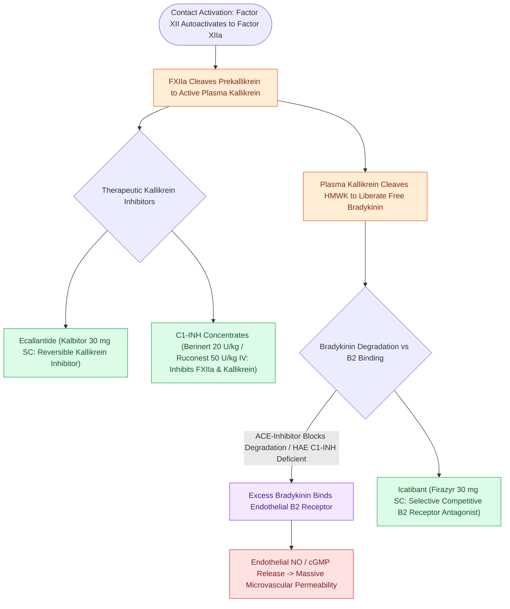

# Icatibant and ecallantide provide targeted treatment for bradykinin-mediated angioedema refractory to standard therapy

## Active Recall

> [!question]- Why do standard doses of IV dexamethasone, diphenhydramine, and IM epinephrine fail to resolve ACE-inhibitor-induced lingual angioedema?
> *Answer / Clinical Rationale*: ACE-inhibitor angioedema is driven entirely by **bradykinin accumulation** acting on endothelial B2 receptors, completely independent of mast cell degranulation, histamine release, or standard corticosteroid-sensitive inflammatory pathways.

> [!question]- What is the mechanism of action of Icatibant versus Ecallantide?
> *Answer / Clinical Rationale*: **Icatibant** is a direct competitive antagonist at the **bradykinin B2 receptor**, whereas **Ecallantide** is a direct inhibitor of **plasma kallikrein**, preventing the enzymatic cleavage of high-molecular-weight kininogen into bradykinin.

## Core Clinical & Mechanistic Principles
**Bradykinin-mediated angioedema** arises from unregulated generation or impaired degradation of bradykinin, a potent vasoactive nonapeptide. Unlike histamine-driven allergic reactions that respond promptly to epinephrine, antihistamines, and corticosteroids, bradykinin acts directly on **bradykinin B2 receptors** on vascular endothelial cells, triggering rapid cyclic GMP and nitric oxide release, profound vasodilation, and plasma extravasation. Standard anti-allergic pharmacotherapy is ineffective, making targeted pathway inhibition critical to prevent catastrophic upper airway obstruction in patients with [[Mast cell-mediated histaminergic angioedema responds rapidly to epinephrine, antihistamines, and corticosteroids|hereditary or ACE-inhibitor-induced angioedema]]:

- **The Kallikrein-Kinin Cascade**:
  1. Factor XII (Hageman factor) undergoes autoactivation to Factor XIIa upon contact with negatively charged surfaces or abnormal vascular endothelium.
  2. Factor XIIa cleaves plasma prekallikrein to generate active **plasma kallikrein**.
  3. Plasma kallikrein cleaves high-molecular-weight kininogen (HMWK) to liberate **bradykinin**.
  4. In healthy individuals, C1-esterase inhibitor (C1-INH) inhibits both Factor XIIa and plasma kallikrein, while angiotensin-converting enzyme (ACE), aminopeptidase P, and neutral endopeptidase degrade bradykinin.
  5. Deficiency of C1-INH or pharmacologic ACE inhibition leads to unchecked bradykinin surge.

- **Targeted Therapeutic Modalities**:
  - **Icatibant (Firazyr)**:
    - *Mechanism*: Synthetic decapeptide acting as a selective, competitive antagonist at the bradykinin B2 receptor.
    - *Dosing & Route*: 30 mg single subcutaneous injection into the abdominal wall.
    - *Clinical Onset*: Rapid symptom relief within 30–60 minutes; may repeat after 6 hours if symptoms persist (maximum 3 doses in 24 hours).
  - **Ecallantide (Kalbitor)**:
    - *Mechanism*: Recombinant 60-amino-acid protein that selectively and reversibly inhibits plasma kallikrein.
    - *Dosing & Route*: 30 mg subcutaneous administered as three separate 10 mg (1 mL) injections at different sites.
    - *Critical Safety Warning*: Carries a Black Box warning for **anaphylactoid reactions (3%–4%)**; must only be administered by healthcare professionals equipped to manage anaphylaxis.
  - **C1-Esterase Inhibitor Concentrates**:
    - *Plasma-Derived C1-INH (Berinert)*: 20 IU/kg IV bolus for acute mucosal and laryngeal attacks.
    - *Recombinant C1-INH (Ruconest)*: Purified from transgenic rabbit milk; 50 IU/kg IV bolus (max 4200 IU).
  - **Fresh Frozen Plasma (FFP)**:
    - Contains physiologic concentrations of C1-INH, but also contains HMWK and prekallikrein substrate. Administered when targeted agents are unavailable (1–2 units IV).

## References
1. LoVerde, D., Files, D.C., Krishnaswamy, G. (2017). Angioedema. *Crit Care Med*, 45(4):725-735.
2. Cicardi, M., Banerji, A., Bracho, F., et al. (2010). Icatibant, a new bradykinin-receptor antagonist, in hereditary angioedema. *N Engl J Med*, 363(6):532-541.
3. Zuraw, B.L., Busse, P.J., White, M., et al. (2010). Nanofiltered C1 inhibitor concentrate for treatment of hereditary angioedema attacks. *N Engl J Med*, 363(6):513-522.

## Connected Concepts & Graph Traversal
- **Physiological Basis**: [[Mast cell-mediated histaminergic angioedema responds rapidly to epinephrine, antihistamines, and corticosteroids|Angioedema Mechanisms]]
- **Diagnostic Serology**: [[Hereditary angioedema types I through III exhibit distinct C1 esterase inhibitor and C4 complement patterns|HAE Complement Subtyping]]
- **Airway Management**: [[Awake fiberoptic intubation is the preferred airway technique for angioedema with impending obstruction|Awake Intubation Strategy]]
- **Emergency Surgical Airway**: [[Standard open tracheotomy utilizes horizontal intersinusoidal or Bjork flap entry|Emergency Open Tracheotomy]]
- **Differential Pathology**: [[Acute epiglottitis presents with rapid-onset odynophagia, fever, and the tripod sign requiring immediate airway protection|Acute Supraglottic Airway Obstruction]]
