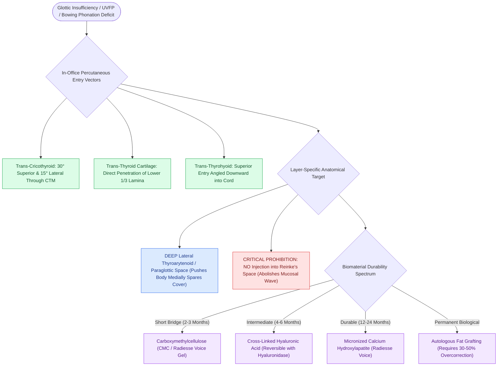

# Injection laryngoplasty requires precise placement into lateral thyroarytenoid muscle

## Active Recall

> [!question]- Why must injection laryngoplasty biomaterials be placed laterally in the thyroarytenoid muscle rather than medially in Reinke's space?
> *Answer / Clinical Rationale*: Lateral placement pushes the vocal fold margin to the midline while preserving the pliable superficial lamina propria for mucosal wave propagation; superficial injection causes severe foreign-body stiffness and irreversible dysphonia.

> [!question]- What are the three common percutaneous routes for in-office injection laryngoplasty?
> *Answer / Clinical Rationale*: (1) **Trans-cricothyroid membrane**, (2) **trans-thyroid cartilage**, and (3) **trans-thyrohyoid membrane** approaches.

## Core Clinical & Mechanistic Principles
**Injection Laryngoplasty** (vocal fold injection augmentation) is a minimally invasive procedure designed to medialize a paretic or atrophic vocal fold by injecting a bulk-enhancing biomaterial into the lateral vocal fold architecture.

### Target Injection Plane & Layer-Specific Sparing
- **Target Compartment**: The needle must be positioned strictly within the **lateral [[The thyroarytenoid muscle modulates glottal stiffness and adduction|thyroarytenoid muscle (thyromuscularis)]]** or the [[The paraglottic space facilitates transglottic tumor spread|paraglottic space]].
- **Mechanical Bulk Displacement**: Injecting laterally into the muscle displaces the intact medial body and cover toward the glottic midline, closing the [[Glottal closure patterns identify specific laryngeal biomechanical deficits|glottal gap]].
- **Strict Protection of Reinke's Space**: The superficial lamina propria must **never** be injected with particulate or viscous bulk agents (such as [[Calcium hydroxylapatite provides durable medialization but causes granulomas if superficial|CaHA]] or Teflon). Violating Reinke's space causes catastrophic foreign-body reaction, severe mucosal stiffening, and loss of the [[The mucosal wave travels as a fluid mechanical displacement|mucosal wave]].

## Injection Approaches & Techniques
1. **Transoral Approach**: Performed under indirect mirror or rigid telescopic guidance in the operating room or clinic using a curved laryngeal needle.
2. **Percutaneous Approaches (In-Office with Flexible Endoscopy)**:
   - *Trans-Cricothyroid Membrane*: Needle enters through the cricothyroid membrane, angled 30° superiorly and 15° laterally into the subepithelial TA muscle.
   - *Trans-[[Thyroplasty cartilage window dimensions differ between males and females|Thyroid Cartilage]]*: Needle passes directly through the lower third of the thyroid cartilage lamina into the paraglottic space.
   - *Trans-Thyrohyoid Membrane*: Needle enters superiorly through the thyrohyoid membrane, angling downward into the vocal fold.

## Biomaterial Selection Spectrum
- **Short-acting (2–3 months)**: [[Carboxymethylcellulose gel provides short-acting temporary vocal fold augmentation|Carboxymethylcellulose (Radiesse Voice Gel)]].
- **Medium-acting (4–6 months)**: [[Cross-linked hyaluronic acid provides intermediate-duration vocal fold augmentation|Cross-linked Hyaluronic Acid (Restylane / Juvederm)]].
- **Long-acting (12–24 months)**: Micronized Calcium Hydroxylapatite (Radiesse Voice).
- **Permanent**: [[Autologous fat augmentation requires overcorrection for resorption|Autologous Fat Grafting]].

## Critical Failure Modes & Error Traps
- **Superficial Extravasation**: Inadvertently placing the needle too superficially into Reinke's space creates an immediate, severe [[Adynamic vocal fold segments indicate mucosal stiffening, malignancy, or scar|adynamic segment]] with severe dysphonia.

## Connected Concepts & Graph Traversal
- **Targeted Muscle Anatomy**: [[The thyroarytenoid muscle modulates glottal stiffness and adduction|Thyroarytenoid Muscle]]
- **Calcium Mineral Filler**: [[Calcium hydroxylapatite provides durable medialization but causes granulomas if superficial|Calcium Hydroxylapatite]]
- **Temporary Gel Filler**: [[Carboxymethylcellulose gel provides short-acting temporary vocal fold augmentation|Carboxymethylcellulose]]
- **Hyaluronic Acid Filler**: [[Cross-linked hyaluronic acid provides intermediate-duration vocal fold augmentation|Hyaluronic Acid]]
- **Surgical Implant Alternative**: [[Type I thyroplasty medializes the vocal fold with conscious voice tuning|Type I Thyroplasty]]
