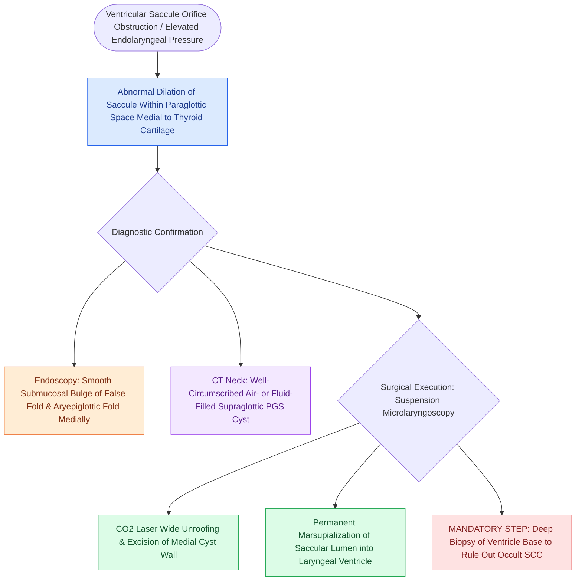

# Internal laryngoceles present as supraglottic masses medial to thyroid cartilage

## Active Recall

> [!question]- What anatomical structure dilates to form an internal laryngocele?
> *Answer / Clinical Rationale*: The **laryngeal saccule (appendix of the ventricle of Morgagni)**, which extends superiorly from the roof of the laryngeal ventricle.

> [!question]- What is the standard first-line surgical approach for an isolated internal laryngocele?
> *Answer / Clinical Rationale*: **Transoral endoscopic CO2 laser marsupialization / unroofing**, creating a wide, permanent drainage opening into the laryngeal lumen.

## Core Clinical & Mechanistic Principles
An **Internal Laryngocele** is an abnormal, air-filled or mucus-filled (laryngopyocele/laryngomucocele) dilation of the **laryngeal saccule (appendix of the [[The laryngeal ventricle separates supraglottic and glottic lymphatic pathways|laryngeal ventricle of Morgagni]])** that remains confined strictly within the laryngeal framework.

### Anatomical Confinement & Mechanism
- **The Laryngeal Saccule**: A blind pouch extending superiorly from the anterior roof of the laryngeal ventricle between the false vocal cord medially and the [[Thyroplasty cartilage window dimensions differ between males and females|thyroid cartilage alar lamina]] laterally.
- **Internal Confinement**: An internal laryngocele expands within the [[The paraglottic space facilitates transglottic tumor spread|paraglottic space]] **medial to the thyroid cartilage alar lamina and thyrohyoid membrane**, without penetrating externally into the neck.
- **Endoscopic Presentation**: Appears as a smooth, submucosal, cystic mass bulging into the endolarynx, displacing the false vocal cord, aryepiglottic fold, and ventricular band medially over the true vocal fold.

## Clinical Manifestations & Diagnostics
- **Symptoms**: Progressive hoarseness, globus sensation, muffled voice ("hot potato voice"), and inspiratory stridor if the mass is large.
- **Imaging (CT Neck)**: Demonstrates a well-circumscribed, smooth-walled, air- or fluid-filled cystic lesion in the supraglottic paraglottic space medial to the thyroid cartilage.

## Surgical Management
- **Endoscopic Marsupialization / Unroofing**: First-line treatment for internal laryngoceles. Under [[Phonomicrosurgery requires suspension laryngoscopy and stereoscopic magnification|suspension microlaryngoscopy]], a [[The CO2 laser vaporizes tissue via 10600 nm water absorption|CO2 laser]] or microdebrider is used to widely unroof and excise the medial wall of the cyst, marsupializing the saccule directly into the laryngeal ventricle.
- **Ventricular Biopsy Mandate**: The ventricular orifice must be meticulously inspected and biopsied to rule out an obstructing tumor (see adult-onset laryngocele oncology).

## Critical Failure Modes & Error Traps
- **Inadequate Marsupialization**: Simple needle aspiration or tiny incisional drainage results in rapid cyst recurrence; wide unroofing of the medial wall is mandatory.

## Connected Concepts & Graph Traversal
- **External Variant**: [[External laryngoceles herniate through the thyrohyoid membrane into the lateral neck|External Laryngoceles]]
- **Mandatory Oncologic Rule**: [[Adult-onset laryngoceles require ventricular biopsy to rule out occult SCC|Ventricular Biopsy for Occult Carcinoma]]
- **Anatomical Space Occupied**: [[The paraglottic space facilitates transglottic tumor spread|Paraglottic Space]]
- **Laser Tool**: [[The CO2 laser vaporizes tissue via 10600 nm water absorption|CO2 Laser Biophysics]]
- **Clinical Management**: [[Phonomicrosurgery requires suspension laryngoscopy and stereoscopic magnification|Phonomicrosurgery Setup]]
