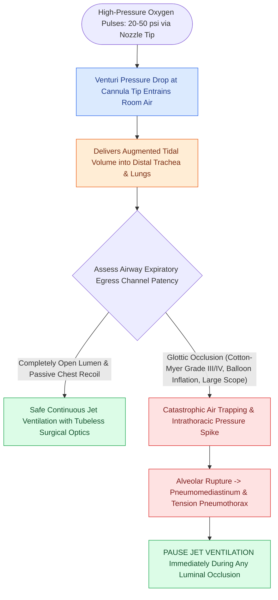

# Jet ventilation requires unimpeded expiratory egress to prevent barotrauma

## Active Recall

> [!question]- What physical principle allows jet ventilation to deliver adequate tidal volume through an open laryngeal lumen?
> *Answer / Clinical Rationale*: The **Venturi effect**; high-velocity oxygen pulses create a localized pressure drop at the nozzle tip, entraining surrounding air to generate adequate tidal volumes.

> [!question]- Why is high-grade subglottic stenosis a major contraindication to supraglottic jet ventilation?
> *Answer / Clinical Rationale*: The narrow stenotic lumen prevents passive expiratory air egress; trapped pressurized air rapidly causes catastrophic **pulmonary barotrauma, pneumomediastinum, and tension pneumothorax**.

## Core Clinical & Mechanistic Principles
**High-Pressure Jet Ventilation** (supraglottic or subglottic, e.g., Mon-Jet, Hunsaker subglottic catheter) is an advanced tubeless anesthesia technique that delivers intermittent pulses of high-pressure oxygen ($20\text{–}50\text{ psi}$) into an open airway system.

### The Venturi Principle & Entrainment
- **High-Velocity Gas Jet**: Oxygen is forced through a narrow metal cannula or subglottic catheter tip at high velocity.
- **Venturi Effect & Gas Entrainment**: The rapid jet stream creates a localized negative pressure zone around the nozzle, entraining ambient room air into the distal airway and augmenting tidal volume.
- **Tubeless Operative Visualization**: Eliminates the bulky polyvinyl chloride endotracheal tube from the operative field, providing uninterrupted $360^\circ$ visualization of the posterior commissure, vocal folds, and subglottis for laser resection or dilation.

## The Absolute Expiratory Safety Mandate
- **Passive Exhalation**: Jet ventilation delivers high inspiratory gas volumes in a fraction of a second, but exhalation relies **entirely on passive elastic recoil of the patient's chest wall and lungs**.
- **Mandatory Open Egress Channel**: The subglottic, glottic, and supraglottic airway must remain **completely patent and unoccluded during the expiratory phase**.

## Critical Failure Modes & Error Traps
- **Barotrauma, Tension Pneumothorax, and Pneumomediastinum**:
  - If high-grade subglottic stenosis ([[The Cotton-Myer classification grades subglottic stenosis by luminal reduction|Cotton-Myer Grade]] III/IV) is present, or if surgical instruments (large suction, laser suspension laryngoscope, or dilation balloon) accidentally occlude the narrow glottic channel during jet firing, escaping air cannot exit.
  - Alveolar pressures rapidly exceed capillary bursting thresholds ($>40\text{–}50\text{ cm H}_2\text{O}$), resulting in catastrophic **alveolar rupture, massive pneumomediastinum, [[Subcutaneous emphysema arises when tracheotomy incisions are closed too tightly|subcutaneous emphysema]], and bilateral tension pneumothorax**.
  - *Safety Rule*: Never fire the jet ventilator when instruments are occluding the airway lumen; immediately pause jetting during balloon inflation.

## Connected Concepts & Graph Traversal
- **Diagnostic Companion**: [[Rigid bronchoscopy requires 90-degree rotation through the glottis|Operative Rigid Bronchoscopy]]
- **Endoscopic Procedure**: [[Endoscopic airway dilation combines radial incisions with balloon bronchoplasty|Endoscopic Airway Dilation]]
- **Critical Safety & Barotrauma**: [[Subcutaneous emphysema arises when tracheotomy incisions are closed too tightly|Subcutaneous Emphysema and Air Trapping]]
- **Alternative Primary Airway**: [[Standard open tracheotomy utilizes horizontal intersinusoidal or Bjork flap entry|Standard Open Tracheotomy]]
- **Clinical Management**: [[The Cotton-Myer classification grades subglottic stenosis by luminal reduction|Cotton-Myer Classification]]
