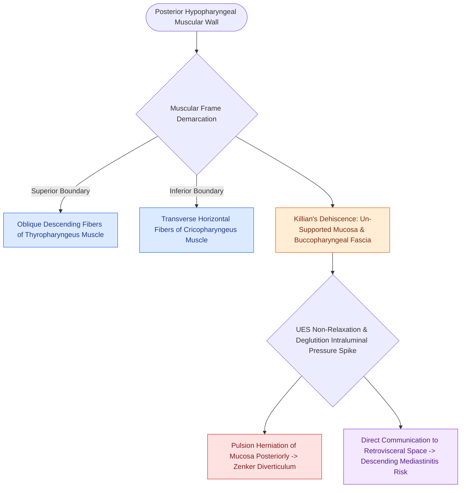

# Killian's triangle is a posterior muscular dehiscence above the cricopharyngeus

## Active Recall

> [!question]- What are the superior and inferior muscular boundaries of Killian's Triangle?
> *Answer / Clinical Rationale*: Superiorly: the oblique fibers of the **thyropharyngeus muscle**; Inferiorly: the transverse horizontal fibers of the **cricopharyngeus muscle**.

> [!question]- Why does an instrumental perforation through Killian's triangle carry a high risk of lethal mediastinitis?
> *Answer / Clinical Rationale*: Killian's triangle opens directly into the **retrovisceral / retropharyngeal space**, which communicates without fascial barriers directly into the **posterior mediastinum**.

## Core Clinical & Mechanistic Principles
**Killian's Triangle** (also known as **Killian's dehiscence**, described by Gustav Killian in 1908) is a natural anatomical area of muscular weakness located in the **posterior midline wall of the hypopharynx**.

### Precise Anatomical Boundaries
- **Superior Boundary**: Oblique, descending muscular fibers of the **thyropharyngeus muscle** (the superior component of the inferior pharyngeal constrictor).
- **Inferior Boundary**: Transverse, horizontal muscular fibers of the **[[Open diverticulectomy combines pouch resection with cricopharyngeal myotomy|cricopharyngeus muscle]]** (the inferior component of the inferior pharyngeal constrictor / [[VFSS provides continuous radiographic evaluation of all deglutition phases|upper esophageal sphincter]]).
- **Floor**: Lacks muscular backing; the posterior wall consists solely of hypopharyngeal mucous membrane and the thin **buccopharyngeal fascia**.

## Clinical & Surgical Significance
- **Site of Zenker's Herniation**: Elevated hypopharyngeal opening pressures during deglutition force the mucosa directly through this un-supported triangle, forming a [[Zenker's diverticulum herniates through Killian's triangle due to elevated pulsion pressure|Zenker's diverticulum]].
- **Direct Access to Danger Space**: The posterior wall of Killian's triangle abuts the retrovisceral (retropharyngeal) space, which communicates directly with the posterior mediastinum (Danger Space). Perforations here during endoscopy or intubation cause rapid, descending mediastinitis.

## Differentiating from Other Muscular Gaps
- **Killian's Triangle**: Located **posteriorly, superior to the cricopharyngeus** (site of Zenker's).
- **Killian-Jamieson Space**: Located **anterolaterally, inferior to the cricopharyngeus** (site of Killian-Jamieson diverticulum and [[The recurrent laryngeal nerve innervates all intrinsic muscles except cricothyroid|RLN]] entry).
- **Laimer's Triangle**: Located **posteriorly, inferior to the cricopharyngeus** between diverging longitudinal esophageal muscle fibers (site of Laimer's diverticulum).

## Connected Concepts & Graph Traversal
- **Primary Pathology**: [[Zenker's diverticulum herniates through Killian's triangle due to elevated pulsion pressure|Zenker's Diverticulum]]
- **Contrasting Muscular Gap**: [[Killian-Jamieson space is an anterolateral muscular gap traversed by the RLN|Killian-Jamieson Space]]
- **Surgical Myotomy**: [[Open diverticulectomy combines pouch resection with cricopharyngeal myotomy|Open CP Myotomy & Diverticulectomy]]
- **Endoscopic Stapling**: [[Endoscopic stapler diverticulotomy divides the cricopharyngeal bar and seals mucosa|Endoscopic Stapler Diverticulotomy]]
- **Clinical Management**: [[The recurrent laryngeal nerve innervates all intrinsic muscles except cricothyroid|Recurrent Laryngeal Nerve (RLN)]]
