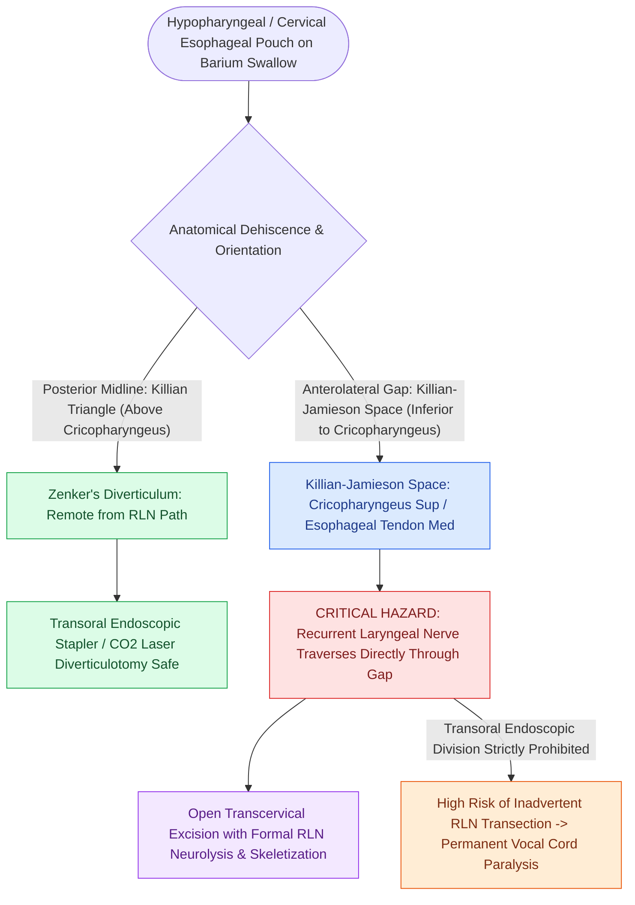

# Killian-Jamieson space is an anterolateral muscular gap traversed by the RLN

## Active Recall

> [!question]- Why is transoral endoscopic stapling contraindicated for a Killian-Jamieson diverticulum?
> *Answer / Clinical Rationale*: The recurrent laryngeal nerve (RLN) passes directly through the anterolateral Killian-Jamieson space intimately associated with the diverticular neck; transoral division of the common wall risks direct transection of the RLN.

> [!question]- What are the anatomical boundaries of the Killian-Jamieson space?
> *Answer / Clinical Rationale*: Superiorly: the **cricopharyngeus muscle**; Medially: the **longitudinal muscle fibers/tendon of the esophagus**; Anterolaterally: the [[Cricotracheal resection removes subglottic stenosis while sparing posterior cricoid and RLNs|cricoid cartilage]].

## Core Clinical & Mechanistic Principles
The **Killian-Jamieson Space** (described by Gustav Killian and James Jamieson) is a paired anatomical muscular gap located on the **anterolateral wall of the upper cervical esophagus / hypopharynx**.

### Precise Anatomical Boundaries
- **Superior Boundary**: Transverse fibers of the **[[Open diverticulectomy combines pouch resection with cricopharyngeal myotomy|cricopharyngeus muscle]]**.
- **Medial / Anterior Boundary**: Longitudinal tendon / muscle fibers of the **anterior esophagus** (suspensory tendon of the esophagus inserting onto the posterior cricoid crest).
- **Lateral Boundary**: Cartilaginous framework of the cricoid / thyroid inferior cornu.

## Clinical & High-Stakes Surgical Significance
- **Entry Point of the Recurrent Laryngeal Nerve**: The Recurrent Laryngeal Nerve (RLN) ascends through the tracheoesophageal groove and **passes directly through or immediately adjacent to the Killian-Jamieson space** to enter the larynx behind the cricothyroid articulation.
- **Killian-Jamieson Diverticulum (KJD)**: Mucosal herniation through this space produces an anterolateral pouch (frequently bilateral).
- **Surgical Approach Mandate**:
  - Unlike [[Zenker's diverticulum herniates through Killian's triangle due to elevated pulsion pressure|Zenker's diverticulum]] (which is posterior and safe for transoral stapling), **Killian-Jamieson diverticula are strictly managed via an open transcervical approach**.
  - Transoral endoscopic stapling or laser division of a KJD carries an unacceptably high risk of **transecting the adjacent recurrent laryngeal nerve**, resulting in permanent vocal fold paralysis.

## Anatomical Comparison Matrix
| Anatomical Space | Location in Pharynx/Esophagus | Relation to Cricopharyngeus | Herniating Pathology | Relation to RLN | Surgical Approach |
| :--- | :--- | :--- | :--- | :--- | :--- |
| **Killian's Triangle** | **Posterior Midline** | **Superior** to CP | Zenker's Diverticulum | Far removed from RLN | **Transoral Endoscopic** or Open |
| **Killian-Jamieson Space** | **Anterolateral** | **Inferior** to CP | Killian-Jamieson Diverticulum | **RLN passes directly through gap** | **Strictly Open Transcervical** |

**Key Links**: [[Killian's triangle is a posterior muscular dehiscence above the cricopharyngeus|Killian's Triangle]] · Cricopharyngeus · Zenker's Diverticulum · Recurrent Laryngeal Nerve (RLN)

## Connected Concepts & Graph Traversal
- **Contrasting Posterior Triangle**: [[Killian's triangle is a posterior muscular dehiscence above the cricopharyngeus|Killian's Triangle]]
- **Associated Pathology**: [[Zenker's diverticulum herniates through Killian's triangle due to elevated pulsion pressure|Zenker's Diverticulum]]
- **Protected Nerve**: [[The recurrent laryngeal nerve innervates all intrinsic muscles except cricothyroid|Recurrent Laryngeal Nerve (RLN)]]
- **Open Surgical Approach**: [[Open diverticulectomy combines pouch resection with cricopharyngeal myotomy|Open Transcervical Diverticulectomy]]
- **Clinical Management**: [[Cricotracheal resection removes subglottic stenosis while sparing posterior cricoid and RLNs|Cricotracheal Resection (CTR)]]
