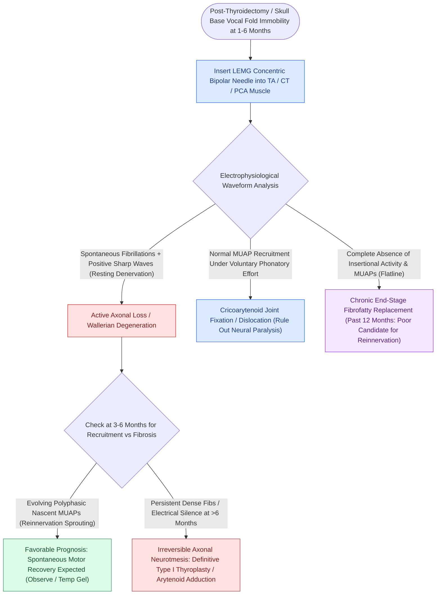

# LEMG denervation potentials indicate axonal injury within one to six months

## Active Recall

> [!question]- Why is LEMG testing performed ideally between 1 and 6 months post-injury rather than immediately after thyroid surgery?
> *Answer / Clinical Rationale*: Fibrillations and positive sharp waves require 2 to 3 weeks of wallerian degeneration to appear; prior to 3 weeks, false-negative readings occur. Beyond 6–12 months, muscle endplates fibrose, limiting prognostic utility.

> [!question]- What does the appearance of polyphasic motor unit action potentials indicate on LEMG?
> *Answer / Clinical Rationale*: It indicates active **collateral axon sprouting and reinnervation** of denervated muscle fibers, suggesting potential for spontaneous neural recovery.

## Core Clinical & Mechanistic Principles
Waveform analysis during [[Laryngeal electromyography differentiates vocal fold paralysis from joint fixation|Laryngeal Electromyography (LEMG)]] provides prognostic information regarding nerve continuity, ongoing axonal degradation, and spontaneous collateral reinnervation following laryngeal nerve trauma.

### Waveform Phenotypes & Electrophysiologic Mechanisms
1. **Insertional Activity**:
   - *Normal*: Brief burst of electrical activity lasting <300 ms as the needle pierces muscle fibers.
   - *Increased / Prolonged*: Indicates muscle membrane irritability, early denervation, or myotonia.
   - *Decreased / Absent*: Indicates fibrotic replacement of muscle or severe chronic end-stage atrophy.
2. **Denervation Potentials (Spontaneous Activity at Rest)**:
   - **Fibrillation Potentials (Fib Potentials)**: Biphasic or triphasic spikes ($10\text{–}100\text{ µV}$, $1\text{–}5\text{ ms}$) representing spontaneous, uncoordinated action potentials of single muscle fibers that have lost their motor axon supply.
   - **Positive Sharp Waves (PSWs)**: Rapid initial positive deflection followed by a slow negative decay, representing discharge of injured, denervated muscle fibers.
   - *Pathological Meaning*: Signifies **active axonal loss / wallerian degeneration**. Appears 2 to 3 weeks post-injury.
3. **Reinnervation Potentials (Voluntary Activation)**:
   - **Polyphasic Potentials (Complex MUAPs)**: Motor unit action potentials with >4 phases, broadened duration, and variable amplitude.
   - *Pathological Meaning*: Signifies **collateral axonal sprouting** from surviving motor neurons re-occupying denervated motor endplates. Indicates neurotmesis recovery or laryngeal synkinesis.

## Optimal Testing Window & Clinical Decision Making
- **Optimal Testing Window**: **1 to 6 months post-injury**.
  - *Prior to 3–4 weeks*: Axonal membrane instability has not fully developed, risking false-negative interpretations.
  - *Past 6–12 months*: Denervated muscle fibers undergo progressive atrophy and fibrofatty replacement, eliminating spontaneous discharges.
- **Prognostic Guidance**:
  - *Presence of Polyphasics with Recruited Units*: High likelihood of functional motor recovery; observation with temporary [[Injection laryngoplasty requires precise placement into lateral thyroarytenoid muscle|injection augmentation]] is indicated.
  - *Persistent Fibrillations / Complete Electrical Silence at 6 Months*: Poor prognosis for spontaneous recovery; indicates permanent [[Type I thyroplasty medializes the vocal fold with conscious voice tuning|Type I thyroplasty]] or [[Arytenoid adduction closes large posterior glottic gaps and corrects height mismatch|arytenoid adduction]].

## Critical Failure Modes & Error Traps
- **Laryngeal Synkinesis**: Reinnervating axons from the adductor and abductor branches can aberrantly cross-innervate opposing muscles (e.g., adductor fibers innervating the [[The posterior cricoarytenoid is the sole vocal fold abductor|PCA]]), resulting in normal-appearing polyphasic MUAPs on LEMG despite persistent vocal fold immobility.

## Connected Concepts & Graph Traversal
- **Core Diagnostic Test**: [[Laryngeal electromyography differentiates vocal fold paralysis from joint fixation|Laryngeal Electromyography (LEMG)]]
- **Clinical Condition**: [[Unilateral vocal fold paralysis causes glottic insufficiency, breathiness, and aspiration|Unilateral Vocal Fold Paralysis]]
- **Temporary Bridge**: [[Carboxymethylcellulose gel provides short-acting temporary vocal fold augmentation|Carboxymethylcellulose (Radiesse Voice Gel)]]
- **Definitive Surgery**: [[Type I thyroplasty medializes the vocal fold with conscious voice tuning|Type I Medialization Thyroplasty]]
- **Clinical Management**: [[The posterior cricoarytenoid is the sole vocal fold abductor|Posterior Cricoarytenoid (PCA) Muscle]]
