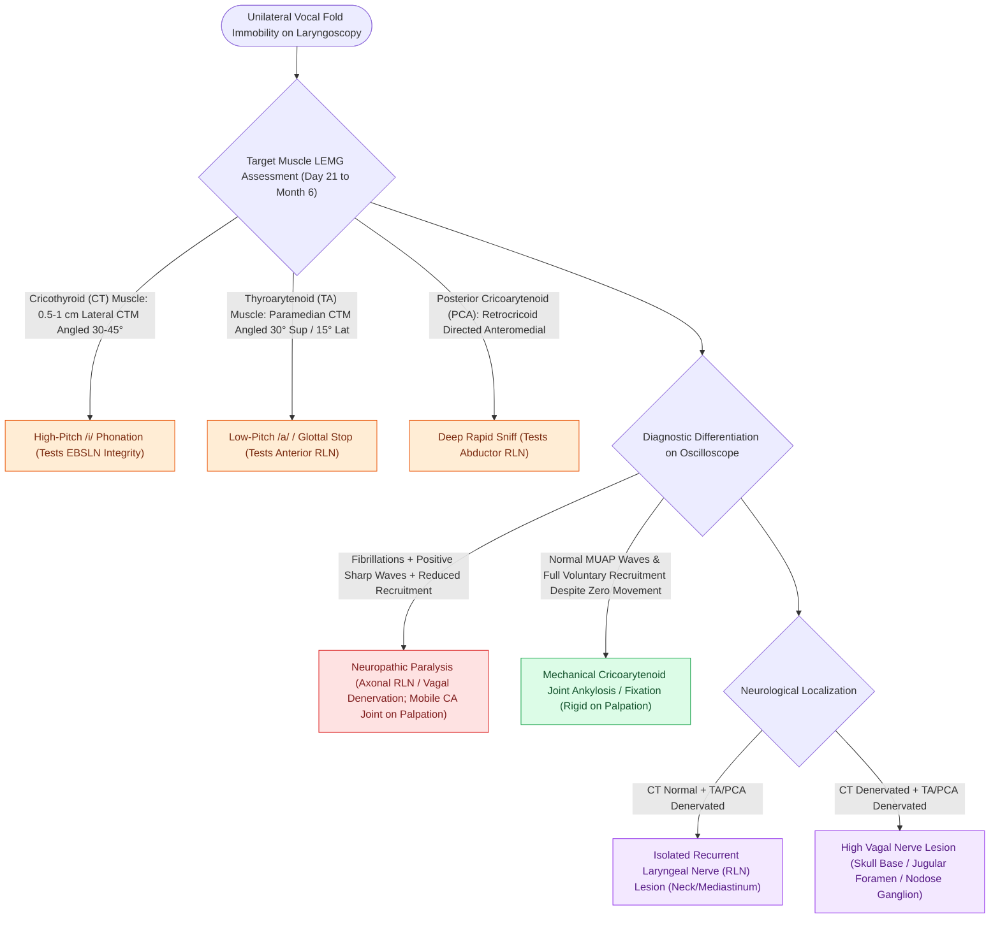

# Laryngeal electromyography differentiates vocal fold paralysis from joint fixation

## Active Recall

> [!question]- How does LEMG definitively differentiate cricoarytenoid joint ankylosis from true recurrent laryngeal nerve paralysis?
> *Answer / Clinical Rationale*: In CA joint ankylosis, the intrinsic muscles demonstrate **normal electrical activity and normal motor unit recruitment** despite physical immobility, whereas true RLN paralysis demonstrates fibrillations, positive sharp waves, or markedly reduced recruitment.

> [!question]- Why is testing the cricothyroid muscle during LEMG essential when evaluating a patient with a paralyzed vocal fold?
> *Answer / Clinical Rationale*: The CT muscle is innervated by the EBSLN. If the CT muscle is denervated alongside the TA/PCA, it localizes the lesion to the high vagus nerve (at or above the skull base / nodose ganglion) rather than an isolated mediastinal or neck RLN injury.

## Core Clinical & Mechanistic Principles
**Laryngeal Electromyography (LEMG)** is the gold-standard electrodiagnostic modality used to evaluate the neuromuscular integrity of the intrinsic laryngeal muscles. It directly measures the motor unit action potentials (MUAPs) of laryngeal muscles to differentiate between **neuropathic vocal fold immobility (paralysis/paresis)** and **mechanical immobility ([[The cricoarytenoid joint moves via coupled rocking and sliding|cricoarytenoid joint]] ankylosis/fixation)**.

### Target Muscles, Insertion Vectors & Activation Maneuvers
| Muscle | Insertion Landmark & Needle Vector | Activation / Verification Maneuver | Clinical Role |
| :--- | :--- | :--- | :--- |
| **Cricothyroid (CT)** | Insert needle $0.5\text{–}1.0\text{ cm}$ lateral to midline at cricothyroid membrane; angle 30°–45° posterolaterally. | High-pitch phonation (/i/). | Tests EBSLN integrity (differentiates high vagal vs isolated RLN lesions). |
| **Thyroarytenoid (TA)** | Pierce cricothyroid membrane paramedian; direct needle 30° superiorly and 15° laterally into paraglottic space. | Low-pitch phonation or sharp sniff/glottal stop. | Tests anterior motor branch of RLN. |
| **Posterior Cricoarytenoid (PCA)** | Rotate thyroid cartilage framework laterally; insert needle from posterior-inferior border of cricoid directed anteromedially. | Deep, rapid inspiratory sniff. | Tests abductor branch of RLN. |

**Key Links**: [[The cricothyroid muscle elongates vocal folds to elevate pitch|Cricothyroid (CT)]] · [[The thyroarytenoid muscle modulates glottal stiffness and adduction|Thyroarytenoid (TA)]] · [[The posterior cricoarytenoid is the sole vocal fold abductor|PCA]] · [[The superior laryngeal nerve provides supraglottic sensation and cricothyroid motor control|EBSLN]] · [[The recurrent laryngeal nerve innervates all intrinsic muscles except cricothyroid|RLN]] · [[The paraglottic space facilitates transglottic tumor spread|Paraglottic space]] · [[Thyroplasty cartilage window dimensions differ between males and females|Thyroid cartilage]]

## Differentiating Paralysis from CA Joint Fixation
- **Neuropathic Paralysis (RLN Injury)**: Shows [[LEMG denervation potentials indicate axonal injury within one to six months|fibrillations and positive sharp waves]] (denervation), reduced recruitment, or polyphasic waveforms (synkinesis/reinnervation). Passive palpation in the OR reveals a mobile joint.
- **Mechanical Joint Fixation (Ankylosis/Posterior Scar)**: Shows **normal voluntary recruitment and normal MUAPs** despite complete absence of vocal fold movement on laryngoscopy. Passive operative palpation reveals a rigid, immobilized cricoarytenoid joint.

## Critical Failure Modes & Error Traps
- **Testing Too Early or Too Late**: Performing LEMG earlier than 3–4 weeks post-injury may yield false-negative results because wallerian degeneration and spontaneous fibrillations require 21 days to develop. Performing LEMG beyond 6–12 months may show absent potentials due to irreversible motor endplate fibrosis.

## Connected Concepts & Graph Traversal
- **Cricoarytenoid Joint Mobility**: [[The cricoarytenoid joint moves via coupled rocking and sliding|Cricoarytenoid Joint]]
- **Pitch Tensor Myology**: [[The cricothyroid muscle elongates vocal folds to elevate pitch|Cricothyroid Muscle]]
- **Abductor Myology**: [[The posterior cricoarytenoid is the sole vocal fold abductor|Posterior Cricoarytenoid]]
- **RLN Innervation Map**: [[The recurrent laryngeal nerve innervates all intrinsic muscles except cricothyroid|Recurrent Laryngeal Nerve]]
- **Unilateral Paralysis Diagnosis**: [[Unilateral vocal fold paralysis causes glottic insufficiency, breathiness, and aspiration|Vocal Fold Paralysis]]
