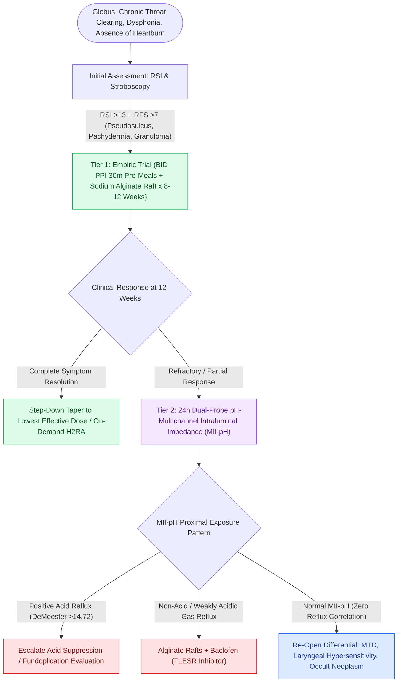

# Laryngopharyngeal reflux presents with globus and throat clearing but responds inconsistently to empiric PPIs

## Active Recall

> [!question]- Why can the larynx be injured by reflux the esophagus tolerates?
> *Answer / Clinical Rationale*: Laryngeal epithelium lacks esophageal defenses (peristaltic clearance, bicarbonate, carbonic anhydrase III); brief proximal exposures — including pepsin reactivated at low pH — injure it.

> [!question]- What is the exit strategy for an empiric PPI trial?
> *Answer / Clinical Rationale*: A defined 8-12 week endpoint with reassessment: respond → taper to lowest effective dose; no response → objective pH-impedance testing and differential re-opening, not renewal by inertia.

## Core Clinical & Mechanistic Principles
- Symptom cluster: globus, chronic throat clearing, dysphonia, postnasal-drip sensation, cough — with **heartburn frequently absent**, because the mechanism is intermittent proximal (often gaseous/pepsin-mediated) exposure rather than sustained esophageal acid.
- **Scoring Systems & Diagnostic Metrics**:
  - **Reflux Symptom Index (RSI)**: Self-administered 9-item questionnaire; score **$>13$** indicates clinically significant LPR.
  - **Reflux Finding Score (RFS)**: Standardized 8-item clinician-rated scale; score **$>7$** indicates abnormal laryngeal findings:
    1. *Pseudosulcus vocalis* (subglottic edema running the length of the true vocal fold from anterior commissure to posterior glottis)
    2. *Ventricular obliteration*
    3. *Erythema / hyperemia* (arytenoids, vocal cords)
    4. *Vocal fold edema*
    5. *Diffuse laryngeal edema*
    6. *Posterior commissure hypertrophy / pachydermia laryngis*
    7. *Granuloma / contact ulcer*
    8. *Thick endolaryngeal mucus*
- The measurement problem, stated honestly: **RSI and RFS are sensitive but nonspecific**; laryngeal 'reflux signs' are present in up to $86\%$ of healthy asymptomatic volunteers.
- Objective testing when it matters: **24-hour ambulatory dual-probe pH-multichannel intraluminal impedance (MII-pH)** is the diagnostic gold standard (detects acidic $\text{pH} < 4$, weakly acidic $\text{pH } 4\text{–}7$, and nonacid proximal gas/liquid bolus events with symptom association probability).
- The differential is the point: [[Muscle tension dysphonia arises from supraglottic hyperfunction and responds to circumlaryngeal voice therapy|MTD]], [[Chronic refractory cough reflects laryngeal hypersensitivity treated with neuromodulators and behavioral suppression therapy|chronic cough hypersensitivity]], and early laryngeal malignancy all wear the LPR costume — persistent unilateral symptoms mandate flexible laryngoscopy before empiric PPIs.

### Management & Critical Safety Checks
- **First-Line Medical Regimen**: Twice-daily PPI ($30\text{–}60\text{ min}$ before breakfast and dinner) for a full **8 to 12 weeks** combined with **sodium alginate raft-forming oral suspension** after meals and at bedtime to physically block pepsin/acid ascent.
- **Behavioral & Dietary Modifications**: Strict cessation of eating within 3 hours of reclining, head-of-bed elevation ($6\text{–}8\text{ inches}$), and elimination of trigger foods (chocolate, caffeine, citrus, tomato, peppermint, carbonated beverages, alcohol).
- **Non-Responder Escalation**: Patients failing a 12-week high-dose PPI trial must undergo objective MII-pH testing and video-stroboscopy rather than indefinite PPI continuation. True non-acid/volume reflux responds to alginates, baclofen (transient LES relaxation inhibitor), or surgical fundoplication.

## Connected Concepts & Graph Traversal
- **Chronic Cough Reflex**: [[Chronic refractory cough reflects laryngeal hypersensitivity treated with neuromodulators and behavioral suppression therapy|Chronic Cough]]
- **PVFM Triggers**: [[Paradoxical vocal fold motion causes inspiratory stridor from episodic adduction relieved by rescue breathing|PVFM Airway Triggers]]
- **Airway Graft Compromise**: [[Active reflux and eosinophilic esophagitis compromise airway graft survival|Airway Graft Survival]]
- **High-Resolution Manometry**: [[High-resolution manometry classifies achalasia and esophageal motility disorders by the Chicago criteria|High-Resolution Manometry]]
- **Muscle Tension Dysphonia**: [[Muscle tension dysphonia arises from supraglottic hyperfunction and responds to circumlaryngeal voice therapy|Muscle Tension Dysphonia]]
- **Premalignant Esophageal Sequela**: [[Barrett esophagus manifests as salmon-colored columnar metaplasia of the distal esophagus requiring surveillance for adenocarcinoma|Barrett Esophagus]]
- **Vocal Process Mechanical Sequela**: [[Vocal fold contact granulomas arise from mechanical perichondritis of the vocal process treated with proton pump inhibitors, voice therapy, and Botox before excision|Vocal Fold Contact Granuloma]]
