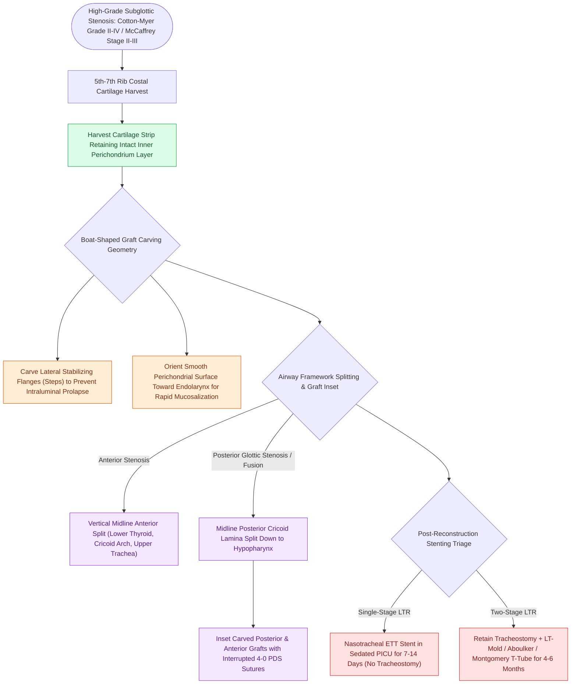

# Laryngotracheal reconstruction expands the airway using carved costal cartilage grafts

## Active Recall

> [!question]- Why must a costal cartilage graft for LTR be carved with lateral flanges (steps)?
> *Answer / Clinical Rationale*: The flanges seat against the external perichondrial margins of the thyroid and cricoid cartilage splits, mechanically preventing the graft from prolapsing into the airway lumen.

> [!question]- Which surface of the costal cartilage graft should retain intact perichondrium, and why?
> *Answer / Clinical Rationale*: The **intraluminal (endolaryngeal) surface**, because intact perichondrium promotes rapid mucosal re-epithelialization and protects the underlying chondrocytes from desiccation and infection.

## Core Clinical & Mechanistic Principles
**Laryngotracheal Reconstruction (LTR)** (pioneered by Robin Cotton) is an open surgical procedure designed to expand the cross-sectional airway diameter in patients with high-grade subglottic and [[The McCaffrey classification stages laryngotracheal stenosis by anatomical subsite|tracheal stenosis]] ([[The Cotton-Myer classification grades subglottic stenosis by luminal reduction|Cotton-Myer Grade II, III, or IV]]) by interposing carved autologous costal cartilage grafts into surgically split anterior and/or posterior laryngeal frameworks.

### Costal Cartilage Graft Harvesting & Carving Craft
1. **Harvest Site**: The 5th, 6th, or 7th rib cartilage is harvested, taking care to preserve the **internal perichondrium** on one side of the graft (which promotes rapid endolaryngeal mucosal re-epithelialization).
2. **Boat-Shaped Carving with Lateral Flanges**:
   - The graft is carved into a distinct **boat-shape with lateral stabilizing flanges (steps)**.
   - The flanges seat securely against the outer cartilaginous edges of the thyroid and cricoid split, preventing the graft from prolapsing into the airway lumen.
   - The central portion projects outward, expanding the cross-sectional airway diameter.

## Step-by-Step Surgical Execution
1. **Exposure**: Horizontal collar incision; elevate subplatysmal flaps; dissect midline raphe between strap muscles to expose [[Thyroplasty cartilage window dimensions differ between males and females|thyroid cartilage]], [[Cricotracheal resection removes subglottic stenosis while sparing posterior cricoid and RLNs|cricoid arch]], and upper trachea.
2. **Anterior Airway Split**: Make a vertical midline incision through the inferior 1/3 of the thyroid cartilage, the cricoid cartilage arch, and the stenotic upper tracheal rings.
3. **Posterior Split (if indicated)**: In posterior glottic/subglottic stenosis, perform a complete midline division of the posterior cricoid lamina down to the hypopharyngeal mucosa (see [[The posterior cricoid split widens the posterior glottis for high-grade stenosis|posterior cricoid split]]).
4. **Graft Interposition & Fixation**:
   - Seat the carved posterior graft (if indicated) and secure with interrupted 4-0 or 5-0 PDS sutures.
   - Seat the carved anterior boat graft with perichondrium facing the endolarynx; suture to the cricoid/thyroid edges with interrupted 4-0 PDS sutures (extraluminal knots).
5. **Stenting Strategy**:
   - [[Single-stage LTR utilizes an endotracheal tube as a temporary stent avoiding tracheostomy placement|Single-Stage LTR]]: Endotracheal tube acts as internal stent for 7–14 days in ICU.
   - [[Two-stage LTR maintains a tracheostomy with prolonged endolaryngeal stenting|Two-Stage LTR]]: Retain tracheostomy; stent with LT-Mold, Aboulker stent, or Montgomery T-tube for 4 to 6 months.

## Critical Failure Modes & Error Traps
- **Graft Prolapse**: Failing to carve stabilizing lateral flanges allows the graft to displace intraluminally, causing complete airway obstruction upon extubation.
- **Reflux-Mediated Graft Resorption**: Exposure to unmanaged acid/pepsin destroys the non-vascularized chondrocytes (see [[Active reflux and eosinophilic esophagitis compromise airway graft survival|reflux optimization]]).

## Connected Concepts & Graph Traversal
- **Classification Indication**: [[The Cotton-Myer classification grades subglottic stenosis by luminal reduction|Cotton-Myer Classification (Grades II-IV)]]
- **Posterior Component**: [[The posterior cricoid split widens the posterior glottis for high-grade stenosis|Posterior Cricoid Split]]
- **🔗 Anatomical Foundation (Pediatrics)**: [[Single-stage LTR utilizes an endotracheal tube as a temporary stent avoiding tracheostomy placement|Single-Stage LTR]]
- **Surgical Craft**: [[Two-stage LTR maintains a tracheostomy with prolonged endolaryngeal stenting|Two-Stage LTR]]
- **Alternative Resection Procedure**: [[Cricotracheal resection removes subglottic stenosis while sparing posterior cricoid and RLNs|Cricotracheal Resection (CTR)]]
- **Graft Survival Mandate**: [[Active reflux and eosinophilic esophagitis compromise airway graft survival|Antireflux Optimization]]
