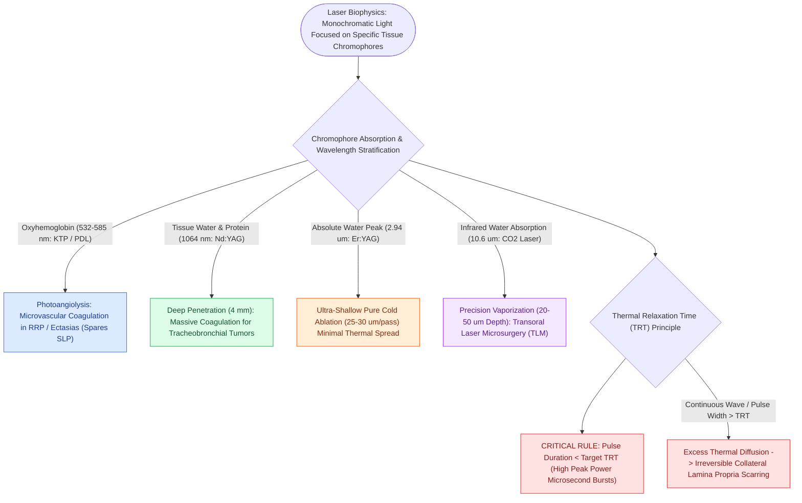

# Laser tissue interactions are dictated by wavelength, tissue chromophore absorption, and thermal relaxation time

## Active Recall

> [!question]- Why do far-infrared lasers (CO2 at $10.6\text{ µm}$ and Er:YAG at $2.94\text{ µm}$) violate the general optical principle that longer wavelengths penetrate deeper into tissue?
> *Answer / Clinical Rationale*: While longer wavelengths penetrate deeper within the visible light spectrum, **water absorption rises dramatically in the infrared range**, reaching an absolute peak at $2.94\text{ µm}$ (Er:YAG) and a massive peak at $10.6\text{ µm}$ ($\text{CO}_2$). Because soft tissues are $70\text{–}80\%$ water, infrared laser energy is absorbed instantaneously at the surface ($<0.1\text{ mm}$ depth), creating ultra-shallow tissue penetration and precision vaporization.

> [!question]- What are the three concentric histological zones of a laser wound from the impact epicenter outwards?
> *Answer / Clinical Rationale*: 1. **Zone of Tissue Vaporization**: Center where tissue is instantly boiled and ablated into steam and plume. 2. **Zone of Thermal Necrosis (Coagulation)**: Intermediate irreversible thermal injury where proteins denature and microvessels coagulate. 3. **Zone of Thermal Conductivity / Reversible Damage**: Outer peripheral boundary of heated tissue that recovers and participates in cellular repair.

> [!question]- What is thermal relaxation time (TRT), and how does pulse duration modulation prevent vocal fold scarring or cosmetic skin burns?
> *Answer / Clinical Rationale*: **Thermal relaxation time (TRT)** is the time required for a target tissue structure or chromophore to lose $50\%$ of its absorbed heat to surrounding uninjured tissue. To prevent collateral thermal necrosis, the **laser pulse duration must be shorter than the target's TRT** (e.g., ultrapulse / superpulse mode delivering high peak power in microsecond bursts).

## Core Clinical & Mechanistic Principles
Lasers (**Light Amplification by Stimulated Emission of Radiation**) generate monochromatic, coherent, collimated light when energy pumping drives **population inversion** within an active medium inside an optical resonant cavity:

### Medical Laser Wavelength Comparison Matrix
- **KTP ($532\text{ nm}$)** & **Pulsed Dye ($585\text{ nm}$)**: Photoangiolytic; delivered through flexible quartz fibers; targets subepithelial microvascular networks in recurrent respiratory papillomatosis (RRP) and vocal fold ectasias without damaging the delicate superficial lamina propria (SLP).
- **Nd:YAG ($1.064\text{ µm}$)**: Near-infrared; deep tissue penetration ($4\text{ mm}$); excellent deep coagulation for bulky obstructive tracheobronchial malignancies and vascular malformations.
- **Er:YAG ($2.94\text{ µm}$)**: Mid-infrared; matches the absolute water absorption peak; removes $25\text{–}30\text{ µm}$ of epidermis per pass with minimal thermal coagulation; heals in $5\text{–}7\text{ days}$.
- **$\text{CO}_2$ ($10.6\text{ µm}$)**: Far-infrared; shallow penetration ($20\text{–}50\text{ µm}$); standard tool for [[Transoral laser microsurgery TLM resects early glottic carcinoma with vocal cord preservation|transoral laser microsurgery]] (TLM) via micromanipulators or flexible photonic waveguides (OmniGuide).

## Connected Concepts & Graph Traversal
- **CO2 Laser Biophysics**: [[The CO2 laser vaporizes tissue via 10600 nm water absorption|CO2 Laser in Laryngology]]
- **Photoangiolysis**: [[The pulsed dye laser targets vascular lesions at 585 nm|Pulsed Dye Laser (PDL)]]
- **KTP Photoangiolysis**: [[The KTP laser targets oxyhemoglobin at 532 nm for photoangiolysis|KTP Laser Photoangiolysis]]
- **Airway Fire Prevention**: [[Airway fire prevention requires FiO2 below 30 percent and laser-safe tubes|Operating Room Airway Fire Protocol]]
- **🔗 Facial Resurfacing (FPRS)**: [[Chemical peels and fractional CO2 laser resurfacing treat photoaging and perioral rhytids|Laser Skin Resurfacing Protocols]]
