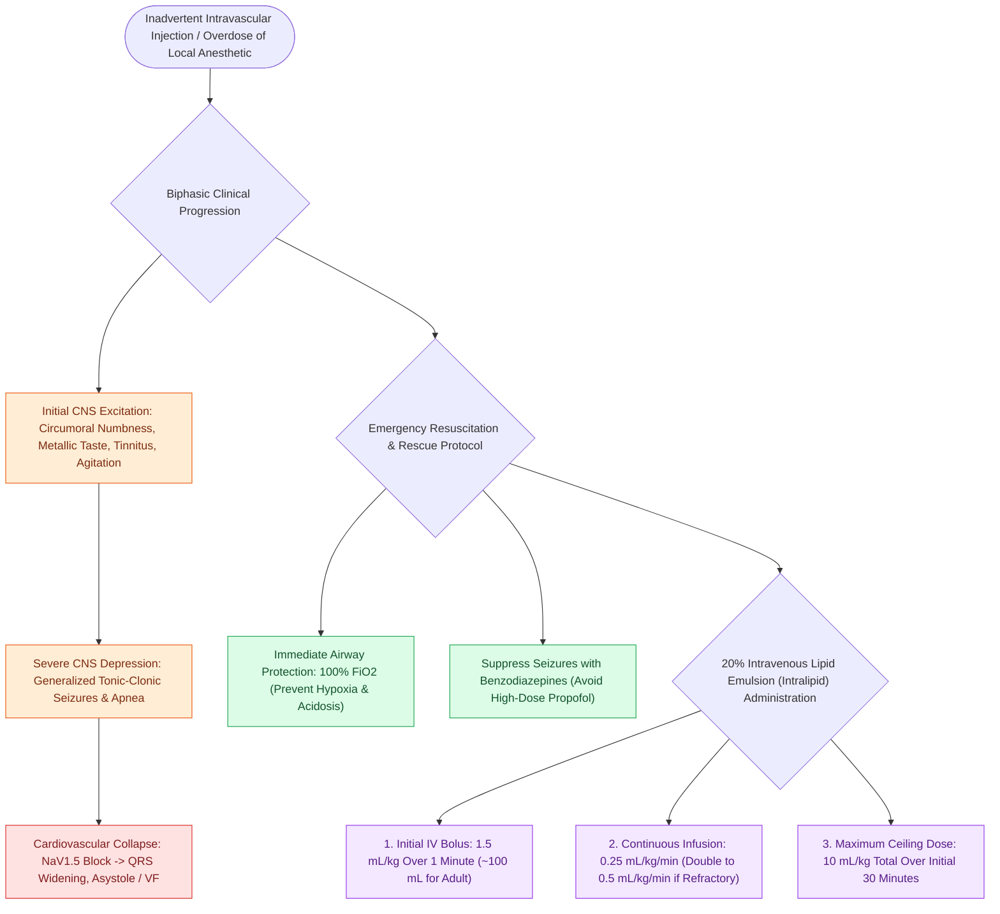

# Local anesthetic systemic toxicity LAST is managed with airway stabilization and twenty percent intravenous lipid emulsion

## Active Recall

> [!question]- What is the typical clinical progression of symptoms in local anesthetic systemic toxicity (LAST)?
> *Answer / Clinical Rationale*: - **Initial CNS Excitation**: Circumoral numbness, metallic taste in mouth, tinnitus, lightheadedness, visual disturbances, and agitation. - **Severe CNS Depression**: Muscle twitching progressing rapidly to **generalized tonic-clonic seizures**, loss of consciousness, and respiratory arrest. - **Cardiovascular Collapse**: PR and QRS prolongation, refractory bradyarrhythmias, ventricular arrhythmias, severe negative inotropy, and profound hypotension.

> [!question]- Why does bupivacaine carry the highest cardiotoxicity index compared to other amide local anesthetics?
> *Answer / Clinical Rationale*: Bupivacaine is **highly lipophilic and binds with high affinity to voltage-gated cardiac sodium channels ($Na_V1.5$)**, dissociating extremely slowly during diastole ("fast-in, slow-out" kinetics). This induces profound, treatment-refractory ventricular conduction blocks and electromechanical dissociation, often causing cardiac collapse *before* overt CNS warning signs.

> [!question]- What is the exact 20% lipid emulsion (Intralipid) dosing protocol for acute LAST resuscitation?
> *Answer / Clinical Rationale*: 1. **Initial Bolus**: **$1.5\text{ mL/kg}$ of $20\%$ lipid emulsion IV bolus over 1 minute** (~$100\text{ mL}$ for an adult). 2. **Continuous Infusion**: **$0.25\text{ mL/kg/min}$ IV infusion**. 3. **Repeat Bolus**: If hemodynamic stability is not restored, repeat the bolus once or twice (every 3–5 minutes) and increase infusion to $0.5\text{ mL/kg/min}$ (maximum total dose: **$10\text{ mL/kg}$ over the first 30 minutes**).

## Core Clinical & Mechanistic Principles
**Local Anesthetic Systemic Toxicity ([[Local anesthetic pharmacology and epinephrine limits govern safe office-based facial surgery|LAST]])** is a life-threatening complication resulting from unintended intravascular injection, rapid mucosal absorption (e.g., highly vascular airway mucosa), or exceeding maximal weight-based safe dosages:

### Local Anesthetic Maximum Weight-Based Dosing Standards
- **Lidocaine plain**: $4.5\text{–}5\text{ mg/kg}$ (Max: $300\text{ mg}$).
- **Lidocaine with Epinephrine ($1:100,000$)**: $7\text{ mg/kg}$ (Max: $500\text{ mg}$).
- **Bupivacaine plain**: $2.5\text{ mg/kg}$ (Max: $175\text{ mg}$).
- **Bupivacaine with Epinephrine ($1:200,000$)**: $3\text{ mg/kg}$ (Max: $225\text{ mg}$).
- **Cocaine (Topical $4\%$)**: $2\text{–}3\text{ mg/kg}$ (Max: $200\text{ mg}$).

## Connected Concepts & Graph Traversal
- **Malignant Hyperthermia**: [[Malignant hyperthermia is triggered by volatile anesthetics and succinylcholine and treated with immediate intravenous dantrolene|Malignant Hyperthermia Protocol]]
- **🔗 Office Local Anesthesia (FPRS)**: [[Local anesthetic pharmacology and epinephrine limits govern safe office-based facial surgery|Local Anesthetic Pharmacology]]
- **Topical Airway Anesthesia**: [[Airway assessment classifications predict difficult direct laryngoscopy using anatomical landmarks|Difficult Airway Assessment]]
- **🔗 Sinonasal Regional Blocks (Sinus)**: [[Regional sensory nerve blocks of the nose and paranasal sinuses target branches of V1 and V2|Sinonasal Nerve Blocks]]
- **Emergency Airway Rescue**: [[Emergency cricothyrotomy provides rapid airway access through the cricothyroid membrane|Cricothyrotomy Rescue]]
