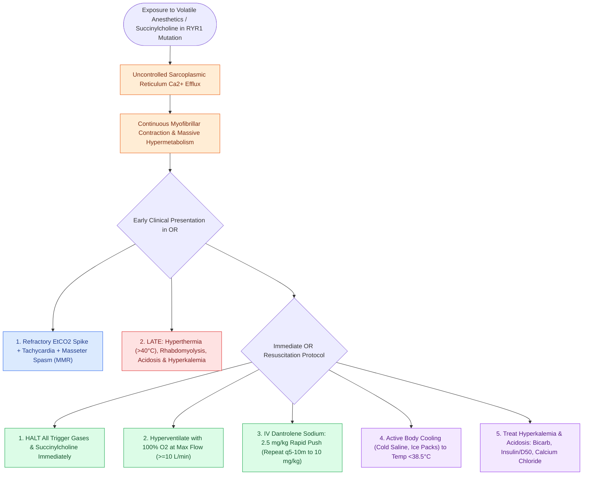

# Malignant hyperthermia is triggered by volatile anesthetics and succinylcholine and treated with immediate intravenous dantrolene

## Active Recall

> [!question]- What is the earliest and most sensitive clinical sign of malignant hyperthermia (MH) during general anesthesia?
> *Answer / Clinical Rationale*: **Unexplained rapid rise in end-tidal $\text{CO}_2$ ($Et\text{CO}_2$) refractory to hyperventilation**, accompanied by sinus tachycardia and **masseter muscle rigidity (MMR)** following succinylcholine administration. Hyperthermia is a *late* sign (core temperature can climb at $1\text{–}2^\circ\text{C}$ every 5 minutes).

> [!question]- What is the molecular pathophysiology and pharmacological mechanism of dantrolene sodium in aborting an MH crisis?
> *Answer / Clinical Rationale*: MH is an autosomal dominant pharmacogenetic disorder of the **ryanodine receptor type 1 ($RYR1$)** or $CACNA1S$ gene. Trigger agents (**volatile inhalational anesthetics like sevoflurane, desflurane, isoflurane and the depolarizing muscle relaxant succinylcholine**) cause uncontrolled sarcoplasmic reticulum calcium release, inducing continuous muscle contraction, hypermetabolism, and rhabdomyolysis. **Dantrolene sodium** directly binds to the $RYR1$ receptor, inhibiting sarcoplasmic calcium efflux.

> [!question]- What are the immediate sequential resuscitation steps when an MH crisis is recognized in the operating room?
> *Answer / Clinical Rationale*: 1. **Discontinue all trigger agents immediately** and call for the MH cart/help. 2. **Hyperventilate with $100\%\text{ O}_2$** at maximum fresh gas flows ($\ge 10\text{ L/min}$). 3. **Administer IV Dantrolene**: Initial bolus **$2.5\text{ mg/kg}$ rapid IV push**, repeated every 5–10 minutes up to $10\text{ mg/kg}$ until hypermetabolism abates. 4. **Active cooling** (cold IV saline, surface ice packs, gastric lavage) to core temp $<38.5^\circ\text{C}$. 5. **Treat hyperkalemia and metabolic acidosis** (IV sodium bicarbonate, calcium chloride, glucose + insulin).

## Core Clinical & Mechanistic Principles
**Malignant Hyperthermia (MH)** is a life-threatening, hypermetabolic pharmacogenetic emergency triggered by exposure to halogenated volatile [[Local anesthetic systemic toxicity LAST is managed with airway stabilization and twenty percent intravenous lipid emulsion|anesthetics]] and succinylcholine:

### Preoperative Preparation for Susceptible Patients
- Patients with known family history of MH, central core disease, or prior unexplained masseter spasm require a **"clean machine"** (flushed with $10\text{ L/min O}_2$ for 20–90 minutes with vaporizers removed/locked and new charcoal filters placed), total intravenous anesthesia (TIVA), and avoidance of succinylcholine.

## Connected Concepts & Graph Traversal
- **Local Anesthetic Toxicity**: [[Local anesthetic systemic toxicity LAST is managed with airway stabilization and twenty percent intravenous lipid emulsion|LAST Emergency Management]]
- **Airway Fire Rescue**: [[Airway fire prevention requires FiO2 below 30 percent and laser-safe tubes|Airway Fire Protocol]]
- **🔗 Cardiac Arrhythmias in ENT (Otology)**: [[Jervell and Lange-Nielsen syndrome combines congenital profound sensorineural hearing loss with a prolonged QT interval|JLNS Arrhythmia Risk]]
- **Difficult Airway Prediction**: [[Airway assessment classifications predict difficult direct laryngoscopy using anatomical landmarks|Difficult Airway Assessment]]
- **🔗 Pediatric Airway Safety (Pediatrics)**: [[High-risk pediatric criteria mandate overnight inpatient admission following adenotonsillectomy|High-Risk Airway Admission]]
