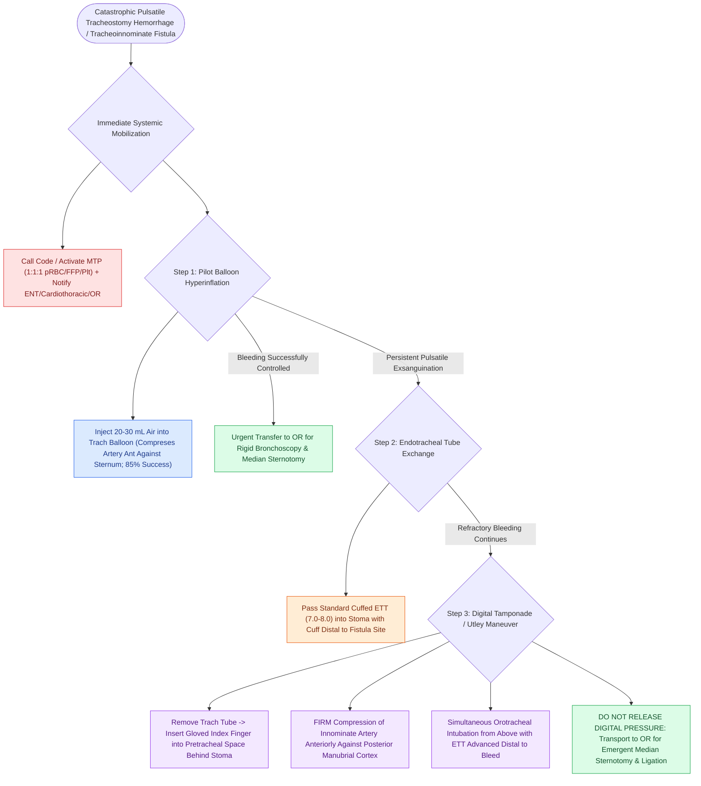

# Massive tracheostomy hemorrhage requires cuff overinflation, digital compression, and emergent surgical or endovascular control

## Active Recall

> [!question]- Describe the physical mechanics of the Utley maneuver in a patient with massive tracheostomy bleeding.
> *Answer / Clinical Rationale*: The tracheostomy tube is removed, the operator inserts an index finger through the stoma into the pretracheal space behind the sternum, and **firmly compresses the innominate artery anteriorly against the posterior cortex of the manubrium** while the patient is intubated from above.

> [!question]- Why is simple suture ligation and division of the innominate artery (without bypass graft) usually well-tolerated during emergency surgical repair of a tracheoinnominate fistula?
> *Answer / Clinical Rationale*: Collateral cerebral blood flow via the **circle of Willis (from the left internal carotid artery)** and retrograde flow down the right internal carotid from the **right vertebral and subclavian arteries** reliably maintains right hemispheric perfusion.

## Core Clinical & Mechanistic Principles
Massive, pulsatile hemorrhage from or around a tracheostomy is a catastrophic, high-mortality surgical emergency. The classic underlying etiology is a **[[Tracheoinnominate fistula presents with sentinel bleeding requiring hyperinflation tamponade and emergency surgical ligation|Tracheoinnominate Fistula]] (TIF)**—an abnormal communication between the posterior wall of the brachiocephalic (innominate) artery and the anterior tracheal wall, occurring in 0.7% of tracheotomized patients with peak incidence at **1 to 3 weeks postoperatively**. Because mortality approaches 100% without immediate mechanical tamponade, every otolaryngologist must execute a rapid, reflexive three-step algorithmic rescue:

- **Pathophysiological Mechanisms of TIF**:
  - **Low Tracheotomy**: Incision placed below the 4th tracheal ring, placing the rigid tube in direct contact with the cross-compressing innominate artery behind the sternal manubrium.
  - **High Cuff Pressures & Mucosal Necrosis**: Sustained cuff hyperinflation ($>30\text{ mmHg}$) exceeding capillary perfusion pressure, causing circumferential ischemic necrosis of anterior tracheal cartilage rings and erosive fistulization into the adjacent arterial adventitia.
  - **Malaligned Rigid Tube Tip**: Forward-curving tip of a rigid tube impinging directly on the anterior tracheal wall.

- **Step-by-Step Bedside Emergency Rescue Algorithm**:
  1. **Immediate Mobilization & Resuscitation**: Activate the hospital-wide emergency surgical/trauma code. Order massive transfusion protocol (MTP: 1:1:1 pRBC, FFP, platelets), place two large-bore IV lines, and notify the Operating Room and Cardiothoracic/Vascular surgery teams.
  2. **Step 1 — Cuff Hyperinflation**:
     - Immediately inject **20 to 30 mL of air** into the tracheostomy pilot balloon using a 20 mL syringe.
     - *Mechanistic Tamponade*: The overinflated balloon expands anteriorly, compressing the eroded innominate artery against the posterior table of the sternum. Controls bleeding temporarily in **$\approx 85\%$ of cases**.
  3. **Step 2 — Endotracheal Tube Exchange & Distal Airway Isolation**:
     - If bleeding persists or if the patient has an uncuffed tube, pass a standard cuffed endotracheal tube (size 7.0–8.0) into the stoma, advancing the cuff distal to the fistula site to ventilate the lungs while sealing the airway from blood aspiration.
  4. **Step 3 — Digital Tamponade (The Utley Maneuver)**:
     - If massive bleeding continues around the tube, **remove the tracheostomy tube**.
     - Insert a gloved index finger directly through the stomal incision into the anterior mediastinal pretracheal space.
     - **Compress the pulsating innominate artery anteriorly against the posterior cortex of the sternal manubrium**.
     - Simultaneously, an assistant or anesthesiologist performs **orotracheal intubation from above**, advancing the ETT past the digital compression site into the distal trachea.
     - **DO NOT RELEASE DIGITAL COMPRESSION** until the patient is prepped, draped, and the sternum is opened in the Operating Room.

## References
1. Ridley, R.W., Zwischenberger, J.B. (2006). Tracheoinnominate fistula: Surgical management of an iatrogenic disaster. *J Laryngol Otol*, 120(8):676-680.
2. Mitchell, R.B., Hussey, H.M., Setzen, G., et al. (2013). Clinical consensus statement: Tracheostomy care. *Otolaryngol Head Neck Surg*, 148(1):6-20.
3. Kraft, S.M., Schindler, J.S. (2020). Tracheotomy. In Flint, P.W., et al. (Eds.), *Cummings Otolaryngology Head and Neck Surgery* 7e (pp. 95-103). Philadelphia, PA: Elsevier.
4. Durbin Jr., C.G. (2010). Tracheostomy: why, when, and how? *Respir Care*, 55(8):1056-1068.

## Connected Concepts & Graph Traversal
- **Physiological Basis**: [[Tracheoinnominate fistula presents with sentinel bleeding requiring hyperinflation tamponade and emergency surgical ligation|Tracheoinnominate Fistula Pathophysiology]]
- **Minor Bleeding Management**: [[Tracheostomy stomal bleeding is controlled with cuff overinflation, hemostatic agents, and silver nitrate cautery|Stomal Granulation & Minor Bleeding]]
- **Tube System Mechanics**: [[Shiley, Bivona, and Portex tracheostomy tubes differ in cannula design, cuff profile, and airway resistance|Tracheostomy Tube Types]]
- **Surgical Prevention**: [[Open tracheostomy provides superior exposure and stay suture placement compared to percutaneous technique|Open Tracheostomy Surgical Anatomy]]
- **🔗 Vascular Blowout Spectrum (Head and Neck)**: [[Carotid blowout syndrome is classified into threatened, impending, and acute hemorrhage|Carotid Blowout Syndrome]]
