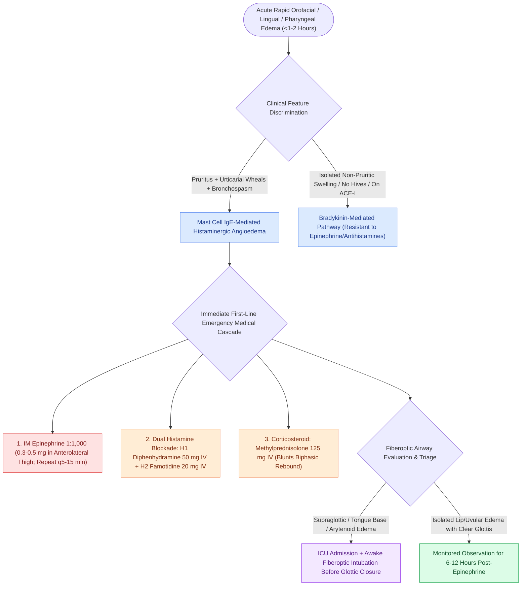

# Mast cell-mediated histaminergic angioedema responds rapidly to epinephrine, antihistamines, and corticosteroids

## Active Recall

> [!question]- What dermatologic and clinical features distinguish mast cell-mediated histaminergic angioedema from bradykinin-mediated angioedema?
> *Answer / Clinical Rationale*: Histaminergic angioedema is classically accompanied by **urticaria (pruritic hives), intense cutaneous erythema, bronchospasm, and hypotension**, whereas bradykinin-mediated angioedema presents with isolated, non-pruritic, non-pitting tissue swelling without urticaria.

> [!question]- What is the first-line pharmacotherapeutic agent and intramuscular dosing for acute histaminergic angioedema with impending airway compromise?
> *Answer / Clinical Rationale*: **Intramuscular Epinephrine $1:1,000\ (1\text{ mg/mL})$ at a dose of $0.3\text{–}0.5\text{ mg}$ ($0.01\text{ mg/kg}$ in pediatrics)** injected into the anterolateral thigh (vastus lateralis) every $5\text{–}15\text{ minutes}$ as needed.

> [!question]- What is the physiological role of $\text{H}_1$ and $\text{H}_2$ histamine receptor blockade in acute allergic angioedema?
> *Answer / Clinical Rationale*: $\text{H}_1$ blockers (e.g., diphenhydramine $50\text{ mg}$ IV) antagonize endothelial cell separation, pruritus, and smooth muscle contraction, while $\text{H}_2$ blockers (e.g., famotidine $20\text{ mg}$ IV) block peripheral vasodilatory receptors that mediate up to $15\%$ of cutaneous vascular pooling.

## Core Clinical & Mechanistic Principles
**Mast cell-mediated (histaminergic) angioedema** represents an acute type I IgE-mediated hypersensitivity reaction or direct non-immunologic mast cell degranulation triggered by foods, insect envenomation, medications (NSAIDs, antibiotics), or radiocontrast:

- **Pathophysiologic Cascade**:
  - Allergen cross-links specific $\text{IgE}$ bound to high-affinity $\text{Fc}\varepsilon\text{RI}$ receptors on tissue mast cells and circulating basophils.
  - Triggers explosive release of preformed **histamine**, tryptase, platelet-activating factor, leukotrienes ($\text{LTC}_4, \text{LTD}_4, \text{LTE}_4$), and prostaglandins ($\text{PGD}_2$).
  - Produces acute post-capillary venular endothelial gap formation, rapid plasma extravasation into the deep dermis and submucosa, smooth muscle bronchoconstriction, and systemic vasodilation.
- **Clinical Phenotype & Progression**:
  - Onset is rapid (minutes to $<1\text{–}2\text{ hours}$).
  - Characterized by **pruritus, urticarial plaques (wheals), facial/lip/tongue swelling, stridor, and dysphonia**.
  - Swelling typically peaks within $2\text{–}4\text{ hours}$ and resolves completely within $24\text{–}48\text{ hours}$ following appropriate treatment.

### Emergency Resuscitation & Pharmacotherapy Protocol
1. **Immediate Epinephrine Administration**:
   - Give **Epinephrine $1:1,000\ (0.3\text{–}0.5\text{ mg})$ IM** in the lateral thigh immediately. Re-dose every $5\text{–}15\text{ minutes}$ for persistent respiratory or hemodynamic symptoms.
2. **Dual Antihistamine & Corticosteroid Therapy**:
   - $\text{H}_1$ Antagonist: Diphenhydramine $50\text{ mg}$ IV or Cetirizine $10\text{ mg}$ IV.
   - $\text{H}_2$ Antagonist: Famotidine $20\text{ mg}$ IV.
   - Corticosteroid: Methylprednisolone $125\text{ mg}$ IV or Dexamethasone $10\text{ mg}$ IV (prevents biphasic anaphylaxis rebound).
3. **Airway Triage & Fiberoptic Evaluation**:
   - Perform urgent flexible fiberoptic laryngoscopy: Tongue base, arytenoid, or false vocal fold edema mandates intensive care admission and preparation for **[[Awake fiberoptic intubation is the preferred airway technique for angioedema with impending obstruction|awake fiberoptic intubation]]** before total glottic obliteration occurs.

## Connected Concepts & Graph Traversal
- **Bradykinin Alternative**: [[Bradykinin-mediated angioedema from C1-INH deficiency or ACE inhibitors fails to respond to standard allergic therapies|Bradykinin Angioedema & C1-INH]]
- **Emergency Airway Management**: [[Awake fiberoptic intubation is the preferred airway technique for angioedema with impending obstruction|Awake Intubation for Angioedema]]
- **Targeted Bradykinin Blockade**: [[Icatibant and ecallantide provide targeted treatment for bradykinin-mediated angioedema refractory to standard therapy|Icatibant & Ecallantide]]
- **Complement System Genetics**: [[Hereditary angioedema types I through III exhibit distinct C1 esterase inhibitor and C4 complement patterns|Hereditary Angioedema Subtypes]]
- **Emergency Surgical Airway**: [[Open tracheostomy provides superior exposure and stay suture placement compared to percutaneous technique|Emergency Surgical Airway]]
