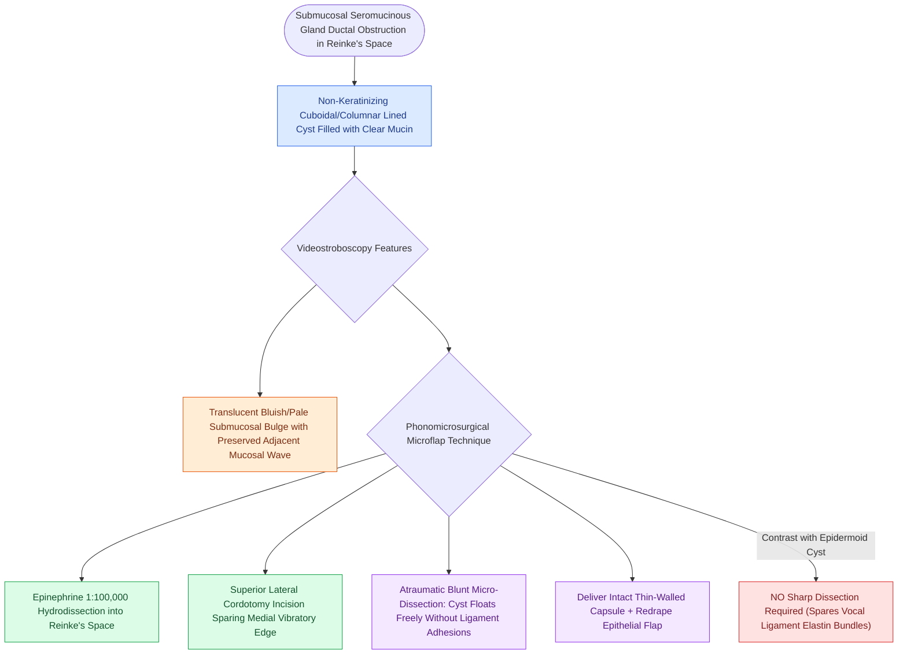

# Mucous retention cysts arise from obstructed glands in superficial lamina propria

## Active Recall

> [!question]- What is the difference in histological lining between a mucous retention cyst and an epidermoid cyst?
> *Answer / Clinical Rationale*: A mucous retention cyst is lined by **non-keratinizing cuboidal/columnar respiratory epithelium**, whereas an epidermoid cyst is lined by **keratinizing [[Stratified squamous epithelium forms the vocal fold protective cover|stratified squamous epithelium]]**.

> [!question]- Why is the dissection of a mucous retention cyst generally less traumatic to the vocal ligament than that of an epidermoid cyst?
> *Answer / Clinical Rationale*: Mucous retention cysts float freely within the loose superficial lamina propria without inciting the dense chronic inflammatory fibrous adhesions to the vocal ligament seen in epidermoid cysts.

## Core Clinical & Mechanistic Principles
**Intracordal Mucous Retention Cysts** are benign, fluid-filled cystic lesions that arise within the [[The superficial lamina propria acts as a pliable shearing fluid bed|superficial lamina propria (Reinke's space)]] of the vocal fold.

### Pathogenesis & Histopathology
- **Ductal Obstruction**: Caused by inflammatory or post-infectious occlusion of the excretory duct of a submucosal seromucinous gland.
- **Lining**: Lined by true **non-keratinizing cuboidal, columnar, or oncocytic respiratory epithelium** (sometimes displaying squamous metaplasia).
- **Content**: Filled with clear, translucent, or thick viscous mucin.
- **Absence of Ligament Tethering**: Because they originate from subepithelial glands in the loose connective tissue, mucous retention cysts do not incite a severe inflammatory response and typically **float freely within the superficial lamina propria**, with no dense fibrous adhesions to the underlying [[The vocal ligament comprises intermediate and deep lamina propria|vocal ligament]].

## Diagnostic & Stroboscopic Features
- **Translucent / Bluish Bulge**: Appears as a soft, translucent, bluish or pale rounded mass beneath the vocal fold cover.
- **Preserved Adjacent Wave**: The [[The mucosal wave travels as a fluid mechanical displacement|mucosal wave]] is typically preserved along the mucosal edges surrounding the cyst, though dampened directly over the dome.

## Surgical Nuances & Atraumatic Dissection
1. **Hydrodissection Plane**: Injection of 1:100,000 epinephrine into Reinke's space easily hydro-dissects the cyst away from both the overlying epithelium and the underlying vocal ligament.
2. **Blunt Micro-Elevation**: Once a superior cordotomy is made, blunt sweeps with a micro-elevator or dissector easily mobilize the cyst intact without requiring sharp division.
3. **Flap Repositioning**: The mucosal flap is repositioned without sutures.

## Critical Failure Modes & Error Traps
- **Confusing with Epidermoid Cyst**: Attempting aggressive sharp dissection on a mucous retention cyst risks rupturing the thin-walled epithelial capsule unnecessarily.

## Connected Concepts & Graph Traversal
- **Contrasting Pathology**: [[Epidermoid cysts adhere to the vocal ligament and require sharp dissection|Intracordal Epidermoid Cysts]]
- **Anatomical Compartment**: [[The superficial lamina propria acts as a pliable shearing fluid bed|Superficial Lamina Propria (Reinke's Space)]]
- **Surgical Technique**: [[The epithelial-sparing microflap preserves native mucosa and prevents glottic webbing|Phonomicrosurgical Microflap Technique]]
- **Biochemical Fluid Bed**: [[Hyaluronic acid regulates lamina propria hydration and shock absorption|Hyaluronic Acid in Vocal Fold ECM]]
- **Clinical Management**: [[The mucosal wave travels as a fluid mechanical displacement|Mucosal Wave Dynamics]]
